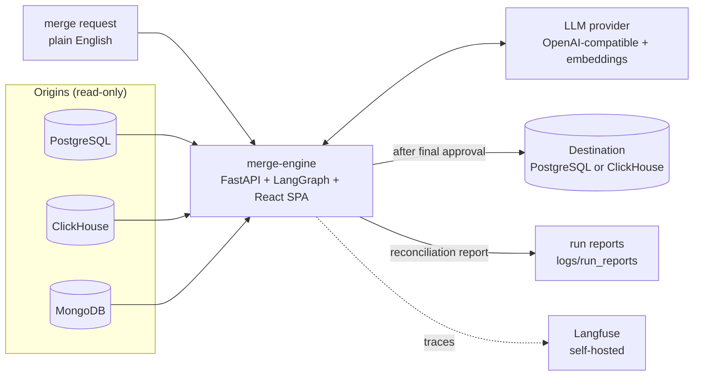
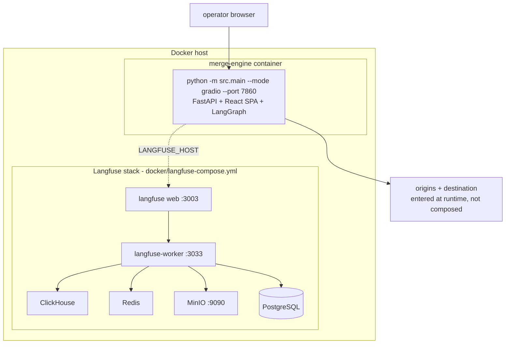
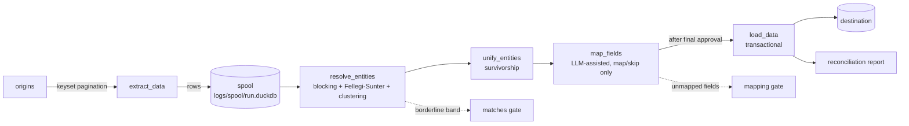
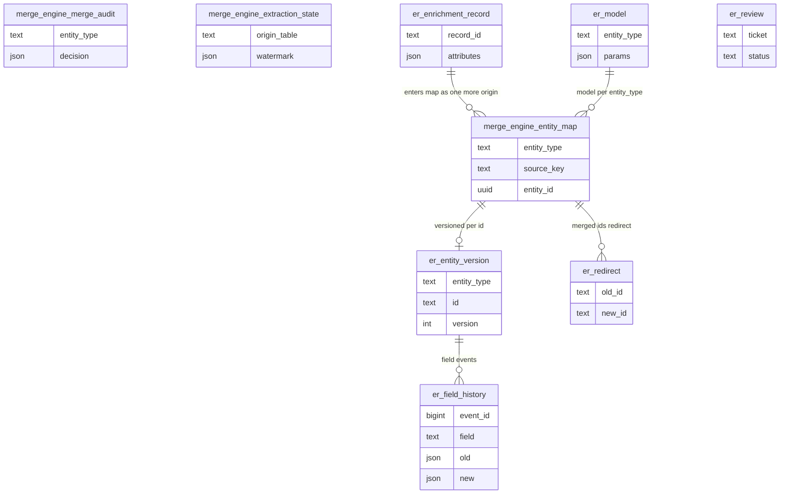
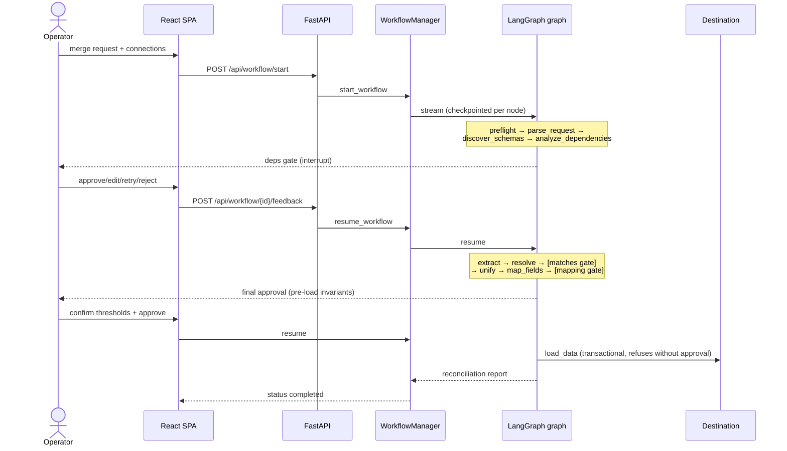

# Architecture

How merge-engine fits together, runs, stores data, and what it guarantees.
Readers: DevOps, CTO, data scientists, DBAs, integration teams. The step-by-step
internal walkthrough stays in
[`docs/architecture/`](docs/architecture/overview.md); this file owns the
system view (J1, J2). Terms are from [GLOSSARY.md](GLOSSARY.md).

## What the system is

One pipeline: read many origins, decide which records are one real-world
entity, write unified records into exactly one destination. The LLM decides
schema and ambiguity; a human approves at HITL gates before any write. The
core is a LangGraph state machine; FastAPI and a React SPA drive it.

<!-- verified: 4d33e0c -->

## System context

Inputs: one or more origin databases and one destination (exactly one, by
design). Outputs: unified rows plus a reconciliation report. The only
external services are the LLM provider and optional self-hosted Langfuse
(`src/main.py::main`, `src/mcp_server/connectors/`).

<!-- verified: 4d33e0c -->

## Deployment

Two compose files, both run the same image built by `Dockerfile`.

| Piece | File | Notes |
|---|---|---|
| App image | `Dockerfile` | multi-stage (Node 22 frontend build, Python 3.11 runtime), `EXPOSE 7860` |
| App run | `docker/app-compose.yml` | one service, `7860:7860`, env from `.env` |
| Tracing | `docker/langfuse-compose.yml` | ports 3003 (web), 3033 (worker), 9090 (MinIO) |
| Config sources | `config/config.yaml` (no credentials), `.env` (secrets), UI-entered connections, `config/profiles/*.json` | `src/utils/config_loader.py::load_config` |

Constraints that matter operationally: the app is single-process (run
tracking lives in memory — `src/orchestrator/workflow_manager.py::WorkflowManager`),
and the SQLite checkpointer (`data/checkpoints.db`) allows one writer.
`--mode both` is broken; `--mode gradio` serves FastAPI + the SPA
(`src/main.py::parse_args`).

<!-- verified: 4d33e0c -->

## Main data flow

Row data never travels through graph state; only ids and decisions do.

Why the spool exists: a 43-million-row list inside a checkpoint is not
something SQLite should serialize per node (`src/orchestrator/spool.py::RunSpool`,
`docs/architecture/data_pipeline.md` §5). Keyset pagination (with a hash
tiebreak) replaced OFFSET after OFFSET silently lost 33% of rows in a
measured test (`src/mcp_server/connectors/keyset.py`).

<!-- verified: 4d33e0c -->

## Data contract (destination tables)

The system writes destination data tables plus its own bookkeeping tables in
schema `merge_engine` (`src/mcp_server/connectors/postgresql_destination.py::ensure_er_side_tables`).

Hard rules of the contract: the destination schema is fixed — field mapping
is `map`/`skip` only, a new destination column is refused in code
(`src/mcp_server/tools/map_fields.py::map_fields_impl`); unmapped fields go to
`unmapped_fields`, never invented into columns. Cluster ids are deterministic
sha256 hashes of sorted member ids, so re-running unchanged data updates rows
instead of duplicating them. The online contract for integrators is the `/v1`
ER service: `MATCHED` / `CREATED` / `AMBIGUOUS` decisions and `503 + Retry-After`
during a batch load (docs/er_contract_v13.md, `src/api/er_routes.py::build_er_router`).

<!-- verified: 4d33e0c -->

## Main workflow (with gates)

The graph pauses via `interrupt_before` (`src/orchestrator/graph.py::HITL_NODES`);
the SQLite checkpoint is what makes a gate survive an app restart. A clean run
skips the matches and mapping gates (nothing to review); the deps gate and the
final approval always fire (`src/orchestrator/graph.py::_build_builder`).

<!-- verified: 4d33e0c -->

## Guarantees — and what it never does

| Guarantee | Mechanism |
|---|---|
| No write without explicit final approval | `load_data` refuses unless `load_approval is True`, checked independently of routing (`src/orchestrator/nodes/load_data.py`) |
| Reject anywhere writes nothing | every gate's `abort` route ends the run (`src/orchestrator/graph.py::_gate_router`) |
| Re-run of unchanged data does not duplicate | deterministic cluster ids + entity map + watermarks |
| No invented destination columns | map/skip-only mapping gate (`src/mcp_server/tools/map_fields.py::map_fields_impl`) |
| PostgreSQL loads are all-or-nothing | stage-then-swap in one transaction (`src/mcp_server/connectors/postgresql_destination.py`) |
| A pair is never dropped because a counter ran out | no comparison budget; the 5M pair limit is an out-of-memory guard that fails the run loudly (`src/mcp_server/tools/resolve_entities.py::_MAX_CANDIDATE_PAIRS`) |
| A failed node stops the run, or a human decides | error taxonomy + error gate (`src/orchestrator/utils/retry.py::classify_exception`) |

Not guaranteed, stated honestly: ClickHouse destination loads are not atomic;
a `completed` status is not proof of good results (runs are scored
independently — see docs/LESSONS.md); over-merging is biased against, so
borderline pairs go to a human, never to an auto-merge.

<!-- verified: 4d33e0c -->

## Quality and performance, as measured

| Claim | Value | Source |
|---|---|---|
| Matcher on the eval harness | precision 1.0000, recall 0.9950 (Fellegi–Sunter + term frequency), 0.2% of pairs to review | docs/verification/BASELINE_V1.md §2 |
| Extraction at scale | 43,276,150-row ClickHouse table: 44.6 min, 16,184 rows/s, 380.8 MB peak RSS, verified row-for-row | `TODO.md` (Phase N evidence) |
| One full Boeing run | 50.7 min → 23.4 min; `resolve_entities` 2.44× | docs/verification/BASELINE_V1.md |
| Blocking pruning loss (WNP) | 4–19% of true pairs vs uncapped, measured | docs/architecture/known_problems.md §18.4 |
| Resolution at 43M rows | **unknown — never measured**; 20k records in 39 s is the best measured so far | docs/architecture/known_problems.md §19.1 |

The eval fixture (1,500 rows) was lost to a blanket `.gitignore` rule and is
being regenerated; until then the harness runs on a 2-row stub and these
baseline numbers date from the full fixture (see TODO.md's test-skips note).

<!-- verified: 4d33e0c -->

## Security and personal data

- The API has no authentication. Bind it to localhost or a trusted network
  only (docs/architecture/known_problems.md §19.8).
- Connection passwords are stored plaintext in `config/recent_connections.json`
  (gitignored); run profiles strip secrets deliberately
  (`src/orchestrator/profiles.py`).
- Credentials live in `.env`; `config/config.yaml` carries `${ENV_VAR}`
  placeholders only (`src/utils/config_loader.py::load_config`).
- The ER service answers `503` during a batch load rather than racing the
  merge (`src/orchestrator/er_service.py::acquire_write_locks`); idempotency
  keys are retained ≥ 30 days (`purge_er_idempotency`).
- Data stays between the configured databases and the configured LLM
  provider; prompt payloads contain record values by design (borderline-pair
  adjudication) — treat the LLM endpoint as in-scope for confidentiality
  (`src/llm/prompts/entity_resolution.human.txt`).

<!-- verified: 4d33e0c -->

## API surface for other projects

| Surface | Purpose | Code |
|---|---|---|
| `/api/workflow/*` | start, status, cost, matches, timeline, feedback, abort | `src/api/main.py` |
| `/v1/*` (ER service) | online entity resolution for the Enrichment Engine: `entities:resolve`, `entities:search`, `PATCH /entities/...`, `/history` | `src/api/er_routes.py::build_er_router` |
| `/api/splink/*` | second matcher engine: recommend, train, predict, model versioning | `src/api/main.py`, docs/decisions/0004-adopt-splink-matcher.md |

Full route list and shapes live in `docs/architecture/orchestration_and_ui.md`.

<!-- verified: 4d33e0c -->

## Libraries and standards

| Library | Role | Decision record |
|---|---|---|
| LangGraph (+ SQLite checkpointer) | workflow, HITL interrupts, retry policy | — |
| Splink (optional extra, `>=4,<5`) | second probabilistic matcher, A/B-gated | docs/decisions/0004-adopt-splink-matcher.md |
| DuckDB | per-run spool, in-process | — |
| networkx + sqlglot | join/lineage graphs | docs/decisions/0009-adopt-networkx-sqlglot-jailer-model.md |
| Valentine | first-pass schema matching | docs/decisions/0005-adopt-valentine-schema-matching.md |
| Desbordante, Great Expectations (optional extras) | deep profiling, format checks, isolated | docs/decisions/0006-adopt-desbordante-optional-agpl-isolated.md, 0008 |
| Langfuse (self-hosted) | traces: one run = one trace | `docker/langfuse-compose.yml` |

Rejected options (Neo4j, DataHub, OpenMetadata, HierGAT, Relater, semantica,
Informatica) are recorded as ADRs and as lessons in docs/LESSONS.md.

<!-- verified: 4d33e0c -->

## Further detail

- Internal design and reasoning: `docs/architecture/overview.md` and siblings.
- How to change the code safely: [TECHNICAL_IMPLEMENTATION.md](TECHNICAL_IMPLEMENTATION.md).
- What was tried and did not work: [docs/LESSONS.md](docs/LESSONS.md).
- Design decisions: `docs/decisions/` (ADRs).

<!-- verified: 4d33e0c -->
