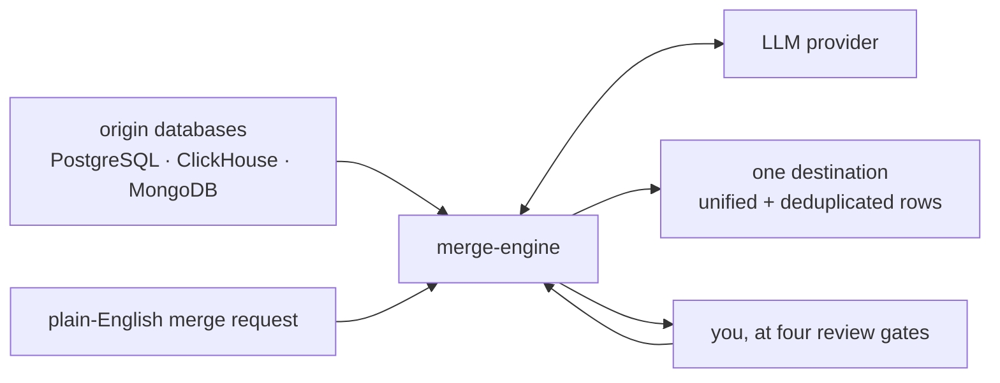
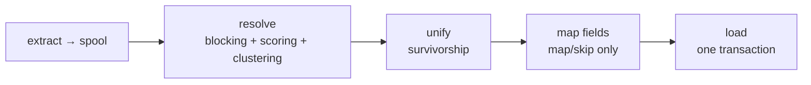

# merge-engine

Merge data from multiple heterogeneous databases (PostgreSQL, ClickHouse,
MongoDB) into one destination. An LLM does the schema understanding and the
ambiguous judgment calls; a human approves at review gates before anything is
written. Built to survive real third-party data — verified live against
Pagila (PostgreSQL), a 43-million-row ClickHouse table, and MongoDB's
`sample_mflix`.

- Users and managers: this file.
- Integrators and operators: [ARCHITECTURE.md](ARCHITECTURE.md).
- Developers: [TECHNICAL_IMPLEMENTATION.md](TECHNICAL_IMPLEMENTATION.md).
- Terms: [GLOSSARY.md](GLOSSARY.md) · What failed before:
  [docs/LESSONS.md](docs/LESSONS.md) · Step-by-step setup:
  [User_Guide.md](User_Guide.md)

<!-- verified: 4d33e0c -->

## What it does

1. You point it at 1+ origin databases and exactly 1 destination.
2. You describe the merge in plain English ("merge customers from both DBs",
   or "merge everything about Nova").
3. The LLM parses the request, proposes which tables hold which entity, and
   proposes the field mapping to the destination schema.
4. merge-engine extracts, deduplicates ("is this row in DB A the same
   real-world entity as that row in DB B?"), and unifies the data.
5. You approve at review gates — table/entity selection, match decisions,
   field mapping, and always a final approval — before any write. Rejecting
   anywhere writes nothing.
6. The result lands in the destination with a reconciliation report (rows
   in / rows out / conflicts resolved / LLM token cost).



Caption: what goes in, what comes out, and where the human sits.

<!-- verified: 4d33e0c -->

## Status

Every planned phase (0 through P) is implemented, unit-tested, and
live-verified; 3,923 tests are collected on the current branch (2026-11-26)
and CI (`check.py all`, 11 stages) runs green on pushes. The phase-by-phase
evidence log is [TODO.md](TODO.md); the exit baseline every later change is
measured against is
[docs/verification/BASELINE_V1.md](docs/verification/BASELINE_V1.md).

| Result (measured) | Value | Evidence |
|---|---|---|
| Matcher on the labelled eval harness | precision 1.0000, recall 0.9950, 0.2% of pairs to human review | docs/verification/BASELINE_V1.md §2 |
| Extraction scale proof | 43,276,150-row ClickHouse table in 44.6 min, 16,184 rows/s, 380.8 MB peak RSS, verified row-for-row | git blob `2a48845:TODO.md` §N.5 (living TODO.md since rewritten) |
| Speed after Part 1.5 | one full Boeing run 50.7 → 23.4 min; `resolve_entities` 2.44× faster | docs/verification/BASELINE_V1.md |
| Idempotent re-run | same input data → same cluster ids → destination updated, not duplicated | `src/mcp_server/tools/resolve_entities.py::_build_clusters` |
| Targeted merge | scoped "Nova" run added exactly its 10 rows to 732 → 742 companies, zero non-Nova rows | live-run record, commit 2a48845 (TODO.md Phase P evidence) |

Open quality gap, stated honestly: entity resolution has never been measured
at 43M-row scale (20k records in 39 s is the best measured so far), and the
eval fixture is being regenerated after a `.gitignore` rule lost it — see
[docs/LESSONS.md](docs/LESSONS.md) and
`docs/architecture/known_problems.md` §19.1.

<!-- verified: 4d33e0c -->

## Quickstart

```bash
python scripts/bootstrap.py        # venv, deps, frontend, hooks, graphs
```

Fill `LLM_API_KEY` in the generated `.env`, then:

```bash
.venv/bin/python -m src.main --mode gradio --port 7860    # Linux/macOS
```

(`--mode gradio` is the legacy flag name — it serves FastAPI + the React
SPA; `--mode both` is broken.) Or with Docker:

```bash
docker build -t merge-engine .
docker run -p 7860:7860 -e LLM_API_KEY=*** merge-engine
```

Open `http://localhost:7860`, enter origins and one destination on the
Setup screen, type a merge request, and approve through the gates. Full
setup, including Docker Compose files and standing up demo databases, is in
[User_Guide.md](User_Guide.md).

<!-- verified: 4d33e0c -->

## One worked example

Merging the Pagila `staff` tables from two origins: both origins' rows enter
token blocking; a Fellegi–Sunter model (learned unsupervised from the run's
own data) scores each candidate pair; "MIKE Hillyer" and "Mike Hillyer" score
above the 0.95 auto-match bar and unify into one record, while two staff
sharing a first name but differing on email cannot share a cluster (conflict
repair). Pairs scoring between 0.70 and 0.95 wait at the matches gate for
your keep/split decision. The unified records map to the destination through
a mapping you approve; `load_data` writes in one transaction and the run
report shows rows in, rows out, and token cost. The pipeline behind this is:



Caption: the five stages between your request and destination rows.

<!-- verified: 4d33e0c -->

## Limits (measured, not smoothed)

- Exactly one destination per run; MongoDB is origin-only.
- ClickHouse destination loads are not transactional (PostgreSQL is).
- The web API has no authentication — localhost or trusted networks only.
- Single-process app: run tracking is in memory, so no `--workers 2`.
- Resolution at tens of millions of rows is unmeasured (see Status).
- A `completed` run status is not evidence of good results; score runs
  against ground truth independently (docs/LESSONS.md).

The full honest list, with severity: `docs/architecture/known_problems.md`.

<!-- verified: 4d33e0c -->

## License

No license file exists in this repository yet and none is declared in
`pyproject.toml`. The code is therefore **not licensed for redistribution**;
the owner is deciding (flagged 2026-11-26 in the docs pass — see
[docs/LESSONS.md](docs/LESSONS.md) footer note). Until a `LICENSE` file
lands, treat all rights as reserved.

<!-- verified: 4d33e0c -->

## Working on this repo

- Understand code through the graph tiers before reading source: graphify →
  graft → codebase-memory-mcp → raw files (`AGENTS.md` §"Code lookup
  order"). `python scripts/bootstrap.py` builds all three; a post-commit
  hook refreshes them (~8 s, no LLM).
- One verification command: `python scripts/check.py all` — exactly what CI
  runs. Run it before pushing.
- Agent rules (branch discipline, mechanical guards, ponytail):
  [AGENTS.md](AGENTS.md). Document map: [docs/INDEX.md](docs/INDEX.md).
- Observability: self-hosted Langfuse (`docker/langfuse-compose.yml`); one
  merge run = one trace, verifiable with
  `python -m scripts.diagnostics.verify_langfuse_trace <thread_id>`.

<!-- verified: 4d33e0c -->
