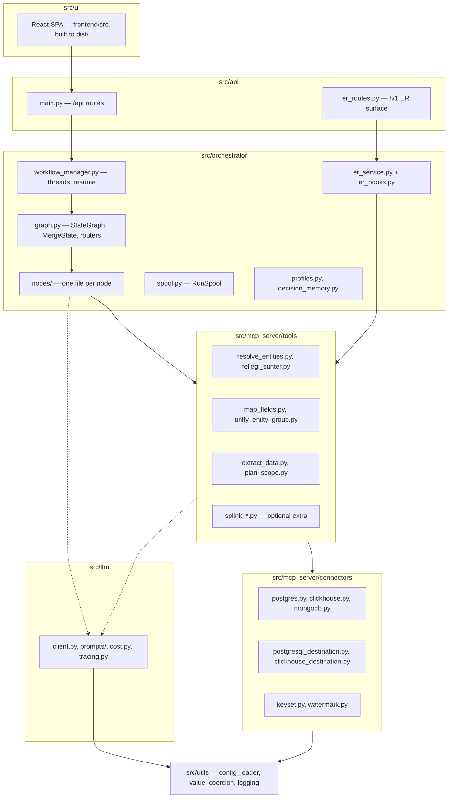
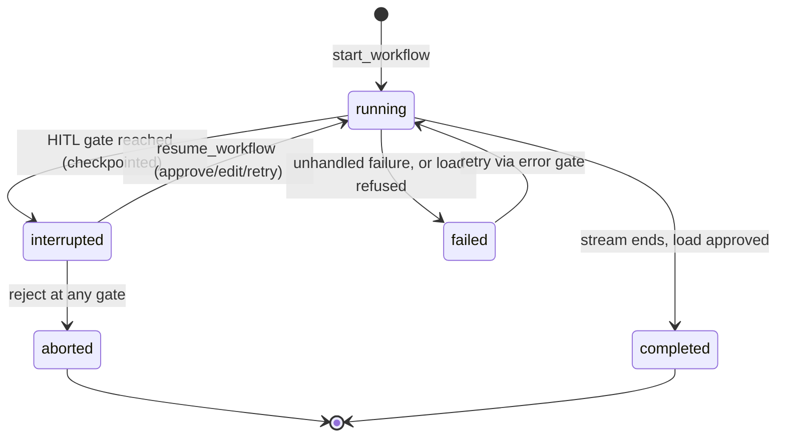
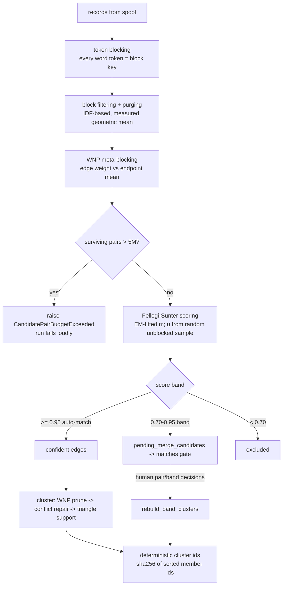

# Technical implementation

For developers of this project: where the code lives, how modules depend on
and talk to each other, the algorithms, and how to change it safely. System
view: [ARCHITECTURE.md](ARCHITECTURE.md). Terms: [GLOSSARY.md](GLOSSARY.md).
The per-subsystem reasoning walkthrough stays in
`docs/architecture/` (J2 — this file owns the developer map, not the prose).

## Where the code lives

Layers are machine-enforced, not convention: `src/api` →
`src/orchestrator` → `src/mcp_server/tools` → `src/mcp_server/connectors` →
`src/utils`, no reverse import; `src/llm` may be imported from below `api`
but must not import upward (`scripts/lint_arch.py`).

<!-- verified: 4d33e0c -->

## Module map

| Area | Files | Owns |
|---|---|---|
| Entry / CLI | `src/main.py::main` | uvicorn boot, `--mode` flag (gradio name is legacy; serves FastAPI + SPA) |
| HTTP | `src/api/main.py`, `src/api/er_routes.py::build_er_router` | `/api/*` dashboard routes, `/v1/*` ER contract |
| Workflow host | `src/orchestrator/workflow_manager.py::WorkflowManager` | start/resume/abort, status, gate payloads, profile capture |
| Graph | `src/orchestrator/graph.py::_build_builder`, `MergeState`, `HITL_NODES`, `NODE_SUCCESSOR` | nodes, edges, routers, `NETWORK_RETRY`, checkpointed compile |
| Nodes | `src/orchestrator/nodes/*.py` | thin async adapters: read state → call tool → return update |
| Extraction | `src/mcp_server/tools/extract_data.py::extract_data_impl`, `connectors/keyset.py`, `connectors/watermark.py` | batched keyset reads into the spool, incremental watermarks |
| Entity resolution | `tools/resolve_entities.py::resolve_entities_impl`, `tools/fellegi_sunter.py::MatchModel` | blocking, scoring, band, clustering |
| Unification | `tools/unify_entity_group.py::unify_entity_group_impl`, `resolve_policy` | per-cluster merge, survivorship chain |
| Field mapping | `tools/map_fields.py::map_fields_impl` | heuristic-first mapping, LLM fallback, map/skip gate |
| Scope planning | `tools/plan_scope.py::plan_scope_impl` | "merge everything about X": per-entity link paths |
| Loading | `src/orchestrator/nodes/load_data.py::pre_load_gate`, `build_reconciliation_report`; `connectors/postgresql_destination.py` | pre-load invariants, transactional write, `merge_engine.*` tables |
| ER service | `src/orchestrator/er_service.py`, `er_hooks.py` | online `/v1` paths, batch↔online hooks |
| LLM | `src/llm/client.py::LLMClient`, `prompts/`, `cost.py::SemanticCache`, `CostLedger` | one client class; every call passes cache + ledger |
| Profiles | `src/orchestrator/profiles.py::PINNED_KEYS` | pin the 4 non-deterministic LLM decisions |
| UI | `src/ui/frontend/src/` | React + Vite + TS SPA, served from `dist/` |

Node bodies are deliberately thin — the logic lives in `tools/` so it is
unit-testable without building a graph (`docs/architecture/overview.md` §0).

<!-- verified: 4d33e0c -->

## The graph: 19 nodes, 6 interrupt points

`_build_builder()` wires every fallible node through `_fallible_router` (a
recorded `failure` goes to the error gate, not onward) and HITL gates through
`_gate_router` (forward / retry-the-producer / abort). Two review edges are
conditional: the matches gate fires only when `has_low_confidence_clusters`,
the mapping gate only when `has_unmapped_fields`; the deps gate and final
approval always fire. `MAX_GATE_RETRIES = 3` caps both retry layers
(`src/orchestrator/graph.py`).

Status life cycle of a run (`src/orchestrator/workflow_manager.py`):

`completed` means the stream ended — it is explicitly *not* proof of good
results; scoring runs are independent (docs/LESSONS.md, AGENTS.md §"Live
verification"). A run that loaded nothing never reports `completed`
(`_finalize_stream_status` refuses it).

<!-- verified: 4d33e0c -->

## Workflow: entity resolution (the highest-consequence one)

Key invariants (why each exists is in
`docs/architecture/data_pipeline.md` §7):

- No comparison budget: a pair is excluded only because a block property
  says so; the 5M cap is an out-of-memory guard, `uncompared_pairs` is
  always 0 (`src/mcp_server/tools/resolve_entities.py::_generate_candidate_pairs`).
- `u` comes from 3,000 random *unblocked* pairs, never from the EM's blocked
  candidates (`tools/resolve_entities.py::_fit_match_model`, P13).
- Borderline pairs are never auto-unioned — over-merging is the worse error.
- Conflict repair: records disagreeing on an exclusive identifier (measured
  from the run's own corpus, P6) cannot share a cluster.

## Workflow: extraction, mapping, loading

1. `extract_data` pages each table by keyset (`>=` boundary +
   `boundary_seen` drop + md5/cityHash tiebreak) into the DuckDB spool;
   watermarks make the next run incremental (`connectors/keyset.py`).
2. `map_fields` tries heuristics, asks the LLM only for the rest, and can
   only `map` or `skip` — an LLM-proposed `new_column` is refused on the
   spot because the destination schema is authoritative
   (`src/mcp_server/tools/map_fields.py`, the `new_column` refusal); the
   only legitimate schema growth is `pending_schema_changes` reconciled at
   load (`src/orchestrator/nodes/load_data.py::_apply_schema_changes`). A
   pinned profile mapping is reconciled against the live destination schema
   on every run (`docs/architecture/data_pipeline.md` §9).
3. `human_final_approval` shows `pre_load_gate` invariants (mapping-coverage
   floor; identity-NULL share, largest-cluster share, flagged-cluster count
   ceilings) with thresholds proposed from the run's own medians; the
   operator's confirmed numbers are enforced at load (`pre_load_thresholds`).
4. `load_data` writes in one transaction (PostgreSQL stage-then-swap),
   refuses without `load_approval`, records the entity map, merge audit,
   watermarks, `er_redirect`/`er_entity_version`/`er_field_history` side
   effects in the same transaction, and builds the reconciliation report
   (`src/mcp_server/tools/load_data.py::load_data_impl`,
   `src/orchestrator/er_hooks.py::write_load_side_effects`).

<!-- verified: 4d33e0c -->

## Key types

| Type | Where | Contract that matters |
|---|---|---|
| `MergeState` (TypedDict) | `src/orchestrator/graph.py` | reducer semantics: `operator.or_` dicts accumulate per entity; `failure` and `pending_schema_changes` are replace-semantics on purpose (`docs/architecture/state_and_graph.md` §2) |
| `MatchModel` / `FieldModel` | `src/mcp_server/tools/fellegi_sunter.py` | score = summed log2 evidence; `explain()` returns per-field bits |
| `RunSpool` | `src/orchestrator/spool.py` | per-run DuckDB table per entity; seq contiguity is a checked invariant |
| `MergeEngineError` + 4 subclasses | `src/orchestrator/utils/retry.py` | disposition `retry`/`fail`/`escalate`; unknown defaults to Permanent |
| `ErError` | `src/orchestrator/er_service.py` | maps to contract HTTP codes; 503 LOAD_RUNNING during a batch load |
| `RetryPolicy` (`NETWORK_RETRY`) | `src/orchestrator/graph.py` | attached per node at build time; HITL gates and pure-compute nodes carry none |

## Prompt layer

Eight stages, each a `.system.txt`/`.human.txt` pair under `src/llm/prompts/`
(request parsing, dependency analysis, entity→table selection, schema
matching, semantic type inference, borderline-pair adjudication, field
mapping, scope planning).
Loaded once at import into `PROMPT_TEMPLATES`; substitution is literal
`str.replace`, never `.format()` — prompts contain literal JSON braces and a
lost placeholder fails silently (enforced by the `no-str-format-on-prompts`
hook, `src/llm/__init__.py`). Every LLM request goes through one
`LLMClient` class; cache + ledger hook inside `.call()` so no call site can
bypass them. A missing prompt file returns `""` (fail-open) — a known
problem, §19.5 of `docs/architecture/known_problems.md`.

<!-- verified: 4d33e0c -->

## Configuration

| Source | Holds | Loaded by |
|---|---|---|
| `config/config.yaml` | LLM provider/model/fallbacks, retry bounds, batch sizes, feature flags (`entity_resolution_enabled`, `field_mapping_enabled`), splink/matching defaults — `${ENV_VAR}` placeholders, no credentials | `src/utils/config_loader.py::load_config` |
| `.env` | `LLM_API_KEY`, `LANGFUSE_*` | python-dotenv at config-loader import |
| UI at runtime | all origin/destination connections | cached in `config/recent_connections.json` (plaintext passwords — known problem §18.3) |
| `config/profiles/*.json` | the 4 pinned decisions | `src/orchestrator/profiles.py::load_profile` |
| `MERGE_ENGINE_DECISION_MEMORY` (env) | decision-memory file path | `src/orchestrator/decision_memory.py` |

## Tests, checks, CI

| Command | What it proves |
|---|---|
| `python scripts/check.py all` | the 11-stage gate CI runs: lint, format, arch, docs, portability, guards, types, frontend, test, eval, prompts |
| `pytest` | 3,923 tests collected (live count, this branch, 2026-11-26) |
| `python -m tests.eval.score` | matcher eval against the labelled harness (fixture gap — see ARCHITECTURE.md "Quality") |
| `scripts/lint_arch.py` | layering + no-module-level-mutable-state in `tools/`, ratcheted on `arch-lint-baseline.txt` (shrink-only) |
| `scripts/lint_docs.py` | every doc link and `path:line` citation under `docs/` still resolves |
| pre-commit guards via `check.py guards` | blanket-gitignore ban, `sample_databases/` ban, `.format()`-on-prompts ban, bare-`except-pass` ratchet, requirements/pyproject drift |

Rules that read like style are scar tissue: each guard in `.pre-commit-config.yaml`
maps to a measured past failure (`AGENTS.md` §"Rules that are mechanically
enforced"). Do not add a new destination column, ever; do not hand-edit
`arch-lint-baseline.txt` to hide a new violation.

## How to change this safely

- Understand through the graph tiers first (`AGENTS.md` §"Code lookup order"),
  then read the real lines (E1/E2).
- A new node: add it to `NODE_SUCCESSOR` too, or the error gate's "skip"
  silently downgrades to "abort" (`src/orchestrator/graph.py::NODE_SUCCESSOR`).
- Touching gate logic: read the HITL resume trap first — an
  `interrupt_before` gate's body never runs on resume; put resume-time work
  in `WorkflowManager.resume_workflow`/shared helpers (`apply_band_decisions`
  is shared for exactly this reason).
- A bug fix starts with a test that fails before and passes after (D3);
  expected values never come from running the code under test (L2).
- Decide which of the four main docs a change affects and update it in the
  same commit, naming the decision "Docs: …" (J13, checked by
  `scripts/ci_rule_checks.py`).
- Release/CI: GitHub Actions (`ci.yml` = `check.py all`; `docs.yml`,
  `docker.yml`, `bootstrap.yml`, `audit.yml`, `rule-checks.yml` by paths);
  run them locally before pushing (G3).

<!-- verified: 4d33e0c -->
