# Merge-engine — technical report

**Revision 2026-09-29.** Supersedes the 2026-09-26 draft in full.

This revision exists because the 2026-09-26 draft failed its own test. Four of
its twelve Part 1 fixes were fitted to the two databases they were measured on
— they contained literals drawn from that corpus rather than constants computed
from data. That was identified by the reader, confirmed by a mechanical audit of
the draft's own text (§0.6), and then extended by the research in Part 2, which
found four further instances the audit had missed, including two inside the
*replacements* the draft proposed.

Every decision in this revision therefore carries three things: **the reason**,
**the ceiling of the option chosen**, and — where a simpler option was taken on
purpose — **the deferred alternative and the trigger for paying it**. Decisions
without a stated reason are not decisions; they are defaults that nobody owns.

The criterion used throughout, stated once and applied everywhere:

> **A general mechanism computes its constants from the data at runtime. A
> fitted one contains literals drawn from a particular corpus.** Grep a rule set
> for literals and ask of each constant whether a count over the corpus would
> produce it. If it would not, the rule is fitted.

---

## Contents

- [§0 Evidence base and measured outcome](#0-evidence-base-and-measured-outcome)
  - [0.6 The audit of this report](#06-the-audit-of-this-report)
  - [0.7 Destination schema defects](#07-destination-schema-defects-found-by-direct-inspection)
  - [0.8 Environment constraints](#08-environment-facts-that-constrain-the-design)
- [Architecture: three states](#architecture-three-states)
- [PART 1 — Defects and fixes to apply now](#part-1--defects-and-fixes-to-apply-now) — P1–P20
- [PART 2 — Research, cited](#part-2--research-cited) — §2.1–§2.21
- [PART 3 — Architecture](#part-3--architecture) — §3.1–§3.14
- [PART 4 — Appendices](#part-4--appendices) — incl. **4.6 Decision register**, **4.7 Corrections register**
- [References](#references)

---
## §0 Evidence base and measured outcome

### 0.1 The run

One full autonomous run over two PostgreSQL origins into `global_warehouse`,
scored against the hand-built `ground_truth` database.

| | |
|---|---|
| wall clock | 828.1 s |
| peak RSS | 0.9 GB (cap 6.5 GB, box has 27 GB and **no swap**) |
| terminal status | `completed` |
| gates traversed | `deps` 3.2 s → `mappings` 367.2 s → `matches` 808.4 s → `final_approval` 814.9 s |
| gate skipped | `human_review_scope` — *"This merge targets no single organisation, so there was no scope to confirm"* (correct) |
| LLM | `Qwen/Qwen3.6-35B-A3B-FP8` via llama.cpp, 1.4 s/call measured through the app's own `LLMClient`, JSON mode verified, 262 144 context |
| tracing | Langfuse v4 in `events_only` mode; ingestion confirmed live |

### 0.2 Reproducibility caveat — stated plainly

Since the run, `ground_truth` has been **dropped**, `global_warehouse` has been
**wiped** (`merge_engine_entity_map` no longer exists), and the `enrichment`
origin credentials have **changed**. Nothing below was re-verified against live
databases after those changes. Every finding rests on artifacts captured during
the run and still on disk:

| artifact | what it proves |
|---|---|
| `phase3/state.json` | `field_mappings`, `unmapped_fields`, `resolution_stats`, `timings`, `entity_tables` |
| `phase3/gates.jsonl` | every gate payload exactly as a human would have seen it |
| `score.json` (1.0 MB) | every TP/FP/FN pair, named |
| `gt_score.py`, `gt_rows.py`, `run_merge.py` | harnesses, re-runnable once databases are restored |

Where a claim could not be re-verified after the environment changed, it is
marked **[unverified post-wipe]**.

The scoring harness was written **before** the run and proven in both
directions — identity scoring returns a perfect result; injected FP and FN are
caught and named:

```
identity     → company TP 13 FP 0 FN 0 | person TP 7 FP 0 FN 0 | 0 unmapped
inject 1 FP  → FP 1, exact pair named
inject 1 FN  → FN 1, exact pair named
```

### 0.3 Measured outcome

| entity | TP | FP | FN | verdict |
|---|---|---|---|---|
| company | 13 / 13 | 4 | 0 | recall 1.000, precision 0.765 |
| person | 3 / 7 | **14 382** | 4 | unusable |

| | value |
|---|---|
| rows short of expected | **10 847** |
| `company.name` NULL | **78 / 99** |
| `legal_name`, `industry_id`, `location_id`, `employee_count` | **100 % NULL** |
| entities producing zero field mappings | **8 of 16** |
| candidate pairs discarded unexamined | **9 556 382** |
| over-merged person clusters | 1 401 |
| **run status** | **`completed`** |

The last row is the most important number in this report. The pipeline
destroyed most of its own output and reported success.

### 0.4 Ground-truth scale, and why rates are the wrong unit

`merge_engine_entity_map` held 13 712 records; only **18 clusters** had more
than one member.

| entity | multi-member clusters | true pairs | composition |
|---|---|---|---|
| company | 13 × size-2 | **13** | every one cross-source |
| person | 4 × size-2, 1 × size-3 | **7** | 5 within-source, 2 cross-source |

Person pair space is C(13 518, 2) = **91 355 403** with 7 positives —
prevalence 7.7 × 10⁻⁸.

With 7 positives, recall moves in steps of 1/7 = 14.3 pp and a Wilson 95 %
interval on 7/7 spans roughly [0.65, 1.00]. **Report confusion counts, not
rates**, and stratify cross-source vs within-source — 13 of the 15 cross-source
positives are companies, so an aggregate figure hides cross-source collapse.

`Fβ` with β = 0.5 (precision weighted 2×, because a false merge is written to
the destination while a false split leaves a visible duplicate) remains correct
as a **tiebreaker between two configurations**, not as an optimisation target.
Tuning a threshold against 20 labelled pairs overfits immediately. Use the
floors that `splink_workbench.evaluate` already accepts (`precision_floor`,
`recall_floor`) instead.

**Report review rate beside every precision figure.** Precision is trivially
gameable by widening the review band; a precision of 0.99 can mean "everything
hard was deferred to a human."

### 0.5 The unifying finding

**The matcher is not naive. It is starved.**

`resolve_entities.py` contains four well-built defences against precisely the
failures this run produced. **Every one is keyed on a field the empty join
graph prevents from arriving.**

| defence | keyed on | fired? | why not |
|---|---|---|---|
| `_UNIQUE_IDENTITY_HINTS` — different non-null email ⇒ different entity | `email` | **no** | email is in `contact_information` (3 781 rows), never joined to `staff` |
| `_DETERMINISTIC_ID_HINTS` — matching domain/ticker settles identity | domain, ticker | **no** | not present on `staff` |
| `_shared_neighbors_beyond_common_parent` — siblings under one parent are not the same entity | `company_relation` rows | **no** | no relation table in either origin ⇒ `relationship_index` empty |
| term-frequency down-weighting of accidental agreement | value distribution | partial | with ~4 usable fields it cannot carry the decision alone |

The parent/subsidiary guard that would have blocked **all four** company false
merges is inert for this reason alone. Its docstring even cites the Airbus
"Defence and Space" failure it was written to prevent.

**Consequence for prioritisation:** P3 is not one repair among twelve. It is the
precondition that activates four existing defences simultaneously. Most of the
algorithmic work needed is already written and never executes.


### 0.6 The audit of this report

The 2026-09-26 draft was audited against the criterion stated at the top of this
document. The test is mechanical and needs no new data: **grep the proposed
fixes for literals drawn from the corpus.**

Result, counting occurrences inside the draft's own proposed mechanisms:

| literal | occurrences | where it came from |
|---|---|---|
| `staff` | 16 | a zoominfo table name |
| `main_entity_id` | 10 | a zoominfo column name |
| `email` | 11 | a field that happens to be populated here |
| `industry` | 18 | a destination table name |
| `France` | 7 | a token in four failing company names |
| `lastname` | 5 | a zoominfo column name |
| `Group` | 4 | a token in the same four names |
| `companyexperience` | 3 | a diffbot table name |
| `Berhad`, `SAS`, `Holdings` | 1 each | tokens in the same four names |

A rule naming `Berhad` is not a rule about company names. It is a rule about
*these* company names. Swap the corpus and it is silent.

**The four fixes identified by the reader (P4–P7) are confirmed fitted**, in
descending severity:

- **P6 was the worst, and is a documented anti-pattern.** Its suffix list was
  the four failures in this corpus. See §2.14 and [T].
- **P5's mechanism was general; its four blocking keys were not.** And the
  draft's own research names the tell: *"a hand-picked blocking key with
  suspiciously high candidate precision is evidence against the key, not for
  it"*, against a general baseline of candidate precision **below 0.003** at
  >90 % recall [R1].
- **P7's mechanism was general; its presentation was a list of this corpus's
  table names.**
- **P4 was mostly general, with one bad sub-rule** — *"a table whose columns are
  all foreign keys is an edge table"*, which is a documented false-positive
  source on payload-carrying tables (§2.13).

**The research then found four more that the audit had missed, and two of them
were inside the draft's own replacements:**

1. **The IND→FK classifier proposed as P3's general replacement has a
   hand-written suffix list as one of its two most discriminative features** —
   Rostin's F9 (`id`, `key`, `nr`) and F6 (column-name similarity). The
   replacement smuggled the defect one level down (§2.13).
2. **The blocking-scheme learner proposed as P5's replacement cannot run on this
   problem at all** — BSL learns `{method, attribute}` pairs, i.e. *named*
   attributes, and every incoming database has a different schema (§2.12).
3. **"Different registered identifiers ⇒ never the same entity"**, floated as
   P6's general replacement, is false and contradicted by the primary source
   (§2.14).
4. **A vendor demo with hard-coded blocking keys was cited approvingly as a
   benchmark**, on the same page where the draft copied that pattern (§2.3).

The complete list of corrections, with who caught each, is Appendix 4.7.

**What this means for how the rest of the report should be read.** Two
conclusions follow, and they pull in opposite directions:

- Fitted rules are not merely incomplete. In the one case tested head-on they
  are **inverted** — standard matchers score *"Acme Group Ltd"* vs *"Beta Group
  Ltd"* (different companies, should reject) **higher** than *"Acme Group Ltd"*
  vs *"Acme Holdings Ltd"* (plausibly the same, should accept), so *"Lower the
  threshold to catch pair B and you also accept pair A as a false positive"*
  [T]. No threshold rescues a fitted rule.
- **The published literature fails the same test** (§2.20). Its authors disagree
  with each other on every constant layered on top of a general core. The
  lesson is therefore not "copy the literature" but **copy the derivations and
  re-derive the constants**.

---

### 0.7 Destination schema defects found by direct inspection

Three facts established by querying `global_warehouse` directly on 2026-09-29.
They are recorded here rather than inside a single P-item because they change
what "a successful run" could mean at all.

**`public.company_industry` is one column wide:**

```
        Table "public.company_industry"
 Column | Type | Nullable
--------+------+----------
 id     | text | not null
```

It has **no `company_id` and no `industry_id`**. It is structurally incapable of
linking a company to an industry — and the last run loaded **539 rows** into it,
every one of them carrying nothing but a key.

**Two dimension tables are empty, and both have real shapes:**

| table | rows | shape |
|---|---|---|
| `industry` | **0** | `name`, `sub_industry`, `industry_group`, `parent_industry_id` — a dimension with a self-hierarchy |
| `product_category` | **0** | `name`, `parent_category_id`, `description` — same |
| `company_industry` | 539 | `id` only |

**This is one broken table, not a pattern.** The siblings are correctly shaped
and populated, which is the evidence:

| table | rows | linkage columns present |
|---|---|---|
| `contact_email` | 3 777 | `person_id`, `company_id`, `email`, `email_type`, `is_primary`, `is_verified` |
| `contact_phone` | 83 | `person_id`, `company_id`, `phone`, `phone_type`, `country_code` |
| `company_relation` | 21 | `company_a_id`, `company_b_id`, `relation_type`, `started_date`, `ended_date` |
| `person_skill` | — | `person_id`, `skill_id`, `proficiency_level` |

**Consequence, and it is a good one.** The destination schema already models
multi-valued attributes as child tables *everywhere except this one table*. The
field taxonomy in §3.5 therefore needs **no new destination columns anywhere** —
which is what makes it compatible with the standing prohibition in `CLAUDE.md`.

The handling of the broken table is decision **D-31**: the app reports it,
never repairs it, holds the links in the corpus, and re-projects once the DDL is
fixed. This is also the clearest demonstration of why §3.4's derived destination
matters — see the closing paragraph of §3.4.

---

### 0.8 Environment facts that constrain the design

Both verified on 2026-09-29, both load-bearing for §3.2.

| fact | verified by | what it constrains |
|---|---|---|
| Destination is **PostgreSQL 17.11** | `select version()` | **No native `uuidv7()`** — that arrived in PostgreSQL 18 |
| Repo pins **Python ≥ 3.11** | `pyproject.toml:9` | **No `uuid.uuid7()`** — that arrived in Python 3.14 |

Together these force decision **D-24**: UUIDv7 is generated application-side by
a small function, with no new dependency and no extension.

---

## Architecture: three states

Three diagrams, referenced throughout. Delta diagrams for the individual changes
that alter the graph's *shape* appear inside their own P-items; changes that do
not alter the shape (a tokeniser fix looks identical on a graph) are described
in prose instead.

### State 1 — now

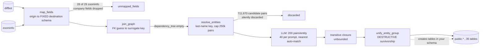

### State 2 — after Part 1

Same topology, repaired components. Three additions change the graph: the
review band is consumed, and two reports are emitted.

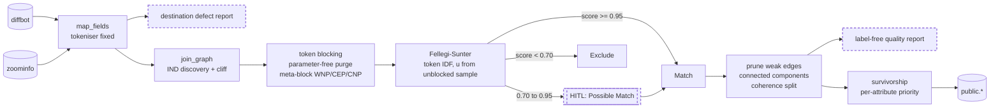

### State 3 — after Part 3

A new stage and a new store. The destination stops being the system of record.

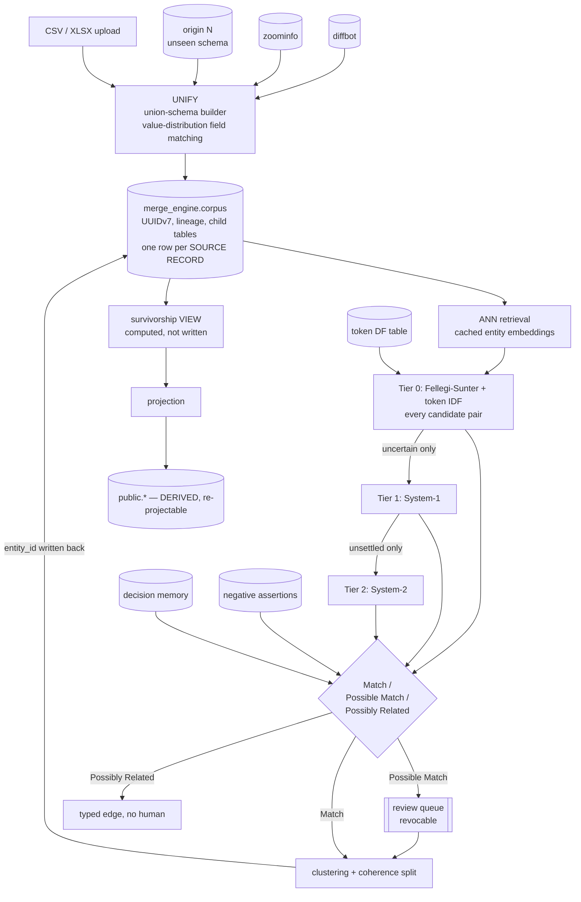

**The single structural difference between State 2 and State 3:** in State 2 the
destination is the only place the merged data exists, so every mistake is
destructive and every rule change requires a re-run. In State 3 the corpus is
the system of record, the destination is a projection, and a rule change is a
re-projection.

---

# PART 1 — Defects and fixes to apply now

**Scope rule for the whole of Part 1: no new storage and no new pipeline stage.**
Everything here runs against the pipeline exactly as it exists today. Anything
requiring the `merge_engine` store or the unification stage is in Part 3, and is
marked as such where the two halves of one fix are split.

**Ordering.** The dependency order changed in this revision and the change
matters — see [Part 1 ordering](#part-1-ordering-and-dependencies). In short:
**P2 must land before P5**, because P5's replacement blocking is deliberately
*less* selective than the hand-picked key it removes.

---

## P1 — Field-name tokeniser cannot split lowercase identifiers

**Classification changed in this revision:** this was filed as a survivorship
bug. It is not. It is an **upstream mapping failure with survivorship impact**.

### Evidence

`_tokenize_field` in `src/mcp_server/tools/map_fields.py` splits on case
transitions and separators. Verified live:

| input | tokens produced | maps? |
|---|---|---|
| `companyName` | `['company', 'name']` | yes |
| `companyname` | `['companyname']` | **no** |

The recorded failure reason in the run output is **`"No matching destination
column found; destination schema is authoritative"`** — not a coalesce failure.
That distinction is the whole correction: the tokeniser breaks the **initial
match**, not merely the `_safe_coalesce_target` fallback.

**Measured cost: 28 of 29 zoominfo `company` fields went unmapped.** Not one
contested field losing a tiebreak — the entire second origin contributing almost
nothing to the company entity.

### Reason this ranks first

Three consequences compound, and the second is the one that misled the earlier
draft:

1. Every concatenated-lowercase column in any origin fails to map at all.
2. **It silently disguises every survivorship defect downstream.** If only one
   origin's values ever arrive, `_resolve_conflict` never sees a conflict, every
   field takes the single-value short-circuit at `unify_entity_group.py:332`,
   and the survivorship rules appear to work. They were never exercised. This is
   why §0.6's priority-direction error (P18①) produced no visible symptom.
3. It is the reason `global_warehouse.company.name` is mostly NULL while
   `ground_truth` has values.

### Fix

Tokenise with a dictionary-driven split for the no-delimiter case, not a longer
list of known prefixes. The general form: attempt a maximal split against the
**vocabulary observed in the destination schema itself** — which is available,
finite, and changes only when the destination changes.

**Ceiling of this option.** A dictionary split cannot resolve genuine ambiguity
(`businessaddress` → `business|address` is right; a column named `presspoint`
is not `press|point` in every schema). Ambiguous splits are reported, not
guessed.

**Deferred alternative — value-based matching, ignoring names entirely.**
Kang & Naughton's mutual-information dependency graph matches schemas with no
reliance on column names at all [KN03]. That is strictly more general and is
already required by §3.2 for cross-origin matching.
**Trigger:** when §3.2's unification stage lands, this component is re-pointed
to map *unified corpus → destination* and value-based matching becomes the
primary signal, with name tokens demoted to a tiebreak.

**Note the double touch, stated rather than hidden:** P1, P4 and P12 are Part 1
fixes to a component that Part 3 re-points to a different input. They are still
worth doing — they are small, and the current pipeline is what runs meanwhile —
but they will be revisited.

---

## P2 — The comparison budget is a silent truncation

### Evidence

`_MAX_COMPARISONS = 250_000` (`resolve_entities.py:59`). On the `staff` entity
the blocking stage produced roughly **962 000** candidate pairs; **711 670 were
discarded unexamined**. Across the run, `9 556 382` candidate pairs were
discarded while the workflow terminated with status `completed`.

### Why this loss is uniquely bad

A cap is not a sample. Pairs are dropped in whatever order the block collection
yields them, so the discarded set is **correlated with block structure** — large
blocks lose proportionally more, and large blocks are exactly where common
surnames and common company tokens live. The loss is therefore systematic, and
it falls hardest on the records the matcher finds hardest.

### The objection, and the resolved answer

The objection raised against the first draft was correct: *a fixed cap is dumb,
but comparing every pair is also dumb.* The resolution is that these are not the
only two options. Reducing comparisons **without dropping real ones** is the
subject of an entire literature, and its answer is three ordered stages rather
than one number [R1]:

1. **Block building** — generate candidates (P5).
2. **Block cleaning** — discard blocks that cannot be informative.
   *Block Purging* is **parameter-free**; *Block Filtering* retains the smallest
   blocks per entity.
3. **Comparison cleaning** — *meta-blocking*: weight every candidate edge and
   prune below a threshold **derived from the local distribution**, not chosen.

The key property, and the reason this is not just a fancier cap: stages 2 and 3
discard comparisons **because a computed property says they cannot be matches**,
not because a counter ran out.

### Fix

Replace `_MAX_COMPARISONS` with the three-stage workflow. Keep a budget only as
an out-of-memory guard, and make it **fail the run loudly** if it ever binds,
rather than silently truncating.

**Ceiling.** Meta-blocking's pruning is itself lossy — it is a recall/cost
tradeoff, just an *informed* one. Its loss is measurable (pair completeness);
the cap's loss was not.

**Deferred alternative — progressive / pay-as-you-go resolution.** Emit matches
in decreasing order of expected correctness so a run can be stopped at any point
with the best-available answer rather than an arbitrary prefix.
**Trigger:** when a run is ever time-boxed rather than quality-boxed. Per the
standing decision that quality is the only priority (D-05), not now.

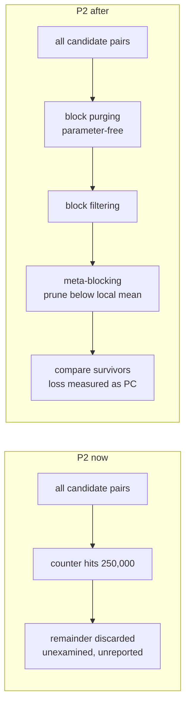

---

## P3 — Join inference targets the surrogate key

### Evidence

`_find_candidate_edges` (`join_graph.py:266`) proposes edges of the form
`child.<parent>id → parent.<primary key>`, where the primary key is the
**surrogate** `_id`. Consequences, both measured:

- `companyexperience.companyid → company._id` is proposed and then **correctly
  rejected** by the inclusion check — the values genuinely are not in `_id`.
- `staff.main_entity_id` is **never proposed at all**, because the name does not
  match the pattern.

Result from 26 tables: `dependency_tree = {}`, `column_dependencies = []` — while
`staff.main_entity_id = company.companyid` in fact joins **all 13 518 rows**.

### Fix — value-based inclusion-dependency discovery, with the classifier corrected

The mechanism is IND discovery: find every column pair where one column's values
are contained in another's, from the data, with no reliance on names.

**Correction to the previous draft, and it is the important part of this item.**
The draft proposed Rostin-style IND→FK classification as the *general*
replacement. Its feature set was reproduced in full by the research (§2.13) and
**its two most discriminative features are fitted**: F6 (column-name similarity)
and **F9, a hand-written suffix list — `id`, `key`, `nr`** [RO09]. The proposed
general replacement smuggled the same defect one level down.

**What in that literature is genuinely parameter-free, and is what we adopt:**

| mechanism | constant | measured effect |
|---|---|---|
| **The cliff** — cut the ranked candidate list at its **largest score gap** | **none**; the source states *"no need to setup a parameter"* | TPC-H: **7.67×10⁷ candidate key combinations → 1**, losing **zero** true keys [HOPF] |
| RHS-uniqueness prefilter | none | **8–10× reduction** [HOPF] |
| `PK ⊆ PK` consecutive-subsequence filter | none | — |

The cliff is the single most reusable idea in this report. It is the general
form of every tuned threshold: rather than choosing a cut-off, **rank and cut
where the ranking itself breaks.**

**Caveat that would have caused a regression.** HoPF's non-cyclic rule *"would
reject every junction table and every self-referencing hierarchy"* — precisely
the two structures P4 and P7 must find. Adopt the three filters above; **do not
adopt the acyclicity rule.**

**Speed claim corrected.** The previous draft asserted "BINDER is 26× faster".
That figure matches no published measurement. The real numbers [D19]:

| workload | SINDY | FAIDA | BINDER |
|---|---|---|---|
| Musicbrainz, unary INDs (32 workers) | **15.38 min** | 27.67 min | 45.69 min |
| TPC-H 10, n-ary | — | **22.65** | 121.09 |

And: **FAIDA, SINDY and MANY are described in the paper but absent from the HPI
repository** — so "use the HPI implementation" is wrong for the fastest of them.

**Ceiling.** IND discovery finds *containment*, which is necessary but not
sufficient for a foreign key. Without Rostin's name features the classifier is
weaker, and some genuine FKs will be ranked below the cliff.

**Deferred alternative — supervised FK classification with non-name features
only.** Rostin's F1–F5, F7, F8, F10 (coverage ratio, value distribution,
cardinality, out-of-range rate) minus the two fitted ones, trained on a labelled
set of confirmed FKs accumulated across runs.
**Trigger:** once §3.9's decision memory has accumulated confirmed FK judgments
from HITL gates across enough databases to train on — i.e. after Part 3, not
before, because the labels do not exist yet.

---

## P4 — Eight of sixteen entities produced zero field mappings

### Evidence

Half the entities produced no field mappings at all. Two distinct root causes,
and the previous draft conflated them.

**Root cause (a): no dimension-table materialisation.** The destination has real
dimension tables that nothing populates:

| table | rows | shape |
|---|---|---|
| `industry` | **0** | `name`, `sub_industry`, `industry_group`, `parent_industry_id` |
| `product_category` | **0** | `name`, `parent_category_id`, `description` |

Origins carry industry as **text on the company row**. Nothing converts a
repeated text value into a dimension row plus a link. This is §0.7's evidence,
and it is P4's measured cost.

**Root cause (b): junction tables have no destination column** — and here the
previous draft's rule was itself the defect.

### The junction rule, replaced

**Deleted:** *"a table whose columns are all foreign keys is an edge table."*
This is a documented false-positive source on **payload-carrying** junction
tables, and it tests the wrong property.

**Adopted** — from the relational-to-ER reverse-engineering line:

> A junction table is one whose **minimal unique column combination equals the
> union of two or more foreign-key column sets**. Non-key attributes are
> **explicitly irrelevant**.

The old rule asked "are all columns FKs?" The correct question is "**is the FK
pair itself the minimal key?**" — which admits payload columns and excludes
coincidence.

**Stated as a limit, not hidden:** there is **no published, evaluated,
instance-driven junction detector**. A 2024 paper hands the decision to a human,
noting cardinality from plain table data is *"almost impossible to tell"* [SCH].
The genuinely hard case is **junction vs. weak entity** (key = FK + a local
discriminator), which the UCC test alone does not separate. **Composing the UCC
test with HoPF's discovery is my synthesis and is labelled as such**, not
presented as a citation.

**Fact vs. dimension, honestly sourced.** The only published *data-derived*
threshold is SAMSTAR's `Th = mean + K·σ` computed over its own connection-topology
distribution [SAM]. Its 131-noun dimension-name list is hard-fitted and is not
adopted. **Row-count ratios are folklore or patents, not peer-reviewed** — and
are labelled folklore wherever used.

**Ceiling.** Without a published detector, junction classification will produce
errors on weak-entity tables. Those errors are reported at the HITL gate rather
than silently acted on.

**Deferred alternative — human-confirmed structure, remembered.** Present the
proposed table roles at a gate; persist the confirmations; stop asking about a
structure already confirmed.
**Trigger:** Part 3's decision memory (§3.9). Until then the proposal is shown
and acted on within the run only.

---

## P5 — Blocking is not selective, and closure amplifies it

**Rewritten in full.** The previous version proposed four hand-picked blocking
keys. They are deleted. So is the learning algorithm proposed to replace them.

### Evidence

Person matching blocks on **surname alone**. On the `staff` entity that yields
roughly 962 000 candidate pairs at a measured precision near **0.0002**, and the
resulting low-precision edges feed an unbounded transitive closure, which merges
them into a single giant component.

### Why the obvious replacement was rejected

The natural fix is to *learn* the blocking scheme rather than choose it. The
canonical algorithm is **BSL (Blocking Scheme Learner)** — a modified Sequential
Covering Algorithm wrapping LEARN-ONE-RULE, a greedy general-to-specific beam
search [M06, pp. 3–5]. Its objective is **split**: LEARN-ONE-RULE maximises
**reduction ratio subject to `PC ≥ min_thresh`**, while the outer loop maximises
**pair completeness** by adding disjuncts until every training match is covered.
`RR = 1 − C/N`, `PC = Sm/Nm` [M06, p. 2].

**It is disqualified here, and the reason is the deployment constraint, not the
algorithm.** BSL's atomic unit is a **`{method, attribute}` pair** — it learns
*which named attribute* to block on. Every incoming database has a different
schema, so there is no stable attribute name to learn about. **dedupe, Zingg and
delex are disqualified identically**, all three being attribute-name-based.

Two terminology repairs while correcting this section: the paper **never uses
the phrase "blocking predicate"** — that is dedupe's vocabulary, which the
previous draft blended in; its terms are `{method, attribute}` and, for a
conjunction, **"blocking criteria"** [M06, p. 3].

And the labels BSL would need are not cheap in the way the draft implied. The
minimum reported anywhere is **50 labelled pairs, 25 per class** — with the
counter-intuitive result that **more labels *hurt* F1 by 24.8 %**. BSL's
smallest reported run had 11.5 matches and that was too few.

### Fix — schema-agnostic, zero-label blocking

Every constant below is computed from the block collection itself.

| stage | mechanism | its constant |
|---|---|---|
| Block building | **Token blocking** — *"Creates one block for every token in the attribute values of at least two entities"* [JED] | none; attribute names never read |
| Block cleaning | **Block Purging** | **parameter-free** [R1] |
| Block cleaning | Block Filtering | retain smallest blocks per entity, `r` as a ratio |
| Comparison cleaning | **Meta-blocking, WNP** | **local mean** edge weight per node |
| Comparison cleaning | **CEP** | `K = Σ|b| / 2` |
| Comparison cleaning | **CNP** | `k = Σ|b| / (|E1| + |E2|)` |
| Alternative builder | **KLSH** | `n/c` by construction |

Reported performance **with no labels at all: PC 0.96–0.99, RR 0.76–0.90.**
**PI-Block** is the one technique in the surveyed set that needs no
reconfiguration whatsoever on a new schema — attribute names are never used and
every token is a key.

### The consequence that changes Part 1's ordering

**RR 0.76–0.90 is far less reduction than a hand-picked key gives.**
Schema-agnostic blocking is *deliberately* unselective; that is the price of not
knowing the schema, and the general baseline is candidate precision **below
0.003 at >90 % recall** [R1]. Two things follow:

1. **Meta-blocking stops being optional and becomes mandatory.**
2. **P2 is a precondition for P5, not a sibling.** Ship P5 first and the next run
   generates *more* candidate pairs than the current code does.

### A self-criticism that belongs in the report

**§2.1 of the previous draft already prescribed exactly this pipeline.** It was
cited, and then four keys were hand-picked two sections later. The citation was
decorative. This is recorded because the failure mode — citing a general method
and then not using it — is harder to catch than an uncited claim.

**Ceiling.** Token blocking on short, high-frequency strings produces enormous
blocks; purging and meta-blocking bring the cost down but the memory peak during
block building is real, and is the practical limit on corpus size.

**Deferred alternative — ANN / embedding blocking.** Embed records and retrieve
candidates by approximate nearest neighbour (FAISS, HNSW, Annoy, Voyager) rather
than by shared tokens [BP]. Schema-agnostic, and it is the same component §3.6
specifies for candidate retrieval.
**Trigger:** this is already scheduled as Part 3's ANN retrieval tier. Token
blocking is what Part 1 can have without new infrastructure; the ANN index
replaces or complements it in State 3.

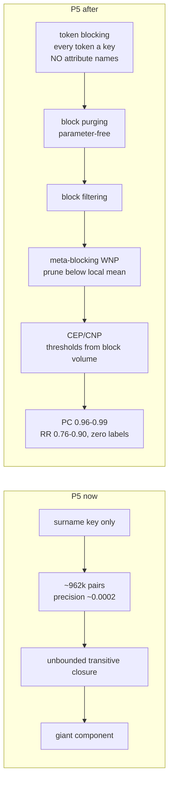

---

## P6 — No parent/subsidiary discrimination

**Rewritten in full.** This was the worst item in the previous draft and the one
the reader identified first.

### Evidence

Four company pairs in this corpus are parent/subsidiary or
jurisdictional variants, not duplicates. The previous draft's fix was a
**hardcoded suffix list** — `France`, `US`, `SAS`, `Berhad`, `Global`, `Group`,
`Holdings` — which is precisely the set of tokens appearing in those four
failures. Swap the corpus and the rule is silent.

### Why a suffix list cannot work, from the one source that tests it head-on

This is not merely an incomplete rule. **The ordering it produces is inverted:**

| pair | truth | what matchers score |
|---|---|---|
| "Acme Group Ltd" vs "Beta Group Ltd" | different companies — **reject** | **higher** |
| "Acme Group Ltd" vs "Acme Holdings Ltd" | plausibly the same — **accept** | **lower** |

*"Lower the threshold to catch pair B and you also accept pair A as a false
positive."* [T] **No threshold rescues it.** And normalisation *"does nothing for
common business-language tokens like Group, Holdings, International, Services
and Solutions"*, which appear in **5–25 % of records** and are *"sometimes
discriminative and sometimes not — a Solutions subsidiary is different from an
Industries subsidiary"* [T].

Note the distinction that resolves the apparent conflict with statutory
practice: **as normalisation before comparison**, a suffix list has precedent
(Companies House strips `Ltd`, `Limited`, `PLC`, `LLP`). **As the
duplicate-vs-subsidiary discriminator**, it is an anti-pattern. The previous
draft used it in the second role.

### The replacement the draft proposed, also retracted

The draft then offered: *"two records with different registered identifiers are
never the same entity."* **This is false**, and the primary source supplies
three counterexamples [S]:

- *"two records for ABC Company and ABC Enterprises Inc. with the same address
  and different tax IDs"* is documented as a **Possible Match**, not a rejection.
- Exclusivity only *"strongly encourage[s] the records to be kept apart."*
- One principle matches *"even if the passport is different."*

It would have been a fitted rule swapped for an unsourced absolute veto. Not an
improvement.

### Fix — three mechanisms, all with measured constants

**1. Token IDF inside the existing comparator.** `weight(token) = log(N /
count(token))`, re-derived from every corpus. *"Group"* is down-weighted because
`df("group")/N` is large — **no one writes it down**. The vendor states the
criterion in its own words: this *"automatically derives domain-specific token
importance from your actual dataset, eliminating reliance on manual rule
maintenance"* [T]. Implementation is P14.

**2. Conflicting exclusives suppress the matching rule, never the pair.**
The mechanism is a rule column headed **"SKIP ON CONFLICTING EXCLUSIVES"** [S,
p. 3]: a merge principle is suppressed when an attribute shows conflicting
exclusive behaviour. Its constants are **measured and revised online** —
frequency classes are defined by how many entities share a value, and *"when
multiple people are using the same SSN, our software detects it, labels that SSN
as generic and reevaluates all prior records"* [S, p. 1]. Which fields are
exclusive is decided by §3.5's class 4, from data, never by a list.

**3. A three-way outcome, not a binary.**

| outcome | documented example [S, p. 4] | disposition here |
|---|---|---|
| **Match** | *"two records for ABC Company with the same email address"* | auto-merge |
| **Possible Match** | *"ABC Company and ABC Enterprises Inc. with the same address and different tax IDs"* | **HITL** (P15, §3.7) |
| **Possibly Related** | *"ABC Company and XYZ Enterprises Inc. with the same address and phone number"* | **typed edge, no human** |

The person-domain analogue in the same source is the exact shape of this
problem: same account number, different dates of birth → *"more likely father
and son."*

**This satisfies the decision to discriminate rather than decline (D-02)** — it
discriminates, with constants computed from data.

### The honest limit, stated rather than glossed

Against two flat name/address sources with no populated identifier column and no
declared hierarchy row, this machinery yields a **merge-vs-related** decision but
**not the *direction*** of a hierarchy. The reason is structural: a branch is not
a separate legal person, so it has no registration number to conflict with
[DNB]. Direction requires a declared edge — which is why `company_relation` rows
matter (§3.10).

**Ceiling.** With no identifier and no declared edge, the best available outcome
for a genuine parent/subsidiary pair is *Possible Match* routed to review. The
system will not silently get it right, and it will not silently get it wrong.

**Deferred alternative — external identifier enrichment.** Resolve against
GLEIF LEI Level 2 or D&B corporate linkage, where hierarchy is carried as a
**reported, verified identifier** rather than inferred from a name [GLEIF, DNB].
**Trigger:** when an external identifier source is licensed or available. This is
the only mechanism that gives direction reliably, and no amount of string
comparison substitutes for it.

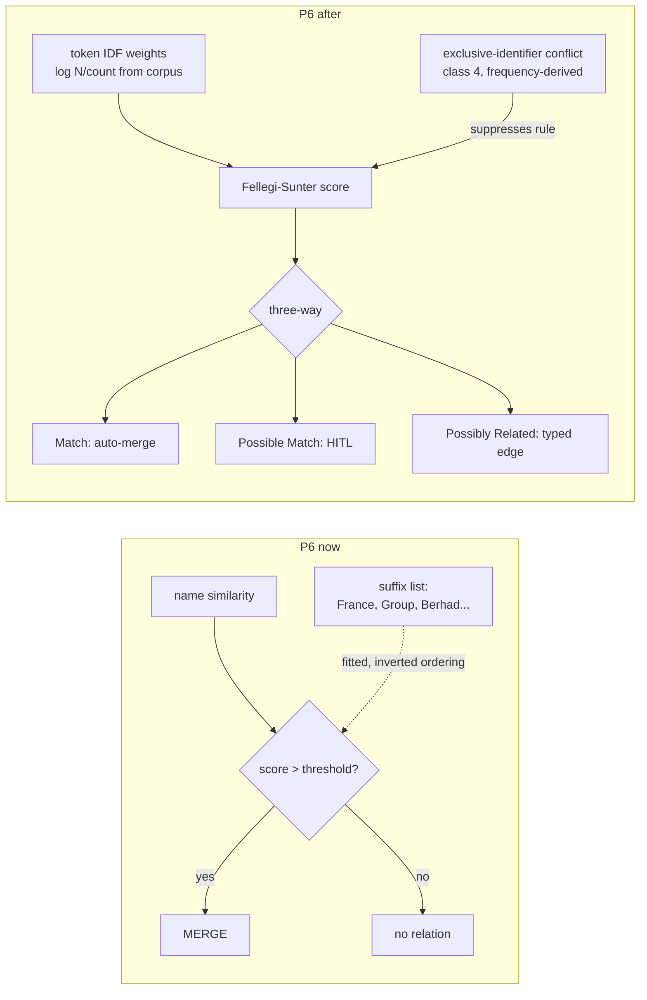

---

## P7 — No relationship derivation from the origins

**Rewritten.** The mechanism was general; the previous presentation was a list
of this corpus's table names, which is why it read as fitted.

### Evidence

`company_relation` holds **21 rows** against a ground truth with substantially
more, and no origin relationship is derived into a typed edge. The origins do
carry the information — it is present as foreign-key structure that P3's
discovery failure leaves invisible.

### Fix — state the mechanism, not the tables

1. **Run IND discovery** (P3) over all origin columns.
2. **Rank and cut at the cliff.** Surviving INDs are candidate foreign keys.
3. **Apply the junction test** (P4): minimal UCC = union of ≥2 FK column sets ⇒
   the table expresses a relationship between the two referenced entities.
4. **Self-INDs fall out free** — a column whose values are contained in its own
   table's key is a parent pointer, i.e. a hierarchy edge. Every IND algorithm
   already produces these as a by-product; nothing extra is computed.
5. **Emit typed edges.** The vocabulary is not invented here: `DIRECT_PARENT`,
   `ULTIMATE_PARENT` and `BRANCH_OF` are literal `REL_POINTER_ROLE` values in a
   shipping specification [S], and GLEIF's typed rows are
   `IS_DIRECTLY_CONSOLIDATED_BY` / `IS_ULTIMATELY_CONSOLIDATED_BY` [GLEIF].

**No table in this corpus is named anywhere in that procedure.** That is the
difference between this version and the previous one.

**Ceiling.** Acyclicity and root confirmation for a discovered hierarchy is **my
synthesis**, not a published method — labelled as such. A cyclic result is
reported, not silently broken.

**Deferred alternative — relationship-based duplicate detection.** Use the
discovered relationship graph as *evidence in the matching decision itself*,
rather than only as output [205]. Two companies sharing several neighbours are
more likely the same entity; the machinery in `resolve_entities.py`
(`_shared_neighbors_beyond_common_parent`) is present but dormant.
**Trigger:** once P3 actually produces a non-empty dependency tree — the
function has nothing to work with today, which is why it is dormant.

---

## P8 — LLM adjudication spends its budget on the wrong pairs

### Evidence

`_MAX_LLM_PAIRS = 200` per entity, selected **"closest to auto-match first"**
(`resolve_entities.py:181`); `_LLM_CHUNK_SIZE = 40` (line 186);
`_LLM_CONCURRENCY = 4` (line 189).

### Why the selection rule is backwards

Pairs closest to auto-match are the ones the probabilistic scorer has **already
decided**. Spending the entire model budget on them buys near-zero information.
The pairs where a model could change the outcome are the ones in the middle —
which P15 shows are currently not examined by anything at all.

### Why 40-per-prompt defeats the purpose

Batching forty pairs into one prompt produces one free-form response covering
forty decisions. There is no per-pair probability, no per-pair calibration, and
a single formatting failure damages all forty.

### Fix

1. **One pair per call**, returning a **calibrated probability** rather than a
   free-form score.
2. **Target the uncertain band**, not the nearly-decided one.
3. **Keep concurrency**; the cost model changes little because the *number* of
   pairs sent drops sharply once the target changes.

**Source correction.** The previous draft justified this design by citing a
vendor demonstration. That citation is withdrawn — see §2.3. The design stands
on its own logic plus the calibration literature, not on that benchmark.

**Ceiling.** A per-pair probability from a general model is not calibrated
merely because it is a number between 0 and 1. Calibration is an open item —
see P13's note and §2.17.

**Deferred alternative — the tiered arrangement in §3.6.** ANN retrieval →
Tier 0 (no model) → System-1 → System-2. The Part 1 change gets the *targeting*
right within the existing single-model structure; Part 3 adds the tiers.
**Trigger:** Part 3.

---

## P9 — No cross-run memory of human decisions

### Evidence

Every gate decision is discarded at the end of the run. Run *n+1* re-asks
everything run *n* answered, including questions a human already settled.

### Consequence

Human review is the scarcest resource in the system and it is spent repeatedly
on the same questions. This is the direct obstacle to the stated intent of
eventually replacing the reviewer with an agent (D-09): an agent trained or
prompted on past decisions needs those decisions to exist.

### Fix — Part 1 slice only

Persist gate decisions to a **file** keyed by a stable hash of the question
(entity pair, proposed structure, field mapping). On the next run, decisions
whose key matches are applied without asking, and the count of auto-applied
decisions is reported.

**Ceiling.** A file has no concurrency control, no schema, and no query surface.
It cannot answer "show me every decision about this entity" without a full scan.

**Deferred alternative — the decision store in `merge_engine`.** Indexed,
queryable, revocable, replayed on every reprocess — see §3.8 and §3.9.
**Trigger:** Part 3. The file exists so that Part 3 has a backfill source rather
than starting empty.

---

## P10 — No stage can fail a run on quality grounds

### Evidence

No stage can fail a run on its **results** — only on an exception. A run
completed `completed` having discarded 9 556 382 candidate pairs, left 78 of 99
`company.name` values NULL, and produced zero field mappings for 8 of 16
entities.

### Fix, part 1 of 2 — the pre-load gate

Before writing to the destination, compute a small set of invariants and **fail
the run** if they are violated: field-mapping coverage per entity, proportion of
NULL identity fields, largest cluster as a share of the corpus, and the
label-free signals from P16. Thresholds are proposed by the run and confirmed at
the gate rather than hardcoded.

**Ceiling.** A pre-load gate can only refuse to write; it cannot roll back a
partial write, because the write is not transactional across tables.

**Deferred alternative — stage-then-promote with a run ledger.** Write to a
staging schema, validate, promote atomically, keep the ledger. §3.3.
**Trigger:** Part 3. Note this becomes nearly free once §3.4's destination is a
projection — promotion *is* re-projection.

---

## P11 — `map_fields` is 44 % of runtime, run serially

### Evidence

`map_fields` accounts for roughly **44 %** of wall-clock time and issues its LLM
calls one entity at a time, despite each entity being independent.

### Fix

Run per-entity mapping concurrently with a bounded pool, matching the existing
`_LLM_CONCURRENCY` pattern already used in `resolve_entities`.

**Ceiling.** Concurrency is bounded by the inference endpoint, not by this code.

**No deferred alternative.** This is a straightforward parallelisation of
independent work, and §3.2 reduces its input volume anyway.

---

## P12 — Catalog tables and metadata columns are analysed and mapped

**Reframed in this revision.** The rule is not deleted; it is relocated, and the
reason matters.

### Evidence

Catalog tables and ETL metadata columns (`created_at`, `etl_batch_id`,
`_row_version`) are profiled, mapped and considered for matching as though they
carried business meaning.

### Fix — two categories, and conflating them breaks things

| category | matching | projection | corpus |
|---|---|---|---|
| **Catalog / system tables** | excluded | excluded | excluded |
| **ETL metadata columns** | **excluded** | **excluded** | **kept** |

The distinction is the point. Under the previous framing, metadata columns were
simply dropped. Under §3.2's losslessness requirement they must be **kept in the
corpus** — they are provenance — while remaining invisible to matching and to
projection.

**Configuration: three layers, per-origin.** Detected defaults (name and value
patterns computed per origin), an optional human override per origin, and a
per-run override. Per-origin support was a stated requirement (D-07).

**Ceiling.** Detection by name and value pattern will misclassify a business
field that looks like metadata (`signup_date`).

**Deferred alternative — classification by the §3.5 taxonomy.** Once fields are
classified by measured features rather than name patterns, metadata falls out as
a class rather than a list.
**Trigger:** Part 3, with §3.5.

---

## P13 — `u` is estimated on the post-blocking population

**New in this revision.** This is the live form of a problem the previous draft
discussed under the wrong name.

### The anti-pattern as named does not exist here

"Random negative sampling" does not apply to this codebase. Nothing samples
negatives: `estimate_model` (`fellegi_sunter.py:182`) performs **unsupervised
EM** over unlabelled candidate pairs. There is no negative sample to draw badly.

### The real defect

`u` means *"the probability that two **random** records agree on this field."*
EM estimates it **from the candidate set** — a population that blocking has
already filtered down to look-alikes. Estimated there, `u` comes out far too
high, which compresses `log2(m/u)` toward zero for exactly the fields that
discriminate. It is the same disease as bad negative sampling, arriving through
a different door.

### Fix

- **`u` from a random sample of the *unblocked* cross product** — a few thousand
  random pairs is sufficient and costs nothing.
- **`m` from EM on the blocked candidates**, unchanged.
- **For token-level exact agreement, use `df/N` directly** — no EM for that term
  at all. Under Fellegi-Sunter's own assumptions the per-token increment *"is
  simply `-log P_D(w)`"* [C03], which is measured, not estimated.

**Two `u` estimation paths will coexist by design** — sampled for field-level
agreement, direct for token-level. This is recorded explicitly so that a later
reader does not "unify" them and reintroduce the bug.

**Ceiling.** The sampled `u` has sampling error; for a very rare field value the
random sample may contain no agreements at all, and the estimate floors.

**Deferred alternative — calibration.** Whether the resulting probability is
*calibrated* is a separate question from whether it is correct. No source in the
surveyed set covers Platt scaling or isotonic regression for this task; the
sourced route is Belin & Rubin (1997), cited independently by both [C03] and
[FL], and not obtained.
**Trigger:** when the review band's volume justifies it — a calibrated score
makes the band's boundaries meaningful rather than conventional. Recorded as an
open item in §2.17 rather than invented.

---

## P14 — Term-frequency weighting operates at the wrong grain

**New in this revision**, and it is the general replacement for P6's suffix list.

### The mechanism already exists, one level too coarse

`build_term_frequencies` (`fellegi_sunter.py:155`) sets
`term_frequency[value] = 1/n` for a value seen once in `n` records, and
`FieldModel.weight` uses it as `u` for exact agreement. **That is already IDF, in
bits**: `log2(m/u) = log2(m) + log2(N/df)`.

It operates on the **whole field value**. `"Thales Group SA"` and
`"Thales Group France"` are two different values, so the token `"Group"` is
never down-weighted by anything.

### Why this is not "adding IDF"

Cohen, Ravikumar & Fienberg derive IDF **from Fellegi-Sunter**: under FS's own
assumptions the per-token match log-odds increment *"is simply `-log P_D(w)`. In
information retrieval terms, this is a simple un-normalized IDF weight"* [C03].

**So this is not borrowing IR machinery for a probabilistic matcher. It is
completing a derivation the code already half-implements.** That distinction is
why this fix is principled where the suffix list was not: one has a proof, the
other had a list.

The same source settles the corpus question: **`document` = one name, corpus =
the union of both sides** [C03].

### Fix

1. Add `build_token_document_frequencies` → `{field: {token: df}}` plus
   `{field: N}`, **beside** the existing function.
2. **Keep the value-level path for atomic fields.** For an atomic field, value
   grain *is* token grain, and exact whole-value agreement remains the strongest
   single signal. Nothing regresses.
3. **Change how text fields select their agreement level** — see D-14 below.
4. Persist the DF table per D-23 (global, keyed by unified-corpus field,
   snapshotted per run so a run is reproducible).
5. **Use `log₂` throughout.** The IR book's *"log base is immaterial"* remark is
   **scoped to ranking** [IIR]; this code has **absolute thresholds** at 0.95 and
   0.70, so the base is not free.

### D-14 · Comparator grain: ordinal levels with IDF-weighted similarity

**Chosen:** keep `EXACT` / `STRONG` / `WEAK` / `DISAGREE`; select the level using
an **IDF-weighted** similarity instead of a plain string similarity.

**Reason:** the EM estimator is built around discrete agreement levels. Changing
the level structure *and* the weighting in one step makes any regression
unattributable. This changes one thing.

**Ceiling:** four levels cannot distinguish "agrees on two rare tokens" from
"agrees on five common ones" — both land on `STRONG`.

**Deferred alternative — continuous token weight.** Text fields contribute
`Σ_{shared t} −log₂(df_t / N)` directly, ordinal levels dropped. Strictly more
expressive and truer to [C03].
**Trigger:** once the level-based version is measured and stable, benchmark
against it on the same corpus (D-14 decision: *"(a), with (b) as a later
benchmarked evolution"*).

**Comparator library.** `py_stringmatching` — the only one of the five surveyed
that ships `TfIdf` and `SoftTfIdf` (StringCompare's token measures are
unstarted; `comparator`'s are *"not yet implemented"*), compiled rather than
pure-Python, and it documents the tokenize-once optimisation that matters at
this pair volume [PSM]. **Two live traps:** its `SoftTfIdf` defaults (`jaro`,
θ = 0.5) **do not match the paper** (Jaro-Winkler, θ = 0.9) [C03], and it raises
on NULL input.

**Cost note, sourced:** pure TF-IDF is **~17× faster** than SoftTFIDF for MaxF1
0.79/0.84 vs 0.89/0.85 [C03]. Start with the cheap one.

---

## P15 — The review band exists and nothing consumes it

**New in this revision.**

### Evidence

`_AUTO_MATCH = 0.95` (`resolve_entities.py:62`) and `_AUTO_EXCLUDE = 0.70`
(line 63) already define three regions. **Pairs scoring between 0.70 and 0.95
are neither merged nor recorded.** The middle band is computed and then dropped.

### Fix

```
score < 0.70          ->  Exclude
0.70 <= score < 0.95  ->  POSSIBLE MATCH -> existing HITL gate
score >= 0.95         ->  Match
```

**And stop treating 0.70 / 0.95 as arbitrary constants.** RELAIS selects its
thresholds against a **plotted `log m/u` mixture showing predicted match counts
before commitment** [RL, pp. 52–55]; its own defaults are Tu = 0.90, Tm = 0.95,
but the defaults are not the method — the plot is. Show that distribution and
those counts at the gate, and let the operator commit. Same two constants, no
longer invented by the report's author.

### Why this is sourced, against an apparent contradiction in the research

The evaluation literature surveyed for this report recommends a **single**
threshold at argmax-F1 [Factil], and none of it recommends a three-way band. The
three-way decision is nonetheless standard, and the source is the statistical
record-linkage tradition rather than the ML-evaluation tradition: RELAIS is
**intrinsically three-way** — *"the pair is assigned to a clerical review
analysis"* for weights inside the interval [RL, p. 47] — and it criticises its
own **deterministic** models precisely because they *"do not admit the state of
'possiblematch'"* [RL, p. 43].

That last sentence is the cleanest available statement of what is wrong with a
suffix rule, and it comes from a national statistical institute's tool rather
than a vendor.

**Ceiling.** The band's width is a policy choice until the score is calibrated
(P13's deferred item). Wider band = more review, fewer silent errors.

**Deferred alternative — Possible Match as a persisted, revocable state with its
own queue.** §3.7.
**Trigger:** Part 3. In Part 1 the band is routed to the existing gate and
resolved within the run.

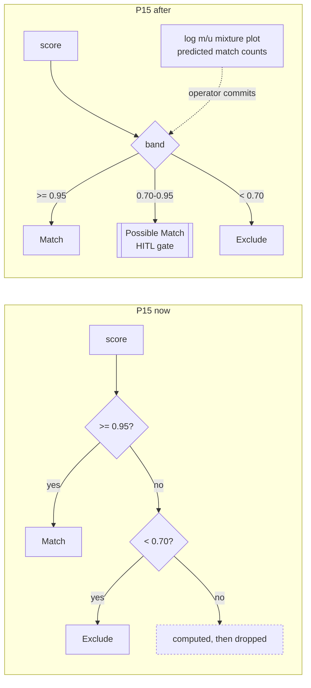

---

## P16 — No label-free quality signal

**New in this revision.** This is the answer to *"if two entities merge wrong,
how would we know? could we?"*

### The answer is yes, without ground truth

*"Without reference data, only summary statistics can be monitored"* [ERE] — and
those statistics are informative:

| signal | what a rise means |
|---|---|
| **Homonymy rate** | **under-merging** — one name, many entities |
| **Name variation rate** | **over-merging** — one entity, many names |
| **Cluster-size distribution** (Hill numbers) | a giant component is visible immediately |
| **B-cubed vs the previous run's clustering** | needs **no labels at all** |

### Fix

Compute and print all four in the run report.

**Honest caveat:** the fourth needs the previous run's clustering persisted. A
file is cheap enough for Part 1, so all four are included — but B-cubed is
available **from the second run onward**, and the report says so rather than
implying run one produces it.

**Why this is worth more than it looks.** A wrong merge and a missed merge are
not symmetric in detectability: *"A program measured on duplicates alone will
push toward over-merging, because duplicates are easy to count from the output
while wrong merges are not."* Name-variation rate is the cheap counterweight.

**Ceiling.** These are *signals*, not measurements. A rise indicates a change in
merging behaviour, not its correctness; the direction is informative, the
magnitude is not.

**Deferred alternative — persisted time series with drift alerting.** §3.13.
**Trigger:** Part 3.

---

## P17 — Destination schema defects are acted on silently

**New in this revision.** See §0.7 for the evidence.

### The conflict this item resolves

`CLAUDE.md` states: **"No new destination columns, ever."** Applied to
`public.company_industry` — which has **no `company_id` and no `industry_id`** —
that rule means industry links can **never** land, no matter how well the rest
of the pipeline works.

### Fix — report, never repair

The application:

1. **Reports the defect loudly** at the pre-load gate, naming the table, the
   missing linkage columns, and the number of rows that cannot be projected.
2. **Holds the links in the corpus** (Part 3) or in the run output (Part 1).
3. **Leaves the destination table empty** rather than loading 539 rows of pure
   key, which is what the current run does.
4. **Re-projects once the DDL is fixed** — by the schema's owner, not by the app.

**Why this shape and not an exception to the rule.** The prohibition exists
because a prompt once told the model to "prefer a new column" and the destination
schema grew from 14 columns to 43. An exception, however well justified in this
one case, re-opens that door. Reporting costs nothing and keeps the contract
intact.

**And this is the clearest demonstration of why §3.4 matters.** Under a
destructive merge those industry links are a permanent loss — the run is over,
the data is not in the destination, and nothing holds it. Under **`merge_engine`
as system of record with a derived destination**, the links sit safely in the
corpus, the table stays empty, the DDL is fixed whenever convenient, and a
**re-projection fills it with no re-merge and no re-run.** The architecture
converts a data-loss event into a pending projection.

**Ceiling.** Until the DDL is fixed, a consumer reading only `public.*` sees no
industry data at all. That is correct — it is better than 539 rows of nothing —
but it is a visible gap, not a silent one.

---

## P18 — Survivorship defects that need no new storage

**New in this revision**, collecting five verified defects in
`src/mcp_server/tools/unify_entity_group.py`.

### ① The priority direction is the opposite of what the report previously stated

`best = max(origin_priorities.get(o, 0) for _, o in candidates)` (line 170).
**Higher number wins.** With `diffbot: 1` and `zoominfo: 2`, **zoominfo wins**
contested identity fields.

An earlier draft of this report stated the opposite. The observed output was
unchanged only because P1 meant zoominfo's fields never mapped, so no conflict
ever occurred. Corrected here.

Separately: `priority: 1` meaning *lower* priority than `2` is a footgun — most
systems treat 1 as highest. The direction is documented in place rather than
reversed, because reversing it silently would change every existing
configuration.

### ② Priority is keyed per origin, never per `(origin, field)`

`origin_priorities: dict[str, int]` is keyed by origin alone. This is
**record-level source trust**, which is the anti-pattern the vendor literature
warns about explicitly: *"trust the ERP for all customer data… can quickly lead
to problems. Instead, build logic based on each attribute"* [PRO].

**Fix:** key by `(origin, field)`, falling back to the origin-level value.

Related: **`measured_reliability` is dead code** whenever priority is set,
because priority always resolves first and never returns more than one
candidate.

### ③ `completeness` = string length has no vendor support

`_completeness(value) = len(str(value).strip())`. **Reltio has no such strategy
at all** [RLT]. Only Data Ladder ships a "Longest" rule (*"highest number of
characters"*) [DL]. Profisee's "Most Complete Record" means **fewest nulls across
a record** — a different thing entirely [PRO].

**Fix:** either rename it `longest` and restrict it to text fields where length
genuinely proxies information, or replace it with Profisee's record-level
definition. Do not leave a rule whose name implies one thing and whose
implementation does another.

### ④ `first_seen` is a latent determinism bug

"First" requires a total order, and the current order is extraction order.
Reltio hit this exact bug and patched it — `sortCrosswalksInSrcSYSNonAdvanced`
exists because of it [RLT].

**Fix:** adopt the only documented last-resort tie-breaker in the surveyed
literature — Semarchy's ranking expression ending `PubID ASC, SourceID ASC`,
which gives a **total order** [SEM].

### ⑤ `numeric_max` silently discards a data-quality signal

`revenue`, `employee_count` and `*_count` resolve by `numeric_max`. Two sources
disagreeing on revenue is **an alert, not a tiebreak**. Taking the maximum
destroys the only evidence that something is wrong.

**Fix:** resolve, but **record the disagreement and its magnitude** and surface
it in the run report.

*No vendor publishes disagreement-as-alert. This is analysis, not a citation,
and is labelled as such.*

**Ceiling of all five.** These repair the rules; they do not make survivorship
non-destructive. The values that lose are still gone at the end of the run.

**Deferred alternative — read-time survivorship over a lossless corpus.** §3.4.
**Trigger:** Part 3. That is where "the loser is still retrievable" becomes true.

---

## P19 — Blocking is tuned against the outcome it is supposed to feed

**New in this revision.**

### The anti-pattern

Tuning blocking parameters by looking at final match quality is circular: the
blocking is being optimised against a metric that blocking itself constrains.
There is a named, published instance — **pBlocking/BEER** tunes blocking against
match quality — so this is a real practice, not a hypothetical.

### The doctrine, sourced

> Judge blocking on **recall, reduction ratio and FNR — deliberately ignore
> precision, F1 and FPR.** [BP]

### Correction to this report's own earlier fix

An earlier draft proposed tuning on pair completeness and pairs quality.
**`recordlinkage` ships only `reduction_ratio`; `pairs_completeness` and
`pairs_quality` do not exist in its evaluation API**, verified on both `/latest/`
and `/stable/`. More importantly, **PC and PQ require ground truth**, which we
will not have for each new database.

Note the asymmetry worth printing in the report: the library ships the metric
that **flatters** aggressive blocking (reduction ratio) and omits the one that
**catches its cost** (pair completeness).

### Fix — tune per database, on zero-label quantities only

Everything in P5's table is computed from the block collection itself:
parameter-free purging, WNP's local mean, `K = Σ|b|/2`, `k = Σ|b|/(|E1|+|E2|)`.
**Report PC and PQ only where ground truth exists** — for this corpus it does,
so they appear in Part 4; for a new database they will not, and their absence is
not a gap to fill with a guess.

**Ceiling.** Without labels, blocking recall is unmeasured. The zero-label
constants are defensible defaults, not optimised ones.

**Deferred alternative — measured PC/PQ against a labelled sample.**
**Trigger:** when a labelled sample exists for a given database, e.g.
accumulated from HITL decisions via §3.9. Note the sampling caveat in §2.17:
metrics computed on a non-random sample need **inverse-cluster-size weights**.

---

## P20 — Clustering amplifies every matching error

**New in this revision.**

### Evidence

Transitive closure over pairwise edges is unbounded. One wrong edge merges two
otherwise-correct clusters, and the effect compounds: *"a single pairwise
misclassification … causes a large number of implicit false positives"* [LIN].
That sentence is the giant component in this run, described exactly.

### Fix — four steps, no graph database

1. **Prune weak edges first**, using **meta-blocking's own edge-weight
   threshold** (WNP's local mean — zero-label). *Not* a hand-set confidence
   cut, which would reintroduce a tuned constant at the clustering step.
2. **Connected components on the surviving strong edges** —
   `scipy.sparse.csgraph.connected_components`, already an installed dependency.
3. **Coherence split**: test each cluster and split where members are
   inconsistent, using P16's within-cluster **name-variation rate**.
4. **LP-based 1:1 reduction** where strict one-to-one matching is required —
   the documented form is an optimisation maximising summed weights [RL, p. 52].

### Neo4j, assessed and rejected

Neo4j plus GDS buys one function we already have. Weakly Connected Components
over ~34 000 edges is a single scipy call. A graph database is a container, a
schema, a query language and an operational burden for that one call.

**More importantly, WCC is not the right clustering regardless of who
implements it** — it is precisely the operation that produced the giant
component. The problem is edge precision and cluster coherence, not the graph
library.

**Ceiling.** Connected components with a coherence split is a heuristic. It has
no global objective and no guarantee.

**Deferred alternative — correlation clustering, or the LP formulation
generally.** A global objective rather than a local split rule.
**Trigger:** when cluster quality is measured and the split heuristic is shown
to be the binding constraint. Do not pre-emptively adopt an optimisation whose
cost is superlinear before the cheap version is shown to fail.

---

## Part 1 ordering and dependencies

**The order changed in this revision.** One dependency is hard and getting it
wrong makes the system measurably worse before it gets better.

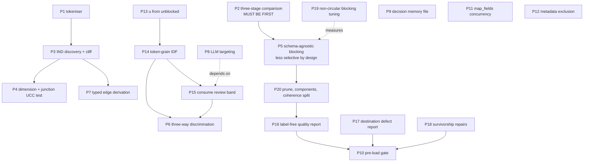

**The hard constraint, stated plainly:** P5's replacement produces candidate
sets with **RR 0.76–0.90**, against a hand-picked key's far higher reduction.
Ship P5 before P2 and the first run afterwards generates **more** comparisons
than the current code, not fewer. P2's block cleaning and meta-blocking are what
make P5 affordable.

**Recommended sequence:** P2 → P5 → P1 → P3 → P4 → P13 → P14 → P15 → P6 → P7 →
P8 → P20 → P16 → P19 → P11 → P12 → P17 → P18 → P9 → P10.

### Net speed effect of Part 1

Per the standing decision that **quality is the first and only priority for now**
(D-05), no fix here is traded away for speed. The net effect is nonetheless not
a slowdown:

| change | direction | why |
|---|---|---|
| P5 token blocking | **slower** | more candidates generated |
| P2 purge + meta-block | **much faster** | most of those candidates never compared |
| P13 `u` sampling | negligible | a few thousand extra pair comparisons, once |
| P14 token IDF | slightly slower | tokenisation per field; pure TF-IDF is ~17× cheaper than the soft variant [C03] |
| P8 LLM retargeting | **much faster and cheaper** | far fewer pairs sent, and they are the ones that matter |
| P11 concurrency | **faster** | 44 % of runtime parallelised |
| P20 pruning before closure | **faster** | closure runs over a smaller, cleaner graph |

The two measured runs took 828.1 s and 395.4 s (warm LLM cache). Part 1 is not
expected to exceed the cold-cache figure.

---

# PART 2 — Research, cited

**How to read this part.** Every mechanism is tagged **GENERAL** (its constants
are computed from data at runtime) or **FITTED** (its constants are literals from
a particular corpus). Where a source was unreachable, that is recorded as a fact
rather than worked around — see §2.21. Where a claim is my own inference rather
than a source's statement, it is labelled as inference in place.

## 2.0 Source access — disclosed

Reached and used: [R1] [R2] [R3] [R4] [R5] [R6] [R7] [R8] [R9] [R10] [R11]
[R12] [R13] [R14] [R15].

**[R14] and [R15] were initially unreachable over the network and were supplied
as local PDFs** (`docs/entity_resolution_blocking_survey.pdf`,
`docs/1-s2.0-S0888613X17300439-main.pdf`). Both are now read in full and cited
to section throughout; §2.10 and §2.11 cover them.

**Still not reached; not cited as evidence:**

| source | outcome |
|---|---|
| `medium.com/neo4j/i-tested-jev-on-entity-resolution-e7249f219ca6` | HTTP 403 — findings taken from the companion repository [R3] instead |
| `sciencedirect.com/science/article/abs/pii/S0020025525010898` | HTTP 403 — reached only as a search-result summary [R5b] |

[R1], [R14] and [R15] were extracted from PDF to text locally; section numbers
refer to each paper's own numbering.

## 2.1 Blocking and filtering — the canonical survey [R1]

**Formal measures** [R1 §2], verbatim:

```
Pair Completeness   PC(B)   = |D(B)| / |D(E)|     ∈ [0,1]
Pairs Quality       PQ(B)   = |D(B)| / ‖B‖        ∈ [0,1]
Reduction Ratio     RR(B,E) = 1 − ‖B‖ / ‖E‖       ∈ [0,1]
```

> *"Higher values for PC indicate higher effectiveness of the blocking scheme,
> while higher values for PQ and RR indicate higher efficiency. Note that PC
> provides an optimistic estimation of recall, presuming the existence of an
> oracle, while PQ provides a pessimistic estimation of precision, treating as
> false positives the repeated comparisons between duplicates."*

**Definition 3 (Blocking)** [R1]: *"Given an entity collection E, Blocking
clusters similar entities into a block collection B such that PC(B), PQ(B) and
RR(B, E) are simultaneously maximized."* The paper adds that blocking is
*"typically treated as an engineering task"* because true duplicates are
unknown — which is what ER computes.

**Workflow** [R1 §3–4, Fig. 1(b)]: **Block Building (BlBu) → Block Cleaning
(BlCl) → Comparison Cleaning (CoCl)**.

**Block Building taxonomy** [R1 §3]: Standard Blocking; Sorted Neighborhood
(sliding window over a sorted order); Q-gram blocking; Suffix Arrays; Canopy
Clustering (cheap approximate distance to form overlapping canopies); LSH.

**Block Cleaning** [R1 §4.1] — static vs dynamic. The governing assumption,
verbatim:

> *"the larger a block is, the less likely it is to contain unique duplicates,
> i.e., matches that share no other block. Such large blocks are typically
> produced by lazy schema-agnostic techniques and correspond to stop words."*

- **Block Purging** — *"discards blocks that exceed an upper limit on block
  cardinality or size."*
- **Block Filtering** — *"applies this assumption to individual entities,
  removing every entity from the largest blocks that contain it. In other
  words, it retains every entity in r % of its smallest blocks."*
- Also: Size-based Block Clustering (hierarchical, merges small / splits large
  under a penalty function); MapReduce dynamic blocking; `MaxIntersectionMerge`
  (ensures every block has ≥ |b|min entities); Rollup Canopies (learning-based
  greedy merge of small blocks to raise PC).
- **Dynamic**: Block Scheduling *"optimizes the processing order of blocks"*;
  Block Pruning extends it by exploiting *"the decreasing density of detected"*
  duplicates.

**The result that answers the P2 question** [R1 §4.1]:

> *"both Block Filtering and Block Purging boost PQ and RR by orders of
> magnitude, while exhibiting a low computational cost and a negligible impact
> on PC."*

With the parameter guidance:

> *"Block Filtering is typically applied after Block Purging by lowering r to
> 50 % instead of 80 %, which is the best configuration when applied
> independently."*

And the caution that they are complementary — *"multiple ones can be applied
consecutively in a single blocking workflow."*

**Comparison Cleaning** [R1 §4.2] — mutually **exclusive**, unlike Block
Cleaning:

> *"applying any Comparison Cleaning technique to a redundancy-positive block
> collection deprives it from its co-occurrence patterns and renders all other
> techniques inapplicable. These techniques also involve a much higher
> computational cost than Block Cleaning methods, due to their finer level of
> granularity."*

Cornerstone method: **Comparison Propagation**, which *"propagates all executed"*
comparisons to avoid repeats. Meta-blocking was *"formalized into a more
principled approach"* subsequently.

**Edge-weighting schemes** [R1 §4.2], verbatim:

> *"ARCS sums the inverse cardinalities of the common blocks, giving higher
> weights to entity pairs that co-occur in smaller blocks. CBS counts the number
> of blocks shared by two entities, with ECBS extending it to discount the
> contribution from entities placed in many blocks. JS corresponds to the
> Jaccard coefficient of two block lists, while EJS extends it to discount the
> contribution from entities appearing in many non-redundant comparisons.
> Finally, Pearson's χ² test assesses whether two adjacent entities appear
> independently in blocks."*

Also noted: **Transitive LSH** converts LSH blocks into an unweighted blocking
graph and applies community detection, finishing *"when the size of the largest
cluster is lower than a predetermined"* bound — the model for P5.3.

**Pruning efficacy** [R6]: *"Graph Partitioning prunes 50 % more comparisons
for practically no impact on recall"*; *"Reciprocal Pruning applies to any
blocking graph, retaining only the edges that are important for both adjacent
entities."*

### Direct application

| finding | application |
|---|---|
| PC / PQ / RR, maximise simultaneously | a global comparison cap maximises RR by destroying PC — the one trade the definition forbids (P2) |
| large blocks ≈ stop words, unlikely to hold unique duplicates | justifies per-value block purging over global truncation (P5.2) |
| purge + filter: orders of magnitude on PQ/RR, negligible PC loss | the answer to "reduce comparisons without dropping real ones" (P2) |
| r = 50 % after purging | concrete starting parameter |
| redundancy-positive precondition | **multi-pass must precede purging** — ordering constraint in Part 1 |
| ARCS weights pairs in *smaller* blocks higher | discriminates the 2-member email block from the 60-member Kumar block (P2 stage 3) |
| Transitive LSH stopping criterion | model for bounded closure (P5.3) |

## 2.2 Semantic Graph Blocking [R2]

Evaluates Standard Blocking (SB), Sorted Neighborhood (SN) and **Semantic Graph
Blocking (SGB)** — blocking *"based exclusively on the relations between
entities, including foreign keys in a database or links in RDF data"* — on
synthetic databases and the Citeseer reference database across partitions
Par1–Par3, under Strict and Weak Record Linkage.

**Weak RL, Par3:**

| method | pairs found | true positives | recall | precision |
|---|---|---|---|---|
| SB | 1 669 | 21 | 55.3 % | 1.3 % |
| SN | 480 | 20 | 52.6 % | 4.2 % |
| **SGB** | **32** | **22** | **57.9 %** | **68.8 %** |

**Strict RL, Par1:** SGB — 14 true matches, 31.6 % recall, 87.5 % precision.

Reported further: SGB imposed *"the smallest review effort … significantly
better than SB and SN because of smaller chances to accept false positives"*;
reduced false-positive ratios *"by two orders of magnitude"* in optimal cases;
and needs *"only one pass versus multiple passes needed by SB/SN."* The authors
recommend SGB **wherever relationship data exists.**

The related notion of **collective blocking** — where *"the way records for an
entity are placed in blocks may influence the way the records for another
entity are assigned to blocks"* [R7] — is the generalisation: blocking persons
by employer while blocking companies simultaneously.

### Direct application

This **is** the "block within company first" idea, published and measured.
52× fewer pairs with one *more* true positive than Standard Blocking, and
precision from 1.3 % → 68.8 %. It becomes available to merge-engine only after
P3 (join discovery) and P7 (relationship derivation) — which is the strongest
argument for their priority.


## 2.3 JEV + Neo4j — **demoted from benchmark to illustration** [R3]

**This section was rewritten. The previous version called it "the closest
comparable end-to-end result" and quoted its F1 as evidence. That was wrong, and
the way it was wrong is instructive.**

### What the repository actually is, verified by inspection

| property | finding |
|---|---|
| **License** | **none — no LICENSE file.** Default is all-rights-reserved; it could not be vendored even if desired |
| **History** | **1 commit, 0 stars, 0 watchers** |
| **Shape** | `src/jevdemo/{data_gen,load_graph,blocking,run_benchmark,metrics,charts}.py` — a **benchmark harness**, not a library; nothing is importable as a component |
| **Data** | **synthetic, self-generated**: 703 records, 330 people, **541 duplicate pairs it injected itself** (nicknames, typos, email/phone mutations, same-name twins) |
| **Matcher** | **proprietary hosted API** — TypeSafe AI "System One", `TYPESAFE_API_KEY` |
| **Blocking** | **hard-coded `phone OR last-name`** in `blocking.py`. No key selection |
| **Infra** | Neo4j 2026.08 + GDS plugin via Docker |

### Why citing it was a methodological error, not just an overstatement

Its reported F1 0.943 / P 0.916 / R 0.971 is measured on **duplicates the same
codebase injected**, retrieved by **hand-picked keys**, judged by a **closed
model**. None of those numbers transfer.

**And the previous draft cited its hard-coded `phone OR last-name` key
approvingly on the same page where it copied that pattern into P5.** The
report's own anti-pattern, endorsed by the report's own citation. This is
recorded because it shows how a fitted rule gets laundered: not by asserting it,
but by pointing at someone else who did it and calling the result a benchmark.

### What survives, and is adopted on its own merits

| idea | adopted where | justified by |
|---|---|---|
| **One pair per call, calibrated probability** | P8 | its own logic plus [C03], [FL] — **not** this benchmark |
| **Clustering as an explicit graph algorithm over scored edges** | P20 | [LIN]'s analysis of pairwise error amplification |
| Its blocking keys | **discarded** | §0.6 |
| Neo4j / GDS | **rejected** | P20 — one scipy call |

**Tag: FITTED** (blocking keys), and the benchmark is not usable as evidence.

---

## 2.4 Zingg [R4], [R8] — **one claim corrected**

**The previous draft credited Zingg with "union-not-intersection blocking." That
claim is fabricated.** The documentation was code-searched and the word `union`
appears in **none** of its markdown.

### What Zingg actually documents

- **A greedy blocking tree:** *"at every node, Zingg selects the function and the
  field that produces the least elimination of your known matching pairs."*
- **`verifyBlocking`**, with `counts` and `blockSamples` outputs, **run before
  labelling** — i.e. blocking is validated on its own terms before any matching
  quality is known. That is the practice P19 adopts, and Zingg is a legitimate
  citation for it.
- **Label volume:** 30–50 match pairs, with the caveat that *"the blocking model
  may need more."*

### Why Zingg is nonetheless disqualified as P5's mechanism

Its blocking tree selects **a function and a field** — a named attribute. Like
BSL and dedupe, it presumes a stable schema. **Tag: GENERAL in mechanism, but
requires a fixed schema**, which disqualifies it here (§2.12).

---
## 2.5 Library comparison — Splink / Zingg / Dedupe [R9]

**On blocking.** Splink exposes blocking explicitly with *"interactive
diagnostics."* The central risk, stated in one line: *"bad blocking can miss
real matches or create overloaded blocks."*

**merge-engine is doing both at once** — overloaded blocks (surname) *and*
missed matches (the 250 k cap). These are normally a trade-off; here both
failure modes are present simultaneously.

**On scale.** Splink spans *"DuckDB for local work"* through *"100M+ record
jobs"* on Spark/Athena. Zingg requires Spark 3.5.0. Dedupe's convenience methods
target *"small-to-moderate datasets"*; larger ones *"require custom pair
generation, scoring and engineering."*

**merge-engine already uses Splink on DuckDB, so the backend is nowhere near its
limit at 13 518 records. No part of this run's failure is backend-attributable.**

**On outgrowing these libraries.** The stated transition point is when *"the
resolved entity has to become a real-time identity service"* — needing an
authenticated API, entity-graph maintenance, incremental updates and
low-latency access. merge-engine is a batch pipeline with a HITL loop, so **this
threshold does not apply and there is no case for replacing Splink.**

## 2.6 Unsupervised blocking key selection [R5], [R5b]

> **Revision note 2026-09-29. Superseded as a mechanism, retained for its
> reasoning.** Discriminability × coverage is a sound way to *score* a candidate
> blocking key — but it presumes there is a stable named attribute to score.
> Because every incoming database has its own schema (§3.2), key *selection* is
> disqualified outright; see §2.12. What survives is the underlying idea that a
> key's worth is a measurable property of the data rather than a matter of
> judgement, which is the principle P5 and P19 both rest on.


Each attribute is assigned a **discriminability** score — *"the portion of
distinct values over all values in the given dataset"*; for each attribute with
high discriminability, **coverage** is estimated — *"the portion of entities
that contain it"* — and *"the harmonic mean of discriminability and coverage is
then computed for all valid attributes"* [R5].

Motivation: *"To make the entity resolution process less dependent on human
domain knowledge, automatic selection of optimal blocking keys is required."*
[R5b] notes that existing approaches are *"either based on supervised methods
(which require preexisting labels) or explore solutions guided by specific
goals and restrictions, making them unsuitable for user-configured scenarios"* —
which is the argument for a hybrid: automatic proposal, human ratification.

### Direct application — and its limit

This is the formula behind P5's key selection, and it validates the
profile-driven design. **But it would not alone have saved this run**, and the
reason is instructive: `lastname` scores *well* on it (coverage ≈ 1.0,
discriminability ≈ 0.6, harmonic mean ≈ 0.74). Attribute-level statistics cannot
see that individual *values* are Zipf-distributed and "Kumar" behaves as a stop
word.

**Attribute-level selection picks the key; value-level purging [R1 §4.1]
handles bad values inside a good key. Both are required.** merge-engine had a
plausible key and no mechanism for the second.

## 2.7 Semantic / embedding-based entity resolution [R10]

> **Revision note 2026-09-29. The conclusion here has split in two, and the
> split matters.** Embeddings are **adopted for candidate retrieval** (§3.6's ANN
> tier, where a cached index over reusable entity vectors is exactly the right
> shape) and **still rejected as the primary scorer**. The reason for the second
> half is now sourced rather than cautionary: a scalar similarity cannot express
> "Model X1" vs "Model X2" (−16 %/−18 % F1 against a learned head) [KAR], and
> three independent results show an unsupervised Fellegi-Sunter scorer is
> competitive with learned matchers at a fraction of the cost (§2.19).


Uses language models *"to bring an increased level of automation to schema
alignment, blocking, matching and even merging duplicate nodes and edges."*
**Semantic blocking** encodes records with sentence-transformer models into
dense vectors and clusters on cosine similarity, which *"leverages the rich
contextual understanding of modern language models to capture deeper
relationships between the fields of records, even when their strings differ
dramatically"* — versus traditional reliance on *"string distance, static rules
or complex ETL."*

Benchmark cited: **Ditto** (2020, BERT-based) *"beating previous benchmarks by
as much as 29 %"*; the author reports using it for *"billions of nodes"* in
2021. A demo matched 39 company records *"without a single mistake."*

### Assessment — deliberately not recommended yet

The demo is a proof of concept, not a benchmark, and the article gives **no cost
comparison** against rule-based blocking. Embedding blocking would be a
reasonable *additional pass* in the disjunctive scheme later — it is well suited
to the `SPEEDCAST FRANCE SPEEDCAST` / `Speedcast` string-divergence case — but
it is the wrong first move here, for two reasons: it requires embedding
infrastructure merge-engine does not have, and it would not fix any of the
twelve defects, which are wiring and parameter faults. Revisit once Part 1 is
landed and residual recall loss is measured.

### A third reason, from the survey — and it is specific to this pipeline

[R14 §6.4.4] documents that CRUD support in vector indices is *"non-trivial"*:

> *"**Insert:** FAISS indices support add, but some (e.g., IVF) require periodic
> retraining. **Update:** No native UPDATE; must delete old vector and insert
> new one. Requires maintaining external mapping from entity IDs to FAISS
> offsets. **Delete:** Some indices support remove_ids; others require
> mark-and-rebuild."*

The recommended mitigation is *"a bidirectional mapping between entity IDs and
FAISS internal IDs"* using `IDMap`/`IDMap2` wrappers [R14 §6.4.4].

**merge-engine is an incremental pipeline.** Its correctness already depends on
persisting cluster assignments across runs (§3.1), and an embedding index would
add a *second* piece of cross-run state with weaker update semantics — no native
UPDATE, periodic retraining, and an external id mapping to keep consistent with
`entity_map`. That is a meaningful new failure surface for a system whose
present defining weakness is that it cannot detect its own inconsistency (P10).

[R14 §6.6] adds the operational cost: *"Training data requirements"* (supervised
methods need labelled pairs — which merge-engine does not yet retain, see P9),
*"Computational cost: Neural encoding is slower than hash-based blocking"*, and
*"Infrastructure complexity: Requires GPU-accelerated training and specialized
ANN libraries."*

Balanced against that, the survey's own benchmark section reports that
*"vector-based methods with neural embeddings achieve superior recall and
reduction ratios compared to classical approaches"*, with DeepBlocker and
SC-Block achieving the better recall-efficiency trade-offs [R14 §6.5]. The named
lineage is DeepER → AutoBlock → DeepBlocker → Ditto → Sudowoodo → SC-Block
[R14 §6.2].

**So the verdict is "not yet", not "no".** The sequence that makes it viable:
land Part 1 → accumulate labelled pairs via P9's decision memory → measure
residual recall loss → then evaluate an embedding pass with training data that
exists and an incremental story that has been thought through.

## 2.8 ReAct [R11], [R12]

**The loop** [R11]: **Thought** (verbal reasoning traces), **Action**
(task-specific commands to an environment), **Observation** (environment
feedback). The key property, verbatim:

> *"reasoning traces do not affect the external environment. Instead, they
> affect the internal state of the model by reasoning over the context."*

**Versus chain-of-thought** [R11]: CoT reasons self-containedly with no
environmental grounding and relies on internal knowledge, producing
hallucination — the paper's example has CoT confidently asserting a false film
release date. ReAct retrieves facts to support reasoning while *using* reasoning
to *"target what to retrieve next."*

**Stated strengths** [R11]: interpretability through visible trajectories; gains
on QA, fact verification and interactive decision-making; human-in-the-loop
collaboration via editable reasoning traces.

**Stated limitation** [R11]: ReAct requires *"sparse reasoning"* for
decision-making tasks with many actions — it degrades where actions are dense.

**Components** [R12]: an LLM core *"as the agent's 'brain'"* requiring *"highly
capable models with advanced reasoning and instruction-following ability"*;
**tools**; a **scratchpad**; and **optional memory** to *"learn from past
mistakes and successes."*

**When ReAct is the wrong choice** [R12], verbatim: function calling is
preferable for *"straightforward, predictable tasks"* and *"can execute faster,
save tokens, and be simpler to implement than a ReAct agent."* ReAct's iterative
loops are *"inefficient"* for deterministic pipelines. Mitigations offered: a
maximum loop-iteration count, smaller models for delegated subtasks, confidence
thresholds for early termination.

## 2.9 Orchestration and multi-agent systems [R13], [R7]

**Patterns** [R13]: **centralized** (one orchestrator as *"the 'brain' of the
system"*), **decentralized** (independent or consensus decisions),
**hierarchical** (*"layers, resembling a tiered command structure"*),
**federated** (*"without fully sharing data or relinquishing control"*).

**Documented failure modes** [R13]:
- *"widespread failure"* where agents share vulnerabilities
- coordination failures — agents *"working against each other or duplicating efforts"*
- scalability collapse — *"delays or system failures"* under load
- single points of failure at a centralized orchestrator
- data-security exposure, since agents *"frequently process and share sensitive information"*

**Multi-agent advantages** [R7]: they *"tend to outperform single-agent systems
due to the larger pool of shared resources"*, the mechanism being that
*"instead of multiple agents learning the same policies, one can share learned
experiences to optimize time complexity and efficiency"*; each agent *"can hold
specific domain expertise."*

**Caveat, stated honestly:** [R7] argues the *advantages* of multi-agent systems
and offers **no explicit criteria for when a task should not be split.** The
negative recommendation in §3.3 therefore does **not** rest on it. It rests on
[R12]'s explicit "predictable tasks" guidance, [R13]'s failure-mode list, and
this run's measured evidence.

## 2.10 Blocking survey and architecture analysis [R14]

> **Revision note 2026-09-29.** This section's prescription is now actually
> followed. The 2026-09-26 draft cited it and then hand-picked four blocking keys
> two sections later (§0.6). P5 adopts the pipeline described here — token
> blocking, parameter-free purging, meta-blocking with locally derived thresholds
> — and nothing else.


Gurevich, December 2024. Categorises blocking into **logic-based** (key/hash,
rule-based), **statistical** (token-based, q-gram), **cryptographic** (Bloom
filters), **LSH**, and **learned** (vector-based, neural) approaches, then adds
an architecture analysis for distributed ER.

**Complexity figures** (§2–§7):

| method | time | space |
|---|---|---|
| Standard Blocking | O(N) | O(N) |
| Sorted Neighborhood | O(N log N + N·w) | O(N) |
| Token-based | O(N · m̄) where m̄ = avg tokens/record | O(N · m̄) |
| K-means blocking | O(N · K · d · T) | — |

On k-means as a blocker (§7.1), the stated dilemma is the same trade in another
form: *"Selecting K: too small yields large blocks (inefficient); too large
risks splitting true matches."* Hierarchical and density-based alternatives
*"generally scale poorly (O(N²) or worse)"* (§7.2).

**Reference architecture** (§9.1) — the seven JedAI phases, tabulated against
merge-engine in §3.6. The missing phase is **Block Filtering**.

**Meta-blocking** (§9.3): *"Block merging: Merge highly overlapping blocks
(Jaccard similarity > τ). Pair weighting: Assign weights to pairs based on
co-occurrence frequency; prune low-weight pairs."*

**Transitive closure** (§9.4, Algorithm 5): build G = (V, E) over match edges,
compute connected components; for large graphs use distributed graph processing
(GraphX, Giraph).

**Incremental / streaming ER** (§9.5): Insert adds to the index and matches
against existing blocks; Update is remove-then-insert; Delete removes from index
and clusters. Named challenges: *"Maintaining index consistency (especially for
vector indices requiring retraining)"* and *"Propagating updates through entity
clusters (transitive closure)."*

**Hybrid approaches** (§10.1): **ensemble** (union of blockers, improves recall)
and **cascaded** (*"fast, coarse blocker first, then refine with more expensive
method"*).

**Active learning** (§10.2): parameter selection for LSH K and L, k-means K, and
similarity thresholds *"is challenging"*; active learning *"can guide parameter
tuning by soliciting labels for ambiguous pairs."*

**LLMs** (§10.3): few-shot matching and in-context clustering are possible, but
*"LLMs have prohibitive cost for blocking (due to quadratic comparisons). Future
work may integrate LLMs selectively, e.g., for refining ambiguous candidates
post-blocking."*

**Neural blocking** (§6.2–6.6): lineage DeepER → AutoBlock → DeepBlocker → Ditto
→ Sudowoodo → SC-Block; benchmarks favour DeepBlocker and SC-Block on the
recall-efficiency trade-off (§6.5); limitations are labelled-data requirements,
encoding cost, and *"Infrastructure complexity: Requires GPU-accelerated
training and specialized ANN libraries"* (§6.6); vector-index CRUD is
*"non-trivial"* (§6.4.4).

**Open challenges** (§10.4): *"Heterogeneous schemas: Most methods assume fixed
schemas; adapting to schema drift remains difficult"* — directly relevant, since
merge-engine's entire problem is two origins with different spellings of the
same concept; *"Multi-modal data"*; and *"Fairness and bias: Blocking may
introduce demographic biases if keys correlate with protected attributes."*

### Direct application

| finding | application |
|---|---|
| JedAI seven phases; Block Filtering absent in merge-engine | reframes P2 as a missing architectural phase, not a missing technique (§3.6) |
| cascaded blocking | new refinement added to P5.1 — cheap passes first, `pg_trgm` only on survivors |
| LLMs selectively, post-blocking only | independent endorsement of P8's stage placement |
| in-context clustering as an LLM pattern | the pattern to **avoid** — it is what 40-pairs-per-prompt approximates (P8) |
| vector-index CRUD difficulty | third, pipeline-specific reason embedding blocking is "not yet" (§2.7) |
| incremental ER: propagate closure updates | supports persisting `entity_map` (§3.1) |
| fairness and bias | new §5.4 — surname blocking is a fairness defect, not only a quality one |
| heterogeneous schemas as an open challenge | context for P1/P4 being genuinely hard, not merely unfinished |

## 2.11 ERBlox — matching dependencies with machine learning [R15]

Bahmani, Bertossi & Vasiloglou, *International Journal of Approximate
Reasoning* 83 (2017) 118–141. Integrates four components: an ML classifier for
duplicate/non-duplicate pairs; **MDs supporting the blocking phase**; record
merging from classifier results; and LogiQL (a Datalog extension on LogicBlox)
for specification and enforcement.

**The problem statement** (§1) — the clearest articulation of this run's person
failure found in any source:

> *"Although blocking will discard many record pairs that are obvious
> non-duplicates, some true duplicate pairs might be [lost due to] low
> sensitivity of blocking keys. More interestingly, similarity between blocking
> key values alone may fail to capture the relationships that naturally hold in
> the data and could be used for blocking. Thus, entity blocking based only on
> similarities of blocking key values may cause low recall. This is a major
> drawback of traditional blocking techniques."*

**Collective blocking** (§1):

> *"Records for different entities may be related via attributes in common and
> referential constraints, something the blocking mechanism could take advantage
> of. Blocking can be performed on each of the participating entities, and the
> way records for an entity, say Author, are placed in blocks may influence the
> way the records for another entity, say Paper, are assigned to blocks. This is
> called 'collective blocking'. … So, blocking decision making forms a
> collective and intertwined process involving several entities."*

Their construction is *"based on blocking keys **and** the enforcement of
semantic information about the relational closeness of entities"*, captured as
MDs — hence **MD-based collective blocking**.

**Matching dependencies** (§1):

> *"Matching dependencies are declarative logical rules that tell us under what
> conditions of similarity between attribute values, any two records must have
> certain attribute values merged (or matched), i.e. made identical."*

Example MD form: `Dept[Dep] ≈ Dept[Dep] → Dept[City] ≐ Dept[City]` — similarity
on the left, forced identity on the right. MDs also drive the merge phase:
*"when and how to merge is specified by matching dependencies, which invoke
matching functions"* (§1).

**Experiments** (§8). MAS dataset: 250 K authors, 2.5 M papers; author training
and test sets of 3 739 and 2 244 cases; 70/30 split, cross-validated; same SVM
throughout; three datasets including DBLP.

Findings, in their own terms:

- Standard key-equality blocking has the **highest reduction ratio and highest
  precision** but *"is very conservative, and has a very low rate of recall,
  i.e. many of the true candidate duplicate record-pairs are not identified as
  such."*
- *"Precision and recall of MD-based collective blocking are higher than the two
  standard blocking techniques. This emphasizes the importance of MDs that
  support collective blocking, and shows that **blocking based on string
  similarity alone fails to capture the semantic interrelationships that
  naturally hold in the data.**"*
- The cost, stated plainly: *"MD-based collective blocking has lower reduction
  ratio than standard MD-based blocking … larger blocks may be produced, and
  then, more candidate duplicate record-pairs become inputs for the classifier.
  In blocking, this is a common tradeoff that needs to be considered."*
- Overall: *"the quality of MD-based collective blocking dominates standard
  blocking, both in its key-based and MD-based forms, for the three datasets."*

**Related work** (§9) notes an unsupervised collective-deduplication approach
building *"a relationship graph … whose nodes are the entities (records), and
edges indicate entities which co-occur"*, where *"the similarity between two
nodes is calculated as the weighted sum of the attribute-value similarity and
their relational similarity."* That weighted-sum form is essentially what
`_shared_neighbors_beyond_common_parent` computes, once P7 supplies it edges.

### Direct application

| finding | application |
|---|---|
| MD-based collective blocking | the formal name for the employer-blocking idea (§5.1) |
| "string similarity alone fails to capture semantic interrelationships" | the precise diagnosis of the 42-Kumar failure |
| MDs as declarative merge/non-merge rules | the formalism behind `never_merge` / `always_merge`; settles pair-vs-predicate as one table with a `scope` column (P6) |
| MDs usable for blocking *and* merging | a never-merge rule can suppress candidate generation, cheaper than generate-then-reject (P6) |
| lower reduction ratio for collective blocking | **contradicts [R2]'s 52× reduction** — resolved in §5.1 by distinguishing additive from replacing composition |
| relational similarity as a weighted sum | the shape P7's edges should feed into |
| LogiQL / Datalog enforcement | **not adopted** — formalism taken, engine choice rejected as disproportionate (P6) |


## 2.12 Learning a blocking scheme — BSL, and why it cannot be used here [M06]

`docs/michelson06-aaai.pdf` is **Michelson & Knoblock, "Learning Blocking Schemes
for Record Linkage", AAAI 2006.**

### The algorithm

**BSL — Blocking Scheme Learner** [M06, p. 4]: a **modified Sequential Covering
Algorithm** (p. 3, Table 2) wrapping **LEARN-ONE-RULE**, a **greedy
general-to-specific beam search** (p. 3, Table 3).

**The objective is split, which the previous draft flattened into one goal:**

| loop | maximises | subject to |
|---|---|---|
| LEARN-ONE-RULE (inner) | **Reduction Ratio** | `PC ≥ min_thresh` |
| Sequential Covering (outer) | **Pair Completeness** | adds disjuncts until every training match is covered |

with `RR = 1 − C/N` and `PC = Sm/Nm` [M06, p. 2].

**Terminology, corrected.** The paper **never uses the phrase "blocking
predicate"** — that is dedupe's vocabulary. Its atomic unit is a
**`{method, attribute}` pair**; a conjunction of them is a **"blocking
criteria"** [M06, p. 3]. The previous draft blended the two vocabularies.

### Reported results

| dataset | BSL (PC / RR) | comparison |
|---|---|---|
| Restaurants | **99.26 / 98.16** | Marlin 55.35 / 100 [p. 4] |
| Cars | **99.86 / 99.92** | HFM 47.92 / 99.97 [p. 5] |
| Census | **98.12 / 99.85** | **beat the domain expert's** 99.52 / 99.16 on PC [p. 5] |

That last row is the paper's strongest claim and the reason the draft reached for
it: a learner beat a human expert at choosing blocking keys.

### Why it is disqualified for this system

**BSL learns which *named attribute* to block on.** The deployment constraint
here is that **every incoming database has a different schema** — so there is no
stable attribute for a learned scheme to refer to. The same disqualification
applies to **dedupe** (predicate library over named fields, Chvátal greedy
set-cover, `target_cover = int(recall * len(matches))`), **Zingg** (§2.4) and
**delex**, which *"does not learn"* at all — *"The user examines Tables A and B
then writes a declarative blocking program."*

### Label economics, which the draft also got wrong

| method | minimum labels reported |
|---|---|
| GSMB | **50 pairs, 25 per class** — and **more labels *hurt* F1 by 24.8 %** |
| BSL | smallest run had 11.5 matches; too few |
| Zingg | 30–50 match pairs, "blocking model may need more" |
| DeezyMatch | **5 000** positive/negative string pairs |
| **Token blocking + parameter-free cleaning + mean-threshold meta-blocking** | **zero**, at **PC 0.96–0.99 / RR 0.76–0.90** |

### The schema-agnostic / fixed-schema split

| schema-agnostic — usable here | requires a fixed schema — not usable |
|---|---|
| **PI-Block** (attribute names never used) | BSL |
| Token blocking, meta-blocking | dedupe |
| Shingling / LSH, KLSH | Zingg |
| **BlockingPy / R `blocking`** (FAISS, HNSW, Annoy, Voyager, MLPack, NND) | delex |
| **Sparkly** (top-k TF/IDF) | — |
| DeezyMatch (char-level RNN + ANN) | — |

**Honesty note on BlockingPy:** neither it nor the R package ever claims "no
blocking key needed." The closest documented equivalent is the recommendation to
*"combin[e] these columns into a single text column before passing it to the
blocker"* [BP] — which is schema-agnostic in effect but is a documented
workflow, not a claim. **Sparkly** is what delex's own authors recommend trying
first, and they state it beats many state-of-the-art blockers; it is **TF/IDF
based**, which is independent support for §2.16.

**Tags:** BSL **GENERAL but schema-bound**. Token blocking + parameter-free
cleaning **GENERAL**. DeezyMatch **GENERAL, label-hungry**.

---

## 2.13 Structure discovery — inclusion dependencies, keys and table roles

Five local PDFs were mis-cited in the previous draft. Correct identities:

| file | paper |
|---|---|
| `p1210-tan.pdf` | Su, Wang, Tan, Ma — *Discovering Approximate Inclusion Dependencies*, **PVLDB 18(4):1210–1222, 2024** |
| `paper-103.pdf` | Dürsch et al. — *Inclusion Dependency Discovery: An Experimental Evaluation of Thirteen Algorithms*, **CIKM 2019** — **this is the paper behind the HPI repository** |
| `205.pdf` | Weis & Naumann — *Relationship-Based Duplicate Detection* (HU Berlin report 205) |
| `3357384.3357916.pdf` | Bornemann et al. — *Efficient Discovery of Temporal Inclusion Dependencies in Wikipedia Tables*, **EDBT 2024** |
| `AAAI06-070.pdf` | Michelson & Knoblock, AAAI 2006 — **a blocking paper, filed in the structure section** |

**`paper-103.pdf` contains zero occurrences of "blocking" or "entity
resolution"** — established independently by two separate extraction passes. The
previous draft cited it in the blocking section.

### IND discovery — measured, not asserted

The HPI repository implements **11 algorithm modules** under `adp-algorithms/`.
**SINDY, FAIDA and MANY are described in the paper but absent from the
repository** — FAIDA being the fastest measured on n-ary workloads. "Use the HPI
implementation" is therefore wrong for the fastest of them.

| workload | SINDY | FAIDA | BINDER |
|---|---|---|---|
| Musicbrainz, unary INDs, 32 workers | **15.38 min** | 27.67 min | 45.69 min |
| TPC-H 10, n-ary | — | **22.65** | 121.09 |

Only stated complexity: **BINDER O(n) vs sort-merge O(n log n)** [D19]. **The
previous draft's "BINDER 26× faster" matches none of these and is withdrawn.**

### IND → foreign key, and the fitted features inside it

Rostin et al.'s classifier uses 10 features, with measured calibration —
*"~60 % of FKs cover all PK values, none below 10 %"*, and *"<5 % out-of-range
for almost all FKs"* [RO09].

**Its two most discriminative features are FITTED:**

| feature | nature |
|---|---|
| **F6 — column-name similarity** | **FITTED** (names are unstable across databases) |
| **F9 — suffix list `id` / `key` / `nr`** | **FITTED** (a literal list) |
| F1–F5, F7, F8, F10 — coverage ratio, value distribution/typicality, cardinality, out-of-range rate | **GENERAL** |

**This is why P3's fix changed.** The previous draft adopted this classifier as
its *general* replacement.

### What is genuinely parameter-free

| mechanism | constant | measured effect |
|---|---|---|
| **The cliff** — cut at the largest score gap | **none**: *"no need to setup a parameter"* | TPC-H **7.67×10⁷ → 1** candidate key combination, **zero** true keys lost |
| RHS-uniqueness prefilter | none | **8–10×** reduction |
| `PK ⊆ PK` consecutive-subsequence filter | none | — |
| **HoPF non-cyclic rule** | — | **DO NOT ADOPT** — *"would reject every junction table and every self-referencing hierarchy"* |

**Tag: GENERAL.** The cliff is the most reusable idea in this report: it is the
general form of every tuned threshold.

### Junction tables — a sourced negative, then the correct discriminator

**There is no published, evaluated, instance-driven junction detector.** A 2024
paper explicitly hands the decision to a human, noting cardinality from plain
table data is *"almost impossible to tell"* [SCH].

The relational-to-ER reverse-engineering line (Markowitz & Makowsky 1990;
Chiang 1994; Soutou 1996/1998; Alhajj 2003) nonetheless supplies the right test:

> A junction table's **minimal unique column combination equals the union of two
> or more foreign-key column sets**, and **non-key attributes are explicitly
> irrelevant.**

The previous draft's rule ("all columns are FKs") tests the wrong property and
fails on payload-carrying tables. **The genuinely hard case is junction vs. weak
entity** (key = FK + local discriminator), which the UCC test does not separate.
**Composing the UCC test with key discovery is this report's synthesis and is
labelled as such.**

### Fact vs. dimension, and hierarchy

- **SAMSTAR's `Th = mean + K·σ`** over its own connection-topology-value
  distribution is **the only published data-derived fact-table threshold**
  [SAM]. **Tag: GENERAL.** Its **131-noun dimension-name list is FITTED** and is
  not adopted.
- **Row-count ratios are folklore or patents** (three cited), **not
  peer-reviewed**, and are labelled folklore wherever used.
- **Hierarchy: self-INDs are free output of every algorithm above.** The
  acyclicity / NULL-root / depth confirmation is **unpublished** — this report's
  synthesis.

---

## 2.14 Principle-based resolution, and the exclusive-identifier mechanism [S]

This is the source that replaces P6's suffix list with something measured.

### The three-way outcome, with the parent/subsidiary case answered verbatim

| outcome | documented example [S, p. 4] |
|---|---|
| **Match** | *"two records for ABC Company with the same email address"* |
| **Possible Match** | *"two records for ABC Company and ABC Enterprises Inc. with the same address and different tax IDs"* |
| **Possibly Related** | *"two records for ABC Company and XYZ Enterprises Inc. with the same address and phone number"* |

The person-domain analogue is the same structure: same account number, different
dates of birth → *"more likely father and son."*

### The mechanism, and why its constants are general

A rule column headed **"SKIP ON CONFLICTING EXCLUSIVES"** [S, p. 3] suppresses a
merge principle when an attribute shows conflicting exclusive behaviour.
Identifier strength is **measured, and revised online**: frequency classes
(F1/FF/FM/FVM) are defined by how many entities share a value, and *"when
multiple people are using the same SSN, our software detects it, labels that SSN
as generic and reevaluates all prior records"* [S, p. 1].

**Tag: GENERAL** — nothing is listed; a count over the corpus produces it.

### The claim this report previously made, and why it is false

*"Two records with different registered identifiers are never the same entity"*
is **contradicted three times** by this source:

1. Exclusivity only *"strongly encourage[s] the records to be kept apart"*
   [S, p. 2].
2. The different-tax-ID organisation case is a **Possible Match**, not a
   rejection [S, p. 4].
3. Principle `MULT_STAB+LIKELY_NAME+SAME_F1` matches *"even if the passport is
   different"* [S, p. 3].

**The defensible form is demotion to a review or related band — which still
discriminates.** RELAIS supports only the positive direction: deterministic
linkage *"individuates links if and only if there is a full agreement of unique
identifiers"*, with an explicit **error-free precondition** [RL, p. 39].

### Negative assertions, and typed edges

- **Negative assertions are persistent but revocable:** `TRUSTED_ID` forces
  records apart, with a durable custom feature (commonly `MDM_ID`) in *"a
  separate, audited table"* **replayed on every reprocess** [S]. Reltio's "not a
  match" is stored yet **reverted when new attributes arrive** [RLT].
  Informatica has `EXCLUDE_FROM_MATCH`.
- **Typed related edges are literal specification values:** `DIRECT_PARENT`,
  `ULTIMATE_PARENT`, `BRANCH_OF` as `REL_POINTER_ROLE` [S].

### Hierarchy as an identifier, never an inference

**GLEIF** records LEI Level 2 with two parent definitions — **direct** and
**ultimate accounting consolidating parent** — as typed rows
`IS_DIRECTLY_CONSOLIDATED_BY` / `IS_ULTIMATELY_CONSOLIDATED_BY`, **reported and
verified**, stamped `PENDING` → `FULLY_CORROBORATED`, with explicit **reason
codes for absence**: `NO_LEI`, `NATURAL_PERSONS`, `NON_CONSOLIDATING`,
`NO_KNOWN_PERSON`, `NON_PUBLIC` [GLEIF]. **D&B** uses a multi-level corporate
linkage with global ultimate, domestic ultimate, parent and site DUNS [DNB].

**Senzing, GLEIF and D&B independently converged on the same two-level
direct/ultimate model.** None of them infers hierarchy from a name.

**Consequence for §3.10:** "main company" is a **declared pointer or the graph
extremum over declared edges**. Revenue, headcount and most-complete-record have
**no source** and are folklore.

### Types of duplicate

E-discovery practice distinguishes **exact/hash**, **near** (*"95 % or more text
similarity"*), **email** and **family/attachment** duplicates. **Only
hash-identical duplicates are documented as safe to auto-merge**, and the
family case is handled by **preserving the parent-child edge, never collapsing
it** — which is the same conclusion as emitting a typed edge rather than merging.

---

## 2.15 RELAIS — the three-way decision, from a national statistical institute [RL]

`docs/Relais3.1UserGuide.pdf` — Istat's record-linkage tool. It matters because
it is the one source that implements the clerical-review band as a first-class
state.

| property | detail |
|---|---|
| Model | **Fellegi-Sunter with EM** [pp. 46–47] |
| Decision | **intrinsically three-way** — *"the pair is assigned to a clerical review analysis"* for weights in `I=(Tu,Tm)` [p. 47] |
| Thresholds | defaults **Tu = 0.90, Tm = 0.95** [pp. 52–55] — **but chosen against a plotted `log m/u` mixture showing predicted match counts before commitment** [p. 53] |
| 1:1 reduction | **linear program** maximising summed weights (`ROI.plugin.clp`), pruning pairs with r<1; greedy fallback [p. 52] |
| Safety | **hard stop when estimates are unreliable** [pp. 51, 67] |
| Self-criticism | its **deterministic** models are called deficient because they *"do not admit the state of 'possiblematch'"* [p. 43] |

**That last row is the cleanest available statement of what is wrong with a
suffix rule.** A suffix list is a deterministic rule with no possible-match
state, which is exactly the deficiency the tool's own documentation names.

**The defaults are not the method — the plot is.** This is what P15 adopts:
not the numbers 0.90/0.95, but the practice of showing the mixture and the
predicted counts before committing.

**Tag: GENERAL** (the threshold is selected from the observed mixture).

---

## 2.16 IDF is the Fellegi-Sunter weight, not a borrowed heuristic [C03]

`docs/iiweb03.pdf` is **Cohen, Ravikumar & Fienberg, "A Comparison of String
Distance Metrics for Name-Matching Tasks", IIWeb-03.** The previous draft filed
it as a peripheral string-metric paper. It is the load-bearing citation for P6
and P14.

### The derivation

Under Fellegi-Sunter's own assumptions, the per-token match log-odds increment

> *"is simply `-log P_D(w)`. In information retrieval terms, this is a simple
> un-normalized IDF weight."* [C03]

**So token-IDF weighting is not IR machinery bolted onto a probabilistic
matcher — it is the FS agreement weight, at token grain.** `fellegi_sunter.py`
already implements it at *value* grain (`term_frequency[value] = 1/n`, line 176).
P14 completes the derivation rather than adding a feature.

This also fixes the corpus question that no other source answers: **`document` =
one name; corpus = the union of both sides** [C03].

### What else this paper settles

| question | answer |
|---|---|
| Is Jaro-Winkler name-specific? | **Yes, and this is the only real source for it** — the metrics *"seem to be intended primarily for short strings (e.g., personal first or last names)"* [C03]. No library documents it that way; `py_stringmatching` documents it purely as **prefix**-sensitive |
| Cost of the soft variant | **pure TF-IDF is ~17× faster than SoftTFIDF**, for MaxF1 0.79/0.84 vs 0.89/0.85 |
| Calibration | cites **Belin & Rubin (1997)** — the only sourced calibration route found, and not obtained |

### The IDF formula, exactly as sourced — and three corrections

From the Stanford IR book [IIR]: `idf_t = log(N / df_t)`, with the tf-idf product
form and `α`/`β` relation as printed. **Three claims from earlier drafts are
withdrawn:**

1. **"idf has no effect on a one-term query" is not in IIR chapter 6.** A
   tolerant regex over the full chapter returns zero hits. It comes from lecture
   slides, not the book.
2. **IIR gives no smoothed idf at all.** Chapter 6's only "smoothing" is the
   `a = 0.4` constant in **max-tf normalisation**, applied to **tf, not idf**.
3. **"Log base is immaterial" is scoped to *ranking*.** It does **not** license
   mixing bases under an **absolute threshold** — which is this system's
   situation, with cut-offs at 0.95 and 0.70. P14 therefore fixes `log₂`
   throughout.

**Tag: GENERAL** — the idf core. Every constant layered on it is FITTED; see
§2.20.

---

## 2.17 Evaluation — and the retraction of this report's β² claim

### The β² retraction

An earlier draft asserted **β² = cost(FN)/cost(FP)**. **No source supports it.**
The IR book's §8.3 page states exactly two clauses about β:

> *"Values of beta < 1 emphasize precision, while values of beta > 1 emphasize
> recall."* [IIR]

There is **no cost, loss or utility framing anywhere on that page**, and no
"β times as important" wording. What *is* verbatim:
`F = 1/(α·1/P + (1−α)·1/R)`, `β² = (1−α)/α`, `F_{β=1} = 2PR/(P+R)`, and Exercise
8.3's `α = 1/(β²+1)`.

**β is an importance weight with no documented cost interpretation.** The
operating point must therefore be a **policy decision**, not a derivation — which
is what D-15 records.

### The sourced basis for the decision actually taken

**ROR's two-mode rule** is the one directly usable statement: for fully automated
use *"we recommend paying more attention to precision"*, instrumented as **F0.5**;
for semi-automated use with human review, weight **recall**. This system has HITL
gates, so the rule maps onto it directly and requires no invented cost ratio.

### Corrections to attributions in the previous draft

| claim | correction |
|---|---|
| "Linacre recommends precision/recall at multiple thresholds" | **That is Factil, not Linacre.** And Factil recommends **one** threshold at argmax-F1 (*"a threshold of 0.65 gives a maximum f-score of 98.18 %"*) — after opening with asymmetric-cost arguments it then drops |
| Linacre's actual position | **cluster-level metrics**; **stratified not random labelling** — *"I recommend against a random sampling strategy for labelling"*; adversarial test cases — *"adversarial examples can be more valuable than accuracy metrics"*; and *"The end goal should not be considered to be raw accuracy metrics."* |
| Linacre's diagnosis of this run | *"a single pairwise misclassification … causes a large number of implicit false positives"* — the giant component, exactly |

### Pairwise vs cluster metrics, and estimator bias

`er-evaluation` implements pairwise / cluster / **B-cubed** precision-recall-F
(all with a `beta` parameter), homogeneity / completeness / V-measure, Rand and
adjusted Rand. **Variation of information is in `clevr`, not `er-evaluation`.**

**The package disclaims its own metrics module:** *"The metrics in this module do
not provide representative performance estimates"*, and it silently inner-joins,
dropping non-overlapping records. Its docs demonstrate `cluster_precision`
estimates of **1.59 and 1.96 — above 1** — on a truncated prediction, and
pairwise/B-cubed/cluster recall for one system spanning **0.77–0.99**. There is
**no per-metric bias table** in either package.

**Estimator bias is documented and named, twice:** *"Sampling weights correct for
biases in performance metric estimation when working with sampled data"*, because
*"Sampling records at random leads to clusters sampled with probability
proportional to size"* — so weights are the **inverse cluster size**, and
estimators return a point estimate **plus a standard deviation**. Factil documents
the pair-level analogue and names it **importance sampling**.

**Does this invalidate this report's measured numbers?** No. The scorer performed
a **full join against complete ground truth with no sampling**, so no sampling
correction applies. It constrains **future** evaluation at scale — recorded in
Appendix 4.3.

### Blocking evaluation

`recordlinkage` implements **`reduction_ratio` only**; **`pairs_completeness` and
`pairs_quality` do not exist** in its evaluation API (verified on `/latest/` and
`/stable/`). The asymmetry is worth naming: **it ships the metric that flatters
aggressive blocking and omits the one that catches its cost.**

The doctrine P19 adopts comes from BlockingPy instead: judge on **recall,
reduction ratio and FNR; deliberately ignore precision, F1 and FPR** [BP]. The
named circular counter-example is **pBlocking/BEER**.

### Wrong-merge detection without labels

*"Without reference data, only summary statistics can be monitored"* [ERE]. The
label-free signals: **matching rate**, **cluster-size Hill numbers**, **homonymy
rate** (under-merge) and **name variation rate** (over-merge), monitored as a time
series; plus **B-cubed of one prediction against a previous one, needing no
labels**. With labels: `expected_extra_elements` / `expected_missing_elements`
per cluster over a `record_error_table`, root-caused by decision tree.

`clevr` is the citation for the gap being real: *"unsupervised (internal) measures
are also in scope for future releases."* **No source documents cluster coherence
or within-cluster outlier detection as a named method** — P20 step 3 is therefore
labelled synthesis.

---

## 2.18 Schema matching when the schema is never fixed [KN03], [IM04]

This section exists because of a stated deployment fact: **every incoming
database has its own schema.**

### Matching without column names

**Kang & Naughton (SIGMOD 2003)** match schemas using a **mutual-information
dependency graph over value distributions**, with **no reliance on column names
at all**. **Tag: GENERAL**, and it is the principled basis for §3.2's
cross-origin field equivalence. *(Cited from abstract and secondary description;
ACM DL full text is paywalled — §2.21.)*

### Many-to-one mapping — correcting an overstated negative

An earlier draft stated that many-to-one field mapping *"has no source."* That is
**true of MDM vendors and false of the database literature**, and the two should
not have been conflated.

**iMAP (SIGMOD 2004) performs complex matching**, including several source
columns to one target attribute, via a searcher architecture. The number that
decides how much to trust it:

| condition | complex-match accuracy |
|---|---|
| **without** domain constraints or overlap data | **33–55 %**, and **9 % on one domain** |
| **with** them | **50–86 %** |

Those constraints bought **12–23 %**, and they are **cheap to author against a
*fixed target schema*** — which is precisely this system's situation, since the
target is fixed and only the origins vary. **Tag: GENERAL, weak without
target-side constraints.**

### The MDM-side negative, restated correctly

Across the 28 MDM and vendor sources surveyed, **no source documents the
many-to-one case**. Where the machinery exists at all it sits **upstream as
schema mapping**. So §3.5's projection rule for accumulative-text fields has
database-literature support for *detection* and **no vendor precedent for
survivorship** — stated as such rather than dressed in a citation.

---

## 2.19 Three results that argue against building anything new

| finding | source |
|---|---|
| **deepmatcher *loses* on structured data** — 87.9 vs Magellan's 88.8 average F1 — at **216× the training time** (5.4 h vs 1.5 min) | [DM], [ED] |
| **d-blink unsupervised is "competitive with semi-supervised Fellegi-Sunter"** | [DBL] |
| **SoftTFIDF untrained is "close to a learned combination"** | [C03] |
| **The best F1 in d-blink's entire table (0.9426) belongs to "Near Matching"** — link if L−1 attributes agree | [DBL] |

**Conclusion adopted:** keep the Fellegi-Sunter EM already in the repository, fix
its grain (P14) and its `u` estimation (P13), and **add no learned matcher.**
The last row is the humbling one — the simplest rule in the table wins it.

**Comparator libraries surveyed:** `jellyfish` (moved to Codeberg),
`py_stringmatching`, `textdistance`, `StringCompare`, `comparator`. Only
`py_stringmatching` ships `TfIdf`/`SoftTfIdf`; `StringCompare`'s token measures
are unstarted and `comparator`'s are *"not yet implemented"*.

**Per-data-type comparator choice is folklore** and is labelled as such: no
library documents Jaro-Winkler as name-specific (only [C03] does), and there is
**no source at all** for emails or phone numbers. The libraries classify by
**input structure** — sequence, set, bag, hybrid — **not field semantics**.

**fastLink** is the sourced alternative to a hand-set threshold: Fellegi-Sunter
via EM, **unsupervised**, emitting a posterior per pair [FL]. It is the same
framework as the repository's own scorer, estimated per field instead of assumed
per token — which is exactly [C03]'s point.

---

## 2.20 The literature fails the same test this report failed

The general/fitted criterion applies to the sources too, and they do not pass.
**Every constant layered on top of the idf core is fitted, and the sources
contradict each other on all of them:**

| constant | values across sources |
|---|---|
| df stop-word cut-off | **10 % vs 80 % vs 85 % vs none** |
| max-tf normalisation `a` | **0.4 vs 0.5** |
| SoftTFIDF θ | **0.9 (paper) vs 0.5 (`py_stringmatching` default)** |
| idf smoothing | **none vs +0.5 vs +1 vs a free α** |
| Threshold selection | argmax-F1 (Factil) vs three-way band (RELAIS) vs mode-dependent (ROR) |

**The conclusion is not "copy the literature". It is: copy the derivations and
re-derive the constants.** `log(N/df)` is a derivation. `0.85` is somebody's
dataset.

This is the reader's criticism of this report, holding one level up — and it is
the reason every constant in Part 1 is now either computed at runtime, cut at a
cliff, or explicitly owned by a named decision in Appendix 4.6.

---

## 2.21 Source access, honestly disclosed

Claims from unreachable sources are marked at the point of use. They are never
quoted as primary text.

| source | status |
|---|---|
| `docs.informatica.com` | **HTTP 403 on all attempts**; knowledge-base article returned a JS shell. All Informatica facts are **snippet-derived** |
| Every D&B URL | **three 404s, one login redirect.** All D&B claims are excerpt-level |
| Everlaw | **403**; duplicate taxonomy came from the search index |
| JSTOR 48554497 | **Cloudflare JS interstitial** — not read |
| ACM DL (Kang & Naughton) | **paywalled** — cited from abstract and secondary description |
| ScienceDirect (Chiang) | **403** |
| Springer (Soutou ER'96, Jensen DaWaK'04) | **paywall / 303** |
| Medium companion to [R3] | **403** — not used |
| `pdftotext` | **not installed**; extraction via `mutool draw -F txt`, page indices verified with `mutool info` |
| Formula images | Kavita Ganesan's recovered exactly (CodeCogs LaTeX in `src`); **GeeksforGeeks' are opaque `.webp`** — its base-10 log was pinned from its worked example, and its prose formula is **inconsistent with its own `TfidfVectorizer` output**. Flagged, not guessed |
| Sources fetched that contained nothing usable | Quantexa, Semarchy blog, RudderStack (hierarchy); IBM QualityStage (crosswalks); RedPoint MDM (a Kubernetes deployment stub — **do not cite for design**); the LinkedIn post (states the problem, offers no mechanism) |

---

# PART 3 — Architecture

Part 3 is what Part 1 cannot reach: it needs new storage and one new pipeline
stage. It is not a rewrite of the application. The control flow stays a
deterministic DAG (§3.14), the connectors stay, the scorer stays and gets
better, and `map_fields` stays but is re-pointed.

The single structural change is this: **the destination stops being the system of
record.** Everything else in Part 3 follows from that one move.

---

## 3.1 `merge_engine` — the system of record

### Decision D-21 · Its own database, same instance for now

**Chosen:** `merge_engine` is a **separate database** on the **same PostgreSQL
instance** as the destination (port 55201).

**Reason.** A separate schema inside `global_warehouse` would die with the
destination database and would put app-managed tables inside a schema the app
does not own — which is exactly the defect being corrected: today
`merge_engine_entity_map` and `merge_engine_merge_audit` are **created in
`public`**, in your schema. A separate database gives ownership separation
without adding a host to operate.

**The weakness, and how it is resolved rather than ignored.** PostgreSQL has **no
cross-database transaction**, so the crosswalk write and the destination load
cannot be atomic. The resolution is to make the destination **purely derived**:

> **`merge_engine` is the system of record. The destination is a projection.**

A crash then leaves the destination **stale, never corrupt**, and re-projection
repairs it. §0.7's `company_industry` is the worked example — see §3.4's closing
paragraph.

**Ceiling.** Same instance means shared resource limits and a shared failure
domain; a runaway query in one affects the other.

**Deferred alternative — separate instance or host.**
**Trigger:** when corpus size or projection load makes the shared failure domain
a measured problem. Not before, because it adds an operational surface and no
correctness.

---

## 3.2 The unified corpus — the one new stage

This is the largest structural addition, and the reason for it is measured: the
current pipeline maps each origin **directly** onto the fixed destination schema,
so any source field without a destination column is discarded. **28 of 29
zoominfo company fields were discarded on that path** (P1).

The fix is not a better mapper. It is to **make the narrowing happen once, at the
very end**, and to make everything before it lossless.

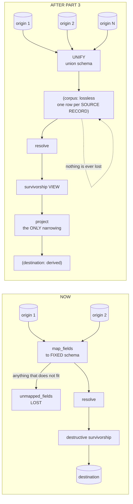

### The decisions that define it

| # | decision | reason |
|---|---|---|
| **D-16** | **One row per source record** (not per resolved entity) | Losslessness requires that a source record's values never be merged away before resolution has been reviewed. It also makes the corpus **double as the crosswalk** (§3.3) — one structure instead of two. The alternative (one row per entity) forces resolution *before* unification and survivorship *during* it, which couples three concerns and makes an unmerge impossible |
| **D-17** | **Unification matches tables and relationships, not only fields within pre-paired tables** | The origins express the same concept at different grains — one has `person` + `companyexperience`, the other `staff` with the company inline. Matching only fields inside pre-paired tables cannot bridge that, and it is the common case across unrelated databases |
| **D-18** | **Keep child tables; never denormalise 1:N** | Denormalising a 1:N relationship loses the cardinality permanently. Losslessness outranks simplicity |
| **D-19** | **Preserve FK, PK and column types** | These are the evidence P3, P4 and P7 consume. Discarding them at the staging boundary would mean re-deriving them from a lossier representation |
| **D-20** | **`<origin>_<field>` for same-name/different-meaning collisions** | Both origins have `id`; collapsing them would be a silent data error. A qualified name is unambiguous and self-documenting |
| **D-22** | **Persist and extend the unified schema.** A new origin **adds** fields without shifting or redefining existing ones | A schema that is rebuilt per run gives the same origin different field identities on different runs, which breaks the persisted DF table (D-23), the decision memory (§3.9) and every stored crosswalk reference |
| **D-24** | **UUIDv7, generated application-side** | Forced by §0.8: PostgreSQL 17.11 has no `uuidv7()`, Python 3.11 has no `uuid.uuid7()`. A small function costs nothing and adds no dependency. UUIDv7 rather than v4 because it is **time-ordered**, giving index locality on insert and a natural creation order — which also removes the arbitrariness behind P18④'s `first_seen` |
| **D-25** | **The corpus lives inside `merge_engine`** | It is the system of record; it belongs with the rest of it |

**Deferred alternative to D-24 — native generation.** PostgreSQL 18's `uuidv7()`
or the `pg_uuidv7` extension.
**Trigger:** a PostgreSQL 18 upgrade. Application-side generation stays correct
either way, so this is a simplification, not a fix.

### The twelve cases unification must handle

These are the cases analysed before building, so that the builder is specified
rather than discovered.

| # | case | resolution |
|---|---|---|
| 1 | Same field, same name (`name`) | Collapse — **but name equality is not sufficient evidence.** Both origins have `id` meaning different things (see case 4) |
| 2 | Same field, different names (`company_name` ≡ `entity_name`) | Collapse, decided by **value distribution, not name similarity** [KN03] |
| 3 | Field in one origin only (`revenue`) | Its own unified field; **NULL** for rows from the origin that lacks it. Lossless and trivial |
| 4 | **Same name, different meaning** (both have `status`) | **Must not collapse.** Value distributions differ ⇒ keep separate as `<origin>_<field>` (D-20) |
| 5 | **Many-to-one** (`description` vs `companydescription`, `summary`, `descriptors`, `alldescriptions`) | **Stay as separate unified fields.** The choice is forced only at projection (§3.5). Detection has database-literature support [IM04] and **no vendor precedent** (§2.18) |
| 6 | **Type conflict** (`revenue` numeric vs `"1.2M"` text) | Keep the **raw** value at the widest type, plus a parsed numeric companion. Losslessness forbids discarding the original string |
| 7 | **Cardinality conflict** (one `phone` vs `phone1`/`phone2`/`phone3`) | A multi-valued field expressed two ways ⇒ one multi-valued unified field (§3.5 class 2) |
| 8 | **Normalisation differs** (address inline vs a child `address` table, 1:N) | **Keep the child table** (D-18) |
| 9 | Entity type in one origin only (`investment_round`) | A unified table with rows from one origin only |
| 10 | **Table granularity differs** (`person` + `companyexperience` vs `staff`) | The hardest case; requires table matching (D-17) |
| 11 | Duplicates **within** one origin | Keep both — resolution deduplicates them. Losslessness applies intra-origin too |
| 12 | Pure metadata (`created_at`, `etl_batch_id`) | **Kept** in the corpus as provenance; **excluded** from matching and from projection (P12) |

### What exists and what must be built

| have | status |
|---|---|
| Connectors and profiling | usable as-is |
| Fellegi-Sunter EM scorer | usable, improved by P13/P14 |
| `join_graph` FK inference | replaced internally by P3, interface stable |
| `unify_entity_group` survivorship | becomes the **view definition** (§3.4) rather than a writer |
| Destination loader | becomes the **projector** |
| `map_fields` | **re-pointed**: unified → destination instead of origin → destination |

| need | why it cannot be adapted from what exists |
|---|---|
| **The union-schema builder** | Nothing in the repository does this |
| **Cross-origin field equivalence** | **Critical:** `map_fields` maps an origin onto a **fixed target**. It structurally cannot map origin ↔ origin, because there is no target to anchor against. This is [KN03]'s job and it is a different component |
| UUIDv7 generator | §0.8 |
| Multi-valued and child-table handling | New, driven by §3.5 |
| Lineage columns on every corpus row | New; they are what makes the corpus a crosswalk |
| The projection step | New; it is the only narrowing in the pipeline |

**Ceiling.** The corpus is a full second copy of every source record. Storage is
roughly origin size plus index overhead, and the union schema grows monotonically
as origins are added (D-22 forbids shrinking it).

**Deferred alternative — a virtual mediated schema.** Compute the union as a view
over the origins rather than materialising it, which removes the copy.
**Trigger:** when corpus storage becomes a measured constraint. Not now:
materialising is what makes the corpus a stable, indexable system of record, and
a virtual schema cannot hold `entity_id` or lineage.

---

## 3.3 The crosswalk is the corpus plus one column

**There is no separate crosswalk to design**, and this is worth stating plainly
because the previous draft treated them as two artefacts.

| a crosswalk row, per the shipping products | a unified-corpus row, per §3.2 |
|---|---|
| one row per **source record** | one row per **source record** (D-16) |
| keyed by (source system, source PK) | origin id + source table + source PK (D-19) |
| carries that system's attribute values | carries all unified fields, NULL where absent |
| linked to an entity id | **— add `entity_id` —** |

**They are the same object.** Reltio keys crosswalks by `type` + `value` and
attaches an `attributes` array; Informatica by `ROWID_SYSTEM` +
`PKEY_SRC_OBJECT`, carrying *"the most recent cell values provided by that
system"*. Both are **per source record with attribute payload attached** — which
is decision **D-23a**, and it is now justified by convergence rather than by
preference.

**One architectural fork worth recording:** Reltio **embeds** crosswalks inside
the entity document; Informatica keeps a **separate side table**. This design
follows Informatica's shape, because the corpus must be queryable by source
lineage independently of any entity — a requirement Reltio's embedding does not
serve.

**Provenance, not lineage.** The sources agree that *"lineage is about flow, while
provenance is about proof"*, and **none of the four provenance references mentions
crosswalks**. A crosswalk is a **provenance** structure that MDM vendors
habitually label "lineage". This report uses *provenance* and notes the clash
rather than adopting the vendors' looser word.

---

## 3.4 Read-time survivorship

### Decision D-01 · A computed projection, materialised into your table

**Chosen:** `public.company` **stays your real table**. The survivorship result
is a **view in `merge_engine`**. Promotion **materialises** the view into the
destination.

**Reason.** Three constraints meet here and only this shape satisfies all three:
`CLAUDE.md` forbids new destination columns and the destination schema is yours;
consumers read `public.*` and must keep working; and survivorship must stop being
destructive. A view in `merge_engine` plus materialisation touches no DDL of
yours, changes nothing for consumers, and keeps every losing value.

**The sourced basis.** Reltio: *"The OV flag of each attribute value is calculated
just-in-time whenever the entity's values are requested"* [RLT]. IBM's virtual
MDM assembles member records *"dynamically … to form a single entity in a
composite view"*. Senzing states the principle: *"There should be no lossy
processes like merge/purge or data survivorship that discard information"* —
with **GDPR single-record deletion** as the payoff, which a destructive merge
cannot perform at all.

**Stated honestly:** with a materialised destination this is
**recompute-on-demand**, not literally read-time.

| kept | lost unless the view is exposed |
|---|---|
| Losslessness — every value retrievable with provenance | Per-read, per-role projections (§3.12) |
| **Unmerge and re-merge for free** | — |
| A rule change takes effect **without re-merging** | — |
| Single-source deletion (GDPR) | — |

The view therefore stays queryable in `merge_engine` for roles and audit, even
though `public.*` is what consumers read.

**Unmerge and re-merge are not features to build.** They are consequences: delete
a crosswalk row's `entity_id`, re-project. This is the direct answer to *"if two
entities merge wrongly, how do we fix it, and if two should have merged and we
learn later, how do we merge them?"* — both are re-projections, and neither
requires a re-run.

**Ceiling.** Materialisation means the destination is stale between promotions,
and a promotion of a large entity set is a bulk write.

**Deferred alternative — `public.company` as a genuine SQL view.** True read-time,
role-parameterised.
**Trigger:** only if you decide the destination may be a view. It would drop your
table and make `public.company` unwritable, which is why it was not chosen.

### Why §0.7 is the proof of this design

`public.company_industry` cannot receive industry links — it has no linkage
columns. Under the current destructive pipeline those 539 rows' worth of real
industry relationships are **permanently lost**: the run ends, the data is not in
the destination, and nothing holds it.

Under this design the links sit in the corpus, the destination table stays empty
(P17), the DDL is fixed whenever convenient by its owner, and **a re-projection
fills it with no re-merge and no re-run.**

**The architecture converts a data-loss event into a pending projection.** That
is the whole argument for Part 3 in one example.

---

## 3.5 The field taxonomy — five classes, classified not listed

Survivorship can only arbitrate values that **compete**. The previous draft ran
one rule chain over every field, which is wrong for most of them.

### D-26 · Classes are an output space; assignment is measured

**Chosen:** a **classifier over measured column features** — distinctness,
within-entity cardinality, token entropy, length distribution, functional-
dependency membership, child-table FK cardinality.

**Reason.** The requirement is explicit: the taxonomy must work on **any new
origin**, whose fields are unknown. **No field is ever named**, so a new database
is classified by the same measurements as the last. The class set is the
extensible part; adding a class means adding a feature signature, not a list of
members.

| class | examples | survivorship? | detection — measured, no names |
|---|---|---|---|
| **1. Single-valued** | `name`, `founded_date`, `revenue` | **yes** — the rule chain applies | one value per entity per origin |
| **2. Multi-valued** | `phone`, `email`, `address`, `industry` | **no — union with dedup** | **one origin already holds 2+ values for one entity** |
| **3. Accumulative text** | `description`, `summary` | **no — keep all** | high token count, high distinct-token entropy, near-zero exact-repeat rate |
| **4. Exclusive identifier** | `tax_id`, LEI, DUNS, ticker, registration no. | **never** — a conflict is **evidence against the match** | near-unique across corpus (distinctness → 1) **and** within-entity cardinality 1 |
| **5. Derived** | `domain` from `website`; `employee_range` from `employee_count` | **no — recomputed from the base field's winner** | functional dependency A→B on ≥ a data-derived share of rows |

### Class 2 has two shapes and both must be detected

This is the subtlety that makes the class general rather than a convention:

- **Repeated columns** — `phone1`, `phone2`, `phone3`.
- **Child rows** — a `company_industry` table with 1:N cardinality from company.

They are the same semantic fact in two schema shapes. The second **falls out of
FK cardinality, which P3's IND discovery already computes** — so detection is
reuse, not new machinery.

**The test itself is the general part.** "One origin already holds two or more
values for one entity" decides multi-valuedness **from evidence inside a single
origin**. It needs no cross-origin comparison, no field names, and no human. A
company legitimately having two phone numbers is not a conflict to resolve; it is
a fact about the field, and the field announces it.

### Class 4 is load-bearing, not optional

**Decision D-32 · classes 4 and 5 are both adopted.**

Class 4 is what makes §2.14's mechanism runnable. "Conflicting exclusives suppress
the matching rule" requires the pipeline to know **which fields are exclusive** —
and the whole point of this revision is that it must know that **without anyone
listing them**. Class 4 is that knowledge, derived from distinctness and
cardinality. Without it, P6's discrimination has nothing measured to stand on and
the suffix list creeps back.

Class 5 fixes the **attribute-coherence** defect (§3.12): resolved independently,
a merged company can carry one origin's `website` beside another's `domain` — an
entity existing in no source.

### Projection — D-27

**Chosen:** every value stays in the corpus with provenance; **one selected winner
is projected** into the destination column. **No concatenation in the destination**
unless a destination field is *explicitly defined as aggregating*.

**Reason.** The destination is a fixed contract that consumers read as single
values. A concatenated `description` would silently change that column's type
from "a description" to "several descriptions glued together", breaking every
consumer that renders it. Keeping all values in the corpus means nothing is lost,
so the projection can afford to be narrow.

**Ceiling.** A consumer reading only `public.*` sees one description where two
informative ones exist. The full set requires querying the corpus.

**Deferred alternative — an explicitly aggregating destination field.** Reltio has
an `Aggregation` strategy for exactly this [RLT].
**Trigger:** when a destination field is *declared* to be an aggregate. The
mechanism is cheap; what it needs is the declaration, which is the schema owner's
decision.

### Worked example: industry, end to end

| stage | outcome |
|---|---|
| Origins | industry carried as **text on the company row** |
| Corpus | a **child table**, **one row per (company, industry)**, each with UUIDv7 and lineage — **5 industries = 5 rows** |
| Cross-origin combination | **union with dedup**, never a contest. `{Aerospace, Defence}` ∪ `{Defence, Electronics}` = `{Aerospace, Defence, Electronics}` |
| Survivorship | **never runs** — class 2 |
| Dimension materialisation | distinct values become `industry` rows (P4) |
| Projection | **blocked** — `public.company_industry` has no linkage columns (§0.7, P17). Held in the corpus; filled by re-projection once the DDL is fixed |

---

## 3.6 The matching pipeline — four tiers

### D-28 · ANN retrieval → Tier 0 → System-1 → System-2, as separate jobs

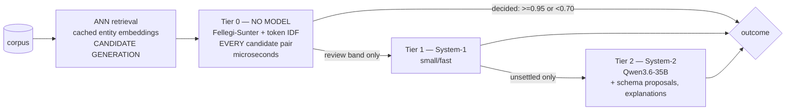

**Reason, and it is a measured one.** Three independent results say the
model-free tier does most of the work:

| finding | source |
|---|---|
| deepmatcher **loses** on structured data (87.9 vs 88.8) at **216× training time** | [DM], [ED] |
| d-blink unsupervised **"competitive with semi-supervised Fellegi-Sunter"** | [DBL] |
| SoftTFIDF untrained **"close to a learned combination"** | [C03] |

**The principle, stated so it cannot drift: System-1 sits *behind* Tier 0; it
never replaces it.**

**Why this is a quality win and not only a cost win.** Today the LLM budget goes
to 200 pairs per entity chosen **nearest to auto-match** — pairs Tier 0 had
already decided. Moving the model to the uncertain band spends the same budget
where it can change an outcome. The cost reduction is a side effect.

### Candidate retrieval, and the CLM-8B assessment

**Chosen:** an embedding index with cached entity vectors, **model not yet
selected**.

**Reason the architecture fits here and nowhere else.** A dual-encoder that
embeds state and actions independently and caches the action embeddings gains its
speed *"when the model could reuse actions across many states or choose from a
large set of candidates"* [CLM]. For **pairwise adjudication** the action set is
three labels, so the caching mechanism is idle and buys nothing. For **candidate
retrieval and referent resolution** the "actions" are the warehouse entities — a
large, fixed, reusable set. That is the fit.

**But cached embeddings plus nearest-match selection is an ANN index.** CLM-8B is
a *learned* ANN index with an 8B encoder in front. It earns its place only if
retrieval needs semantics a cheaper embedding cannot capture.

**D-29 · Benchmark before adopting.** Evaluate CLM-8B against a much cheaper
embedding model on **recall@K, latency, memory and cost**. **If the cheap
retriever achieves essentially the same candidate recall, use it.** Weights are
Apache 2.0 and open [CLM], so the benchmark is cheap to run — but the project
lead's own limit is explicit: *"I would not use a CLM as a replacement for a
general-purpose reasoning model on tasks that require substantial open-ended
reasoning."* And **the article mentions entity resolution nowhere** — there is no
published result for this task.

**Ceiling.** An ANN index returns approximate neighbours; recall@K is below 1 and
whatever it misses no downstream tier can recover.

**Deferred alternative — ANN complementing rather than replacing token blocking.**
Union the two candidate sets, which is the disjunctive-blocking result that recall
is the union while cost is the sum [R1].
**Trigger:** if measured recall@K falls short of token blocking's PC.

---

## 3.7 Three outcomes, and a review queue that stays small

### D-06 · HITL is scoped to Possible Match only

| outcome | disposition | human? |
|---|---|---|
| **Match** | auto-merge | no |
| **Possible Match** | **persisted state + review queue, revocable resolution** | **yes** |
| **Possibly Related** | **typed edge** (`DIRECT_PARENT`, `ULTIMATE_PARENT`, `BRANCH_OF`, `related`) | **no** |

**Reason.** The stated constraint is that at this data volume human review is
unusable if it is asked for everything. Scoping review to the middle band, and
letting *Possibly Related* become an edge that needs no adjudication, is the
difference between a queue a person can work and one they cannot. The
three-outcome contract comes from [S]; the persisted clerical-review state comes
from [RL, p. 47].

**Revocability is required, not optional.** Reltio's "not a match" is stored yet
**reverted when new attributes arrive** [RLT]. A resolution recorded today must
not permanently prevent a correct merge tomorrow when better evidence appears.

**Ceiling.** The band's width is a policy choice until the score is calibrated
(P13's deferred item). Wider band, more review, fewer silent errors.

**Deferred alternative — agents in the gates.** Replace the reviewer with an
agent once the volume is reduced and the decision history exists.
**Trigger:** the stated intent (D-09) is *"later use agents instead of human in
HITL gates but for now quality matter so we use real HITL."* The ordering
constraint is firm: **reduce the review volume before replacing the reviewer**,
and **accumulate the decision history first** (§3.9), because an agent with no
precedent is a slower human.

---

## 3.8 Negative assertions

**Persistent, audited, replayed, revocable.** A `merge_engine` table recording
"these two are known to be different", with the asserting actor and timestamp.

**Reason and precedent.** Senzing's `TRUSTED_ID` forces records apart via a
durable custom feature held in *"a separate, audited table"* and **replayed on
every reprocess** [S]. Informatica has `EXCLUDE_FROM_MATCH`. Without this, every
human "no" is re-litigated on the next run — which is P9's defect in its most
expensive form, because a wrongly re-merged pair is invisible in the output.

**Replayed, not baked in.** The assertion is applied **during** resolution on
every run rather than written into the data once. That is what makes it revocable
and what keeps the corpus lossless.

**Ceiling.** A negative assertion between two *source records* does not
generalise to their clusters; asserting at cluster level would be wrong, because
clusters change between runs.

---

## 3.9 Decision memory

Every gate decision — field mappings, table roles, FK confirmations, match
adjudications — persisted with the question's stable key, the answer, the actor
and the timestamp.

**Reason.** It is a precondition for three other things, and this is why it is
architecture rather than a convenience:

1. **Review volume.** Questions already answered stop being asked (P9).
2. **Replacing the human with an agent** (D-09) requires precedent to act on.
3. **Supervised FK classification** (P3's deferred alternative) requires labels
   that only these decisions can supply.

**Keyed by the unified-corpus field, not the source column name** (D-23) — source
names are unstable across databases, so a memory keyed on them would mis-apply a
decision from one database to an unrelated field in another.

**Applied instantly on acceptance.** The stated requirement is that when a human
accepts something it takes effect immediately rather than at the next run.

**Ceiling.** A stable question key is only as stable as the unified schema. D-22's
extend-never-redefine rule is what keeps old keys valid.

---

## 3.10 Case (b) — "main" means the parent of a hierarchy

### D-13 · Declared pointer, or the graph extremum over declared edges. Never inferred.

| method | status |
|---|---|
| **(a) A declared parent pointer** | **documented** — adopted |
| **(b) The ultimate node of a linkage graph over declared edges** | **documented** — adopted |
| (c) Largest by revenue or headcount | **folklore. No source.** Rejected |
| (d) The most complete record | **folklore for this purpose. No source.** Rejected |

**Reason.** Every authority that maintains corporate hierarchy at scale treats it
as a **reported, verified relationship** rather than an inference. GLEIF stamps
parents `PENDING` → `FULLY_CORROBORATED`, carries them as typed rows
`IS_DIRECTLY_CONSOLIDATED_BY` / `IS_ULTIMATELY_CONSOLIDATED_BY`, and publishes
**reason codes for absence** — `NO_LEI`, `NATURAL_PERSONS`, `NON_CONSOLIDATING`,
`NO_KNOWN_PERSON`, `NON_PUBLIC` [GLEIF]. D&B uses global ultimate / domestic
ultimate / parent / site DUNS [DNB]. Senzing's typed roles are the same two-level
model [S]. **Three independent authorities converged on direct/ultimate, and none
of them guesses.**

**On (d) specifically:** completeness *is* documented — but only for **attribute
survivorship after identity is settled**, which is a different question.
Borrowing it to decide identity would be a category error.

**Where the pointer comes from here:** `company_relation` rows, per the stated
answer that hierarchy lives there. When such a row exists, "main" is the **root of
that parent graph**. **When no row exists, "main" is undefined** — and the system
says so rather than nominating a candidate.

**Ceiling, stated plainly.** Against two flat name/address sources with no
identifier and no declared edge, **direction is not recoverable.** The reason is
structural: a branch is not a separate legal person, so it has no registration
number that could conflict [DNB]. The honest output for such a pair is *Possible
Match* or a typed `related` edge — not a guessed parent.

**Deferred alternative — external hierarchy enrichment.** GLEIF LEI Level 2 or
D&B corporate linkage, where direction is carried as an identifier.
**Trigger:** when such a source is licensed. It is the only mechanism that
supplies direction reliably, and no amount of string comparison substitutes.

---

## 3.11 Case (d) — referent resolution, and the CSV/XLSX channel

### What case (d) is, and why it is a different problem

**Merging asks:** *"are these two records the same?"*
**Referent resolution asks:** *"of the N entities in the warehouse, which one does
this incoming mention denote — or none of them?"*

Two things make it structurally different from pairwise matching:

1. **It is retrieval, not comparison.** There is no second record; there is a
   string and a warehouse.
2. **It needs a NIL option** — *"this mention matches nothing we hold"* — which
   pairwise matching has **no concept of**. A pairwise scorer always returns a
   score against something.

**D-30 · In scope now.** A user's spreadsheet row is a **mention**, not a record
to merge, so the upload feature is meaningless without this. It is implemented as
the ANN retrieval tier (§3.6) plus a NIL confidence.

### The CSV/XLSX evidence channel

**D-08 · Two independent dials.** This is the decision most likely to be
misread later, so it is stated as two separate mechanisms:

| dial | setting | rule |
|---|---|---|
| **Matching** | fixed | the uploaded file is **auxiliary evidence and can never be the sole reason to merge** |
| **Survivorship** | **configurable** — highest, second, or any rank | the file **can hold top priority for which value wins** |

**Reason the two must be separate.** They look contradictory and are not. The file
carries the most reliable *values* — so for survivorship it deserves high or
highest priority. But a single user-supplied row asserting a website or a phone
number must not by itself collapse two distinct companies, because a company can
legitimately have two phone numbers or two email domains. **If these were one
dial, "highest priority" would license the file to merge records by itself.**

**Handling:** clean CSV and XLSX only; the app asks which column is the company
name and which are optional metadata (website, address, phone). Errors are
**reported, not repaired**.

**Ceiling.** Metadata columns supplied as auxiliary evidence cannot be validated;
a wrong website in the upload degrades retrieval for that row.

---

## 3.12 Coherence, pinning, and role-based projections

Three mechanisms that only become possible once survivorship is a projection.

### Attribute coherence — a defect the earlier draft missed entirely

merge-engine resolves **each field independently**. Consequence: a merged company
can carry one origin's `name` beside another origin's `website` — **an entity that
exists in no source.**

Reltio's answer is `OtherAttributeWinnerCrosswalk`: an attribute inherits
whichever crosswalk won a *different* attribute, so identity fields come
coherently from one source [RLT]. §3.5's **class 5** is the general form —
derived fields are recomputed from their base field's winner rather than resolved
on their own.

**Adopted:** identity-field coherence groups, where the group's winner is decided
once and its members follow.

### Pinned and ignored values

**Verified absent today** — no such concept exists in the code. A human cannot say
*"this value, always"* or *"never this value"*, so every correction is
re-litigated on the next run.

**Adopted:** per-(entity, field) pin and ignore, stored in `merge_engine`,
**applied before the rule chain runs** and replayed on every projection.

### Role-based projections

**Reltio exposes survivorship strategies per role, and at read time the caller
passes the strategy mapping in the request body** [RLT].

**This is cheap *only because* survivorship is read-time** — under a destructive
merge, serving two roles means maintaining two merged copies. It is recorded here
as a Part 3 capability rather than a Part 1 one for exactly that reason, and it is
the second place in this report where the same finding appears: read-time
survivorship is what makes several other features affordable rather than
impossible.

---

## 3.13 The survivorship protocol

This section answers the protocol questions directly: which strategy families to
use, how to compose them, how the fallback chain is built, and what happens when
there is no competition.

### Which strategy families, and for which class

Only one product documents all six families in one place, with **12 named
strategies** [RLT]. **Attribute-type guidance is almost nonexistent across all 28
sources surveyed** — exactly two type constraints exist anywhere (IBM Product
Master's Average rule applies to *"Number, Number enumeration, and Integer type
attribute"*; Semarchy notes *"binary attributes do not support this consolidation
strategy"*). **Everything else vendors publish is domain-level fitted assignment**
("ERP wins for financial fields"). So the mapping below is driven by §3.5's
measured classes, not by copying a vendor's field list.

| family | use it for | reason |
|---|---|---|
| **A. Source-based** (`SRC_SYS`, priority) | class 1 identity fields; the CSV channel | The only family that encodes external knowledge about reliability. Keyed **per (origin, field)**, never per origin (P18②) |
| **B. Time-based** (`LUD`, `OldestValue`) | class 1 volatile fields — address, phone, employee count | Recency is a proxy for truth **only where the value actually changes**. For `founded_date` recency is noise |
| **C. Frequency** | class 1 fields with ≥3 origins | Meaningless with two sources: with two origins every disagreement is a 1–1 tie. **Not usable today**, listed because it becomes usable as origins are added |
| **D. Min / Max** | **nothing, as a silent tiebreak** | P18⑤ — taking the max of two disagreeing revenues destroys the disagreement signal. **Resolve, but record the disagreement** |
| **E. Value-based priority** | class 1 enumerations (status, type codes) | A preference order over *values* rather than sources; the only family that can express "Active beats Unknown" |
| **F. Aggregation** | **only where a destination field is explicitly declared an aggregate** | D-27 — a concatenated description silently changes the column's meaning for every consumer |

**Classes 2, 3, 4 and 5 use none of these.** Class 2 unions, class 3 keeps all,
class 4 never resolves, class 5 inherits. **That is the main correction to the
previous draft's protocol:** it ran family A–D over every field.

### The three axes, and which composition

| axis | adopted | reason |
|---|---|---|
| **1. Attribute-level override** | **yes — mandatory** | Record-level source trust is the anti-pattern the vendor literature warns about explicitly: *"trust the ERP for all customer data… can quickly lead to problems. Instead, build logic based on each attribute"* [PRO]. This is P18② |
| **2. Role-based rules** | **yes — Part 3 only** | Cheap only because survivorship is read-time (§3.12). Impossible in Part 1 |
| **3. Conditional rules** | **yes — narrowly** | A rule that fires only when a predicate holds. Adopted for the disagreement case (fire an alert when two numerics differ by more than a data-derived margin) and for the CSV channel (the file wins *only* for fields it actually supplies) |

**Composition, in order:** **class first, then axis 1, then axis 3, then axis 2.**

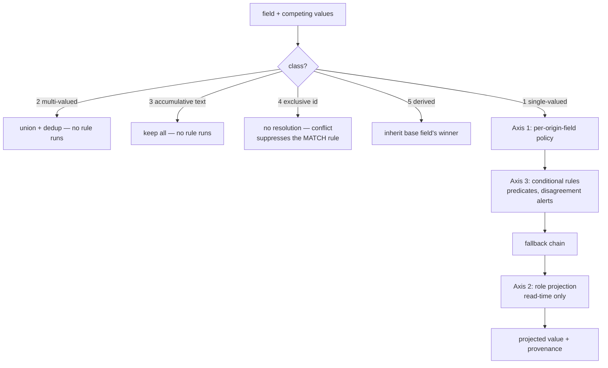

**Why class precedes everything:** the classes decide *whether there is a contest
at all*. Running a priority rule over a multi-valued field is not a mis-tuned
rule, it is the wrong question.

### The fallback chain

**Shape:** a narrowing filter. Each rule receives the surviving candidates and
returns a subset; the chain stops as soon as one candidate remains. This matches
the existing `_resolve_conflict` loop and matches [RLT], so the code's structure
is right even where its rules were not.

**Two refinements from the sources:**

1. **Distinguish *why* fallback fires.** Reltio's `fallbackUsingCriteria` takes
   `MORE_THAN_ONE`, `ZERO`, or `ZERO_OR_MORE_THAN_ONE` — "the rule produced no
   winner" and "the rule produced a tie" are different situations needing
   different next steps. Narrowing to **tied winners only** is what makes long
   chains safe [RLT].
2. **End the chain with a total order.** **Semarchy has the only true
   last-resort tie-breaker found** — a ranking expression ending
   `PubID ASC, SourceID ASC` [SEM]. This is the fix for P18④: `first_seen` is
   nondeterministic because extraction order is not an order. UUIDv7's
   time-ordering (D-24) supplies one naturally.

**Default chain for class 1**, each step justified rather than conventional:

```
(origin,field) priority  ->  value-based priority  ->  recency (volatile only)
                         ->  non-null  ->  total order (UUIDv7, then origin id)
```

`measured_reliability` is **removed from the default chain**, because with
priority set it is dead code (P18②).

### Single source — no competition

**When exactly one origin supplies a value, it is taken directly and no rule is
consulted.** `unify_entity_group.py:328` filters nulls and line 332
short-circuits on a single value. **This part of the existing implementation is
correct** and matches Reltio, which takes the single value *"irrespective of
whether this crosswalk has a source from the priority list"* [RLT].

**Worth naming:** this is arguably **not survivorship at all**. Profisee frames it
as **enrichment — a different activity** [PRO]. *(That framing is an inference
from the quoted definitions rather than an explicit vendor statement, and is
labelled as such.)* The practical consequence is that it should be **counted and
reported separately**: "45 fields enriched from a single source, 12 fields
contested" tells you far more about a run than one merged-field count.

### Evaluation of survivorship output

**D-15 · Mode-based weighting; no invented cost ratio.**

| band | optimise for | instrumented as |
|---|---|---|
| **Auto-merge** (fully automated) | **precision** | **F0.5** |
| **Review band** (semi-automated) | **recall** | recall-weighted |

**Report precision and recall separately for both**, always. **β² = cost(FN)/cost(FP)
is retracted** (§2.17) — β is an importance weight with no documented cost
interpretation, so the operating point is a policy decision, and ROR's two-mode
rule is the sourced basis for the one taken.

**Deferred alternative — a real cost ratio.**
**Trigger:** if the business ever states what a false merge costs relative to a
missed one. Until then, inventing the number would be worse than the policy.

---

## 3.14 Control flow, and what is deliberately not being built

### Keep the deterministic DAG

**Reason 1 — the evidence.** Of the twenty defects in Part 1, **none is a planning
failure.** Every one is a wrong constant, a wrong grain, a missing stage or an
unconsumed result. An autonomous planner would have made the same mistakes with
less traceability.

**Reason 2 — the weakness is observability, not autonomy.** The system's actual
failure was that a run reported `completed` while discarding 9.5 million pairs.
That is a missing invariant (P10, P16), not a missing planner.

**Sub-agents and parallelism** are adopted narrowly where work is genuinely
independent: per-entity field mapping (P11), and the per-pair tiers (§3.6). Not as
an organising principle.

### Recommended against, with reasons

| not building | why |
|---|---|
| **Neo4j / GDS** | One scipy call replaces it, and WCC is not the right clustering anyway (P20) |
| **A learned pairwise matcher** (deepmatcher-class) | **Loses** to a classical matcher on structured data at **216× the training cost** [DM]; d-blink unsupervised is competitive with semi-supervised FS [DBL] |
| **Embedding similarity as the primary scorer** | Adopted for **retrieval** (§3.6), rejected for **scoring** — a scalar similarity cannot express "Model X1" vs "Model X2" (−16 %/−18 % F1 vs a learned head) [KAR] |
| **A general agentic controller** | Reason 1 above |
| **A hand-maintained suffix, stop-word or blocking-key list of any kind** | §0.6, §2.14, §2.20. This is the report's one absolute prohibition |

### Expected impact

Stated as directions with their evidence, not as predicted numbers — the
measured baseline is one corpus and a predicted F1 would be exactly the kind of
claim §2.3 was demoted for.

| change | expected direction | basis |
|---|---|---|
| P1 tokeniser | large recall gain on the second origin | 28 of 29 fields currently unmapped |
| P2 + P5 + P20 | precision gain; giant component eliminated | PC 0.96–0.99 / RR 0.76–0.90 with pruning [R1] |
| P13 + P14 | precision gain on name-heavy matching | `u` currently inflated; `"Group"` currently unweighted |
| P6 | parent/subsidiary pairs move from wrong-merge to review | three-way outcome [S] |
| P15 + §3.7 | silent errors become reviewable | band currently dropped |
| §3.2 corpus | information loss goes to zero before projection | losslessness by construction |
| §3.4 projection | rule changes and unmerges stop requiring re-runs | [RLT], [S] |

---

# PART 4 — Appendices

## 4.1 Constants that govern output quality

All module-level in `resolve_entities.py`; **none is configurable.** For a
system whose output quality turns on these numbers, module scope is the wrong
home.

| constant | line | value | effect this run |
|---|---|---|---|
| `_MAX_COMPARISONS` | 59 | 250 000 | **9 556 382 pairs discarded** |
| `_AUTO_MATCH` | 62 | 0.95 | all 4 company FPs fired above it |
| `_AUTO_EXCLUDE` | 63 | 0.70 | band floor |
| `_MAX_REF_BLOCK` | ~177 | 25 | correct idea, not generalised (P5.2) |
| `_MAX_LLM_PAIRS` | 181 | 200 | bound exactly on 3 entities |
| `_LLM_CHUNK_SIZE` | 186 | 40 | defeats calibration (P8) |
| `_LLM_CONCURRENCY` | 189 | 4 | the one that is right |
| `_MIN_PAIRS_FOR_MODEL` | ~193 | 30 | below this, heuristic replaces the model |

## 4.2 Per-entity resolution statistics (source: `resolution_stats`)

| entity | records | cand. pairs | auto-matched | llm_scored | clusters | uncompared |
|---|---|---|---|---|---|---|
| experience | 13 518 | 250 000 | 31 911 | 1 | 9 070 | **8 792 591** |
| staff | 13 518 | 250 000 | 14 252 | 156 | 10 092 | **711 670** |
| contact_information | 3 781 | 5 526 | 4 | 5 | 3 777 | 0 |
| product | 1 592 | 250 000 | 2 567 | **200** | 1 146 | 52 121 |
| company_industry | 544 | 34 252 | 160 | **200** | 539 | 0 |
| evidence | 517 | 9 005 | 0 | 0 | 517 | 0 |
| entity | 115 | 36 | 0 | 0 | 115 | 0 |
| **company** | **115** | **4 315** | **17** | **0** | **99** | **0** |
| event | 112 | 272 | 3 | 3 | 109 | 0 |
| location | 103 | 1 154 | 28 | 2 | 82 | 0 |
| company_experience | 84 | 784 | 11 | **200** | 75 | 0 |
| contract | 47 | 142 | 0 | 0 | 47 | 0 |
| schema | 24 | 276 | 0 | 0 | 24 | 0 |
| institution | 16 | 7 | 0 | 2 | 16 | 0 |
| company_investment_round | 11 | 13 | 13 | 0 | 5 | 0 |
| source_profile | 1 | 0 | 1 | 0 | 1 | 0 |

Company's 17 auto-matches = 13 TP + 4 FP exactly.

## 4.3 Row-level outcome vs ground truth

`expected` = GT rows minus what the app provably cannot produce.
`ground_truth.company` holds 114 rows = **102 resolved clusters + 12
`stub-created` relation endpoints absent from both origins**; the arithmetic is
exact, so the app's target is **102, never 114**. Comparing against 114 invents
12 misses.

| table | GT | expected | app | Δ |
|---|---|---|---|---|
| company | 114 | **102** | 99 | −3 |
| person | 13 591 | 13 591 | 10 092 | **−3 499** |
| experience | 13 600 | 13 600 | 9 070 | **−4 530** |
| contact_email | 5 696 | 5 696 | 3 777 | **−1 919** |
| product | 1 592 | 1 592 | 1 146 | −446 |
| product_category | 388 | 388 | **0** | −388 |
| industry | 41 | 41 | **0** | −41 |
| location | 103 | 103 | 82 | −21 |
| contact_phone | 83 | 83 | 83 | 0 |
| contract | 33 | 33 | 47 | **+14** |
| contract_entity | 46 | 46 | 115 | **+69** |
| contract_product | 0 | 0 | 1 019 | **+1 019** |
| contract_amendment | 0 | 0 | 27 | **+27** |
| finance | 0 | 0 | 21 | **+21** |
| company_relation | 11 | 11 | 21 | +10 |

**Total short of expected: 10 847.** The `+` rows are P1-8's stray
cross-table mappings (e.g. `company.companyid → contact_email.company_id` at
0.85; `company.totalinvestmentcurrency → finance.currency` at 0.80).

The 12 unreachable companies, for the record: *abu dhabi securities exchange
adx, carnival, euroconsult, gulfstream aerospace, iridium, kongsberg defense &
aerospace, mubadala investment, nbn, norwegian coastal administration, norwegian
cruise lines, public investment fund, royal caribbean international.*

## 4.4 CLAUDE.md and AGENTS.md — assessment and changes applied

**Assessment.** CLAUDE.md is unusually good. The "every line traceable to a real
past failure" discipline works, and the concrete citations (43-column schema
drift, `_LAST_BLOCKING_STATS`, the `*.csv` gitignore incident that degraded the
eval set) make rules stick where abstract style guidance does not. The
code-lookup ladder demonstrably saves time — ~19 500 tokens on a single turn of
this session via `graft skeleton` alone. The branch-discipline and ponytail
sections should not change.

**Changes applied under approval:**

1. **CLAUDE.md, "Live verification is mandatory".** This is the file's most
   important rule and **it did not fire on this run** — exactly the enforcement
   gap the file warns about elsewhere. Added the measured evidence: a run that
   finished `completed` having discarded 9 556 382 pairs, left 78 of 99
   `company.name` NULL and produced zero mappings for 8 of 16 entities; plus
   the instruction to write the scorer *before* the run, since one written
   afterwards gets fitted to the result.
2. **AGENTS.md header.** It claimed *"same content"* as CLAUDE.md while
   containing materially different abridged content — the kind of inaccuracy the
   repo's own standards flag. Now describes itself accurately as a pointer plus
   the few restated rules.
3. **AGENTS.md OpenWiki block.** Reduced from nine lines to four; it was
   explaining at length that something does not exist.

**Not applied, and why.** I did **not** add the new rules this run suggests
(no silent comparison truncation; no destination column fed by one origin when
both have it) to the "mechanically enforced" list. Nothing enforces them yet,
and listing an unenforced rule there is precisely the defect that section exists
to prevent. They belong there once `check.py guards` or the quality gate
actually runs them.


**Note added to 4.1.** After Part 1, the constants in that table divide into three
kinds, and the division is the point of this revision:

| kind | examples |
|---|---|
| **Computed at runtime** | token DF, WNP local mean, `K = Σ|b|/2`, `k = Σ|b|/(|E1|+|E2|)`, block purging, `u` from the unblocked sample |
| **Cut at a cliff** (no constant at all) | IND → FK candidate selection, primary-key selection |
| **Chosen, and owned by a named decision** | the 0.70/0.95 band (D-06, selected against a plotted mixture), origin priorities (D-08), F0.5 (D-15) |

Nothing remains in a fourth category — a constant that is neither computed nor
owned. That category is what §0.6 was about.

**Note added to 4.3.** The scorer performed a **full join against complete ground
truth with no sampling**, so the figures reported there need **no sampling-weight
correction**. This is stated because §2.17 documents that metrics computed on a
**sampled** population are biased — *"Sampling records at random leads to clusters
sampled with probability proportional to size"* — requiring **inverse
cluster-size weights**. Any future scorer that samples rather than joins in full
must apply them.

---

## 4.5 Destination schema audit

Established by direct inspection on 2026-09-29. See §0.7 for the analysis.

| table | rows | linkage columns | verdict |
|---|---|---|---|
| `company_industry` | **539** | **none — `id text` only** | **BROKEN.** Cannot express company→industry. 539 rows carry no information |
| `industry` | **0** | `name`, `sub_industry`, `industry_group`, `parent_industry_id` | correct shape, **never populated** (P4) |
| `product_category` | **0** | `name`, `parent_category_id`, `description` | correct shape, **never populated** (P4) |
| `contact_email` | 3 777 | `person_id`, `company_id`, `email`, `email_type`, `is_primary`, `is_verified` | correct |
| `contact_phone` | 83 | `person_id`, `company_id`, `phone`, `phone_type`, `country_code` | correct |
| `company_relation` | 21 | `company_a_id`, `company_b_id`, `relation_type`, `started_date`, `ended_date` | correct shape, **under-populated** (P7) |
| `person_skill` | — | `person_id`, `skill_id`, `proficiency_level` | correct |

**Also recorded:** `merge_engine_entity_map` and `merge_engine_merge_audit` are
currently created in **`public`** — the app writing its own tables into your
schema. Relocated by D-21.

**Conclusion.** The destination already models multi-valued attributes as child
tables **everywhere except one table**. §3.5's taxonomy therefore needs **no new
destination columns**, which is what makes it compatible with the standing
prohibition.

---

## 4.6 Decision register

Every decision taken, its reason, and where it is implemented. This appendix
exists so that no decision has to be re-derived from the prose.

**Legend.** *Owner* — **U** = decided by the reader; **R** = forced by a source or
a measurement, recorded here.

| # | decision | owner | reason in one line | where |
|---|---|---|---|---|
| **D-01** | `public.*` stays a real table; projection is a `merge_engine` view; promote materialises | U | Satisfies the no-new-columns contract, keeps consumers working, and stops destructive resolution — all three at once | §3.4 |
| **D-02** | **Discriminate** parent vs duplicate; do not decline | U | A declined decision is not an answer; §2.14 supplies measured machinery that discriminates | P6 |
| **D-03** | **Read-time survivorship**, not destructive merge-time | U | Losslessness, free unmerge, rule change without re-merge, GDPR single-record deletion | §3.4 |
| **D-04** | P1 reclassified as **upstream mapping failure with survivorship impact** | U | The recorded reason is "no matching destination column", not a coalesce failure | P1 |
| **D-05** | **Quality is the first and only priority for now** | U | No fix is traded for speed; the speed table is a side effect, not a goal | §Part 1 ordering |
| **D-06** | HITL scoped to **Possible Match only**; Possibly Related is a typed edge | U | At this volume, reviewing everything is unusable; scoping is what keeps the queue workable | §3.7, P15 |
| **D-07** | Configuration is **per-origin**, three layers (detected / human / per-run) | U | Origins differ in quality and conventions; one global setting cannot serve both | P12 |
| **D-08** | CSV/XLSX is **two independent dials** — never sole match evidence; configurable survivorship priority | U | A company legitimately has two phones; one dial would let the file merge records by itself | §3.11 |
| **D-09** | **Human HITL now, agents later** | U | Quality first; and an agent needs the decision history that does not yet exist | §3.7, §3.9 |
| **D-10** | Relationship edges are **directional** | U | `parent_of` and `child_of` are not interchangeable; GLEIF/D&B/Senzing all type them directionally | P7, §3.10 |
| **D-11** | Fix the mapping defect **now**, not during the architecture change | U | It is small, and the current pipeline is what runs meanwhile | P1 |
| **D-12** | Rule selection driven by **column profile plus human choice** | U | Learned default, human override — neither alone is sufficient | §3.5, P12 |
| **D-13** | **"Main" = declared pointer or graph extremum.** Never revenue, headcount or completeness | U/R | Three authorities converged on reported hierarchy; (c) and (d) are folklore with no source | §3.10 |
| **D-14** | Comparator keeps **four ordinal levels**, level chosen by IDF-weighted similarity | U | Changes one thing; leaves the EM machinery intact and the regression attributable | P14 |
| **D-15** | **F0.5 for auto-merge, recall-weighted for review**; report P and R separately; **no invented β²** | U/R | No source supports β² = cost ratio; ROR's mode rule is the sourced basis | §3.13, §2.17 |
| **D-16** | Corpus row grain = **one source record** | U | Losslessness before review, and it makes the corpus double as the crosswalk | §3.2, §3.3 |
| **D-17** | Unification matches **tables and relationships**, not only fields | U | Origins express the same concept at different grains (`person`+`companyexperience` vs `staff`) | §3.2 |
| **D-18** | **Keep child tables**; never denormalise 1:N | U | Denormalising loses cardinality permanently; losslessness outranks simplicity | §3.2 |
| **D-19** | **Preserve FK, PK and column types** into the corpus | U | They are the evidence P3/P4/P7 consume | §3.2 |
| **D-20** | Same-name/different-meaning ⇒ **`<origin>_<field>`** | U | Both origins have `id`; collapsing would be a silent data error | §3.2 |
| **D-21** | `merge_engine` is its **own database, same instance**; **system of record** | U | Ownership separation without a new host; destination becomes derived, so a crash leaves it stale not corrupt | §3.1 |
| **D-22** | Unified schema is **persisted and extended**; a new origin adds, never redefines | U | Otherwise the DF table, decision memory and crosswalk references all break between runs | §3.2 |
| **D-23** | Persisted DF is **global, per column, keyed by the unified-corpus field**, snapshotted per run | U | Source column names are unstable across databases; the unified field is what the matcher actually compares | P14, §3.9 |
| **D-23a** | Crosswalk grain = **per source record with attribute payload** | U | Revised from per-attribute after both documented products were found to converge on this shape | §3.3 |
| **D-24** | **UUIDv7 generated application-side**, no dependency | U/R | PG 17.11 and Python 3.11 both lack it natively; time-ordering also supplies the total order P18④ needs | §3.2, §0.8 |
| **D-25** | The corpus lives **inside `merge_engine`** | U | It is the system of record | §3.2 |
| **D-26** | Field taxonomy is a **classifier over measured features**, not a fixed list | U | Must work on any new origin whose fields are unknown | §3.5 |
| **D-27** | **One winner projected**; all values kept in the corpus; **no concatenation** unless a field is declared an aggregate | U | A concatenated column silently changes meaning for every consumer | §3.5 |
| **D-28** | **ANN retrieval → Tier 0 → System-1 → System-2**, as separate jobs; System-1 sits *behind* Tier 0 | U | Three sources show the model-free tier does most of the work; the model belongs where it can change an outcome | §3.6 |
| **D-29** | **Benchmark CLM-8B** on recall@K, latency, memory, cost; use the cheap retriever if recall matches | U | Cached embeddings + nearest-match *is* an ANN index; the 8B encoder must earn its place | §3.6 |
| **D-30** | Case (d) referent resolution **in scope now** | U | A spreadsheet row is a mention, not a record; the upload feature is meaningless without NIL-capable retrieval | §3.11 |
| **D-31** | `company_industry`: **report, never repair**; hold in corpus; re-project after the owner fixes the DDL | U | Keeps the no-new-columns contract intact and converts a loss into a pending projection | P17, §0.7 |
| **D-32** | **Classes 4 (exclusive identifier) and 5 (derived) both adopted** | U | Class 4 is what lets §2.14's mechanism run without a list; class 5 fixes attribute incoherence | §3.5 |
| **D-33** | **No new destination columns, ever** (standing) | R | `CLAUDE.md`; the schema once grew 14 → 43 columns because a prompt said "prefer a new column" | P17, §4.4 |
| **D-34** | App-managed state **never in the user's schema** | U | Currently violated: two tables created in `public` | §3.1, §4.5 |
| **D-35** | Model endpoint and **Langfuse tracing** enabled for runs | U | Observability is the actual weakness (§3.14 reason 2) | §0.1 |
| **D-36** | Containers `unless-stopped`, destination data **bind-mounted** | U | An anonymous volume lost the destination data once | §0.1 |
| **D-37** | **`scipy.sparse.csgraph.connected_components`, not Neo4j** | U | One call replaces a database; and WCC is not the right clustering regardless of implementation | P20 |
| **D-38** | **`u` from the unblocked sample, `m` from blocked candidates**; `df/N` direct for tokens | U | Blocking inflates `u` and crushes the discriminative weights | P13 |
| **D-39** | Clustering = **prune weak → components → coherence split → LP where 1:1 required** | U | One wrong edge merges two clusters; pruning uses meta-blocking's own threshold, not a new constant | P20 |
| **D-40** | Label-free quality metrics **in Part 1**, persisted **in Part 3** | U | They need no ground truth, so there is no reason to wait | P16, §3.13 |
| **D-41** | Blocking tuned on **zero-label metrics**; PC/PQ only where ground truth exists | U/R | `recordlinkage` ships only `reduction_ratio`; PC/PQ need labels we will not have | P19 |
| **D-42** | **P2 lands before P5** | R | P5's blocking is deliberately less selective; the reverse order makes the next run worse | §Part 1 ordering |
| **D-43** | The report lives at **repo root**; the `.tmp/` copy is dead | U | — | — |

---

## 4.7 Corrections register

Every claim this report got wrong, and who caught it. Recorded because the
pattern matters more than the individual errors: **most were not uncited guesses —
they were citations pointing at fitted work, or general mechanisms with a fitted
component inside.**

| # | the claim | who caught it | the correction |
|---|---|---|---|
| 1 | **P4, P5, P6, P7 are general solutions** | **the reader** | All four fitted to this corpus. Confirmed by grep of the report's own text (§0.6) |
| 2 | Suffix list discriminates duplicate from subsidiary | reader + [T] | Documented anti-pattern; the ordering it produces is **inverted**, so no threshold rescues it |
| 3 | "Different registered identifiers ⇒ never the same entity" | research [S] | **False.** Three counterexamples; the documented outcome is *Possible Match* |
| 4 | Rostin's IND→FK classifier is a general replacement | research [RO09] | **Its two most discriminative features are fitted** — F6 column names, F9 a suffix list |
| 5 | BSL is the general replacement for hand-picked keys | research [M06] | **Disqualified** — learns `{method, attribute}`, i.e. named attributes, and every schema differs |
| 6 | Zingg documents "union not intersection" blocking | research | **Fabricated.** `union` appears in none of its docs; it documents a greedy blocking tree |
| 7 | "BINDER is 26× faster" | research [D19] | Matches no measurement. Real: SINDY 15.38 / FAIDA 27.67 / BINDER 45.69 min |
| 8 | HPI repo implements SPIDER, BINDER, FAIDA | research | **FAIDA, SINDY, MANY are absent from the repository** |
| 9 | β² = cost(FN)/cost(FP) | research [IIR] | **Unsourced.** The book says only that β<1 emphasises precision, β>1 recall |
| 10 | "idf has no effect on a one-term query" is in IIR ch. 6 | research | **Not in the chapter.** From lecture slides |
| 11 | IIR gives a smoothed idf | research | **It gives none.** Its only smoothing is `a=0.4` on **tf** |
| 12 | Log base is immaterial | research [IIR] | **Scoped to ranking.** This system has absolute thresholds, so it is not |
| 13 | Linacre recommends multi-threshold PR | research | **That is Factil** — which recommends a **single** argmax-F1 threshold |
| 14 | Many-to-one mapping has no source | research [IM04] | **Overstated.** True of MDM vendors, **false** of the database literature — iMAP does it |
| 15 | The Jev/Neo4j result is a comparable benchmark | research | 1 commit, 0 stars, **no license**, synthetic self-injected data, **hard-coded keys** — and cited approvingly on the page that copied them |
| 16 | Karapiperis et al. supports the hierarchy argument | research | **Nothing on hierarchy.** Every hit is a reference title or the HNSW index |
| 17 | `paper-103.pdf` is a blocking paper | research | It is the **IND discovery survey**; zero hits for "blocking" |
| 18 | Tune blocking on PC/PQ | research | **PC/PQ need ground truth**, and `recordlinkage` ships neither |
| 19 | Anti-pattern 7 (random negative sampling) applies here | own analysis | **It does not** — the model is unsupervised EM. The live analogue is `u` on the post-blocking population (P13) |
| 20 | diffbot (priority 1) wins contested identity fields | own re-reading | **`max()` means higher wins** — zoominfo (2) wins. Invisible only because P1 stopped the conflict occurring |
| 21 | "Exactly two FKs ⇒ junction table" | research [SCH] | Filed as a bug against a shipping tool; the correct test is **minimal UCC = union of ≥2 FK sets** |

**Two defects the research found that no one had been looking for:** **no
attribute-coherence mechanism** (a merged entity can exist in no source) and **no
pinned/ignored concept** (a human cannot fix a value permanently). Both in §3.12.

---
# References

**[R1]** Papadakis, G., Skoutas, D., Thanos, E., Palpanas, T. —
*"A Survey of Blocking and Filtering Techniques for Entity Resolution."*
arXiv:1905.06167. <https://arxiv.org/pdf/1905.06167>
Retrieved as PDF and extracted to text locally; §2 (metrics, Definitions 2–3),
§3 (Block Building taxonomy), §4.1 (Block Cleaning, Purging, Filtering), §4.2
(Comparison Cleaning, weighting schemes, Transitive LSH).
Also published as: *ACM Computing Surveys* 53(2), 2020 —
<https://helios2.mi.parisdescartes.fr/~themisp/publications/csur20-blockingfiltering.pdf>

**[R2]** *Semantic Graph Blocking* — Universitat Politècnica de Catalunya.
<https://upcommons.upc.edu/server/api/core/bitstreams/073b090a-24a3-4438-b22f-b1fb888118d5/content>
Comparative evaluation of SB, SN and SGB on synthetic databases and the Citeseer
reference database (Par1–Par3, Strict and Weak RL).

**[R3]** *jev-neo4j-entity-resolution.*
<https://github.com/Kervin-Hu-Neo4j/jev-neo4j-entity-resolution>
Graph blocking + typed pairwise judgment + GDS Weakly Connected Components;
F1 0.943, P 0.916, R 0.971, ARI 0.888, 368 ms median, $0.018/1k pairs.
*(Companion Medium article <https://medium.com/neo4j/i-tested-jev-on-entity-resolution-e7249f219ca6> returned HTTP 403 and was not used.)*

**[R4]** Zingg — *"Entity Resolution at Scale, Part 3: Blocking — Making
Billion-Record Matching Tractable."*
<https://www.zingg.ai/post/entity-resolution-at-scale-part-3-blocking>
Union-not-intersection blocking; `verifyBlocking` diagnostics; block-size
control; routing around incomplete keys.

**[R5]** *Unsupervised Blocking Key Selection for Real-Time Entity Resolution.*
Springer, LNCS. <https://link.springer.com/chapter/10.1007/978-3-319-18032-8_45>
Discriminability, coverage, and their harmonic mean as the key-selection score.

**[R5b]** *A generalized approach to perform unsupervised blocking key selection
for entity resolution.* Information Sciences.
<https://www.sciencedirect.com/science/article/abs/pii/S0020025525010898>
**HTTP 403 — reached only as a search-result summary; cited for framing only.**

**[R6]** Papadakis, G., et al. — *Meta-Blocking* and *Supervised Meta-blocking.*
<https://dl.acm.org/doi/10.14778/2733085.2733098> ·
<https://arxiv.org/pdf/2204.08801>
Graph Partitioning and Reciprocal Pruning results.

**[R7]** IBM — *What is a multiagent system?*
<https://www.ibm.com/think/topics/multiagent-system>
Shared-resource advantage, domain specialisation, collective blocking framing.
**Offers no criteria for when not to split a task — noted explicitly in §2.9.**

**[R8]** Zingg — project repository.
<https://github.com/zinggAI/zingg/>
0.05–1 % of the problem space; blocking model + similarity model; active
learning; Spark 3.5.0.

**[R9]** Tilores — *"Best open-source entity resolution and record linkage
libraries: Splink, Zingg, Dedupe — and when to move beyond them."*
<https://tilores.io/content/best-open-source-entity-resolution-and-record-linkage-libraries-splink-zingg-dedupe-and-when-to-move-beyond-them/>
Blocking failure modes; Splink DuckDB → 100M+ scale; the real-time
identity-service threshold.

**[R10]** *The Rise of Semantic Entity Resolution.* Towards Data Science.
<https://towardsdatascience.com/the-rise-of-semantic-entity-resolution/>
Sentence-transformer blocking; Ditto (2020) reported at up to +29 % over prior
benchmarks.

**[R11]** Google Research — *"ReAct: Synergizing Reasoning and Acting in
Language Models."*
<https://research.google/blog/react-synergizing-reasoning-and-acting-in-language-models/>
Thought/Action/Observation loop; CoT grounding failure; the "sparse reasoning"
limitation.

**[R12]** IBM — *What is a ReAct agent?*
<https://www.ibm.com/think/topics/react-agent>
Components (LLM core, tools, scratchpad, optional memory); function calling
preferable for predictable tasks; loop-bounding mitigations.

**[R13]** IBM — *What is AI agent orchestration?*
<https://www.ibm.com/think/topics/ai-agent-orchestration>
Centralized / decentralized / hierarchical / federated patterns; documented
failure modes.

**[R14]** Gurevich, V. — *"Blocking Techniques for Large-Scale Entity
Resolution: A Comprehensive Survey and Architecture Analysis."* December 2024.
Local copy: `docs/entity_resolution_blocking_survey.pdf`
(originally at `raw.githubusercontent.com/imvladikon/imvladikon/master/articles/entity_resolution_blocking_survey.pdf`,
which returned unreadable binary over the network).
§2 (logic-based blocking, complexity), §3 (statistical), §4 (Bloom filters),
§5 (LSH, MinHash, SimHash), §6.2 (neural lineage), §6.4.4 (vector-index CRUD),
§6.5–6.6 (benchmarks, limitations), §7 (clustering-based blocking),
§9.1 (JedAI reference architecture), §9.3 (meta-blocking), §9.4 (transitive
closure), §9.5 (incremental/streaming ER), §10.1 (ensemble vs cascaded),
§10.2 (active learning), §10.3 (LLMs for ER), §10.4 (open challenges incl.
fairness and bias).

**[R15]** Bahmani, Z., Bertossi, L., Vasiloglou, N. — *"ERBlox: Combining
matching dependencies with machine learning for entity resolution."*
*International Journal of Approximate Reasoning* **83** (2017) 118–141.
<https://www.sciencedirect.com/science/article/pii/S0888613X17300439>
Local copy: `docs/1-s2.0-S0888613X17300439-main.pdf` (the publisher URL returned
HTTP 403 over the network).
§1 (matching dependencies, collective blocking, the four integrated components),
§8 (experiments on MAS and DBLP; reduction-ratio trade-off), §9 (related work —
relational similarity propagation).

**Not reached, not used as evidence:**
`medium.com/neo4j/i-tested-jev-on-entity-resolution-e7249f219ca6` (HTTP 403;
companion repository [R3] used instead) ·
`sciencedirect.com/science/article/abs/pii/S0020025525010898` (HTTP 403; search
summary only, cited as [R5b] for framing).

---

## Primary evidence (this repository and run)

| claim | source |
|---|---|
| tokeniser behaviour | live call to `map_fields._tokenize_field` / `_safe_coalesce_target` |
| `_MAX_COMPARISONS`, `_MAX_LLM_PAIRS`, `_LLM_CHUNK_SIZE` | `src/mcp_server/tools/resolve_entities.py:59, 181, 186` |
| join-candidate generation | `src/mcp_server/tools/join_graph.py:266` |
| coalesce allowlist | `src/mcp_server/tools/map_fields.py:860–915` |
| entity-map creation in `public` | `src/mcp_server/connectors/postgresql_destination.py:1168, 1245` |
| `human_split_pairs` reset each run | `src/orchestrator/graph.py:900, 1001` |
| split written, never read by matching | `src/orchestrator/nodes/load_data.py:876`; `src/ui/components/db_discovery.py:521–523` |
| node timings, mappings, stats | `phase3/state.json` |
| gate payloads | `phase3/gates.jsonl` |
| every TP/FP/FN pair | `score.json` |
| scorer correctness | identity run + injected FP/FN, `gt_score.py` |

---

## References added in the 2026-09-29 revision

Tags are those used inline above. Local files are given by repo-relative path.
Access failures are recorded in §2.21 and are not repeated here.

**[C03]** Cohen, W., Ravikumar, P., Fienberg, S. — *"A Comparison of String
Distance Metrics for Name-Matching Tasks."* IIWeb-03.
`docs/iiweb03.pdf`. Load-bearing for P6, P14, §2.16: the derivation of IDF from
Fellegi-Sunter (*"is simply `-log P_D(w)`"*), the Jaro-Winkler-for-names claim,
`document` = one name, the ~17× TFIDF/SoftTFIDF cost ratio, and the Belin & Rubin
calibration pointer.

**[M06]** Michelson, M., Knoblock, C. — *"Learning Blocking Schemes for Record
Linkage."* AAAI 2006. `docs/michelson06-aaai.pdf`, `docs/AAAI06-070.pdf`.
BSL, Sequential Covering + LEARN-ONE-RULE (pp. 3–5), `RR`/`PC` definitions (p. 2),
Restaurants/Cars/Census results (pp. 4–5).

**[D19]** Dürsch, F. et al. — *"Inclusion Dependency Discovery: An Experimental
Evaluation of Thirteen Algorithms."* CIKM 2019. `docs/paper-103.pdf`. The paper
behind the HPI repository. Runtime comparisons; BINDER O(n) vs sort-merge
O(n log n).

**[HPI]** HPI Information Systems — *inclusion-dependency-algorithms.*
<https://github.com/HPI-Information-Systems/inclusion-dependency-algorithms>
11 algorithm modules under `adp-algorithms/`; **FAIDA, SINDY and MANY absent**.

**[PVLDB24]** Su, Wang, Tan, Ma — *"Discovering Approximate Inclusion
Dependencies."* PVLDB 18(4):1210–1222, 2024. `docs/p1210-tan.pdf`.

**[EDBT24]** Bornemann, L. et al. — *"Efficient Discovery of Temporal Inclusion
Dependencies in Wikipedia Tables."* EDBT 2024. `docs/3357384.3357916.pdf`.

**[205]** Weis, M., Naumann, F. — *"Relationship-Based Duplicate Detection."*
HU Berlin technical report 205. `docs/205.pdf`. Basis for P7's deferred
alternative.

**[RO09]** Rostin, A. et al. — foreign-key discovery by IND classification.
The 10-feature set; **F6 (column-name similarity) and F9 (suffix list `id`/`key`/
`nr`) are the two most discriminative and are fitted**; calibration figures
(~60 % of FKs cover all PK values; <5 % out-of-range).

**[HOPF]** HoPF — holistic primary/foreign-key discovery. The **cliff**
(*"no need to setup a parameter"*, TPC-H 7.67×10⁷ → 1), the RHS-uniqueness
prefilter (8–10×), the `PK ⊆ PK` filter, and the **non-cyclic rule that must not
be adopted**.

**[SCH]** Schmurr et al. — KMIS 2024. Junction/cardinality inference handed to a
human; *"almost impossible to tell"* from plain table data.

**[SAM]** SAMSTAR — fact-table identification. `Th = mean + K·σ` over its own
connection-topology-value distribution (**GENERAL**); its 131-noun dimension list
(**FITTED**, not adopted).

**[KN03]** Kang, J., Naughton, J. — *"On Schema Matching with Opaque Column Names
and Data Values."* SIGMOD 2003. Mutual-information dependency graph; **no column
names used**. Basis for §3.2's cross-origin field equivalence. *(ACM DL paywalled;
cited from abstract and secondary description — §2.21.)*

**[IM04]** Dhamankar, R. et al. — *iMAP: Discovering Complex Semantic Matches
between Database Schemas.* SIGMOD 2004. Complex (many-to-one) matching; accuracy
**33–55 %** (9 % on one domain) without domain constraints or overlap data vs
**50–86 %** with them.

**[S]** Senzing — *Principle-Based Entity Resolution* technical overview, and the
Senzing Entity Specification. The Match / Possible Match / Possibly Related table
(p. 4), **"SKIP ON CONFLICTING EXCLUSIVES"** (p. 3), online frequency-class
revision (p. 1), `TRUSTED_ID` and the audited side table, `REL_POINTER_ROLE`
values `DIRECT_PARENT` / `ULTIMATE_PARENT` / `BRANCH_OF`, and the losslessness
principle (*"no lossy processes like merge/purge or data survivorship"*).
<https://senzing.com/what-is-entity-resolution/>

**[RL]** Istat — *RELAIS 3.1 User Guide.* `docs/Relais3.1UserGuide.pdf`.
Fellegi-Sunter with EM (pp. 46–47); the clerical-review band (p. 47);
Tu=0.90/Tm=0.95 chosen against a plotted `log m/u` mixture (pp. 52–55); LP-based
1:1 reduction (p. 52); deterministic models *"do not admit the state of
'possiblematch'"* (p. 43); unique-identifier linkage precondition (p. 39).

**[T]** Tilores — *"Company name normalization isn't enough for fuzzy matching."*
<https://tilores.io/content/company-name-normalization-isnt-enough-for-fuzzy-matching/>
The inverted ordering of "Acme Group Ltd" / "Beta Group Ltd" / "Acme Holdings
Ltd"; the 5–25 % prevalence of business-language tokens; and
`weight(token) = log(N/count(token))` as the recommended data-derived replacement.

**[RLT]** Reltio documentation. The 12 `survivorshipStrategy` values;
*"The OV flag of each attribute value is calculated just-in-time whenever the
entity's values are requested"*; `fallbackUsingCriteria` ∈ {MORE_THAN_ONE, ZERO,
ZERO_OR_MORE_THAN_ONE}; `OtherAttributeWinnerCrosswalk`;
`sortCrosswalksInSrcSYSNonAdvanced`; crosswalk `type`+`value` with an `attributes`
array; role-bound survivorship and `_get_with_survivorship_rules`.

**[PRO]** Profisee — *"What Is a Golden Record?"* and survivorship guidance.
<https://profisee.com/blog/what-is-a-golden-record/>
The attribute-level warning (*"trust the ERP for all customer data… can quickly
lead to problems. Instead, build logic based on each attribute"*); "Most Complete
Record" defined as **fewest nulls across a record**.

**[DL]** Data Ladder — survivorship rule set, incl. the "Longest" rule
(*"highest number of characters"*) and the "Cartesian Explosion" warning.

**[SEM]** Semarchy xDM documentation. The only documented **total-order**
last-resort tie-breaker: a ranking expression ending `PubID ASC, SourceID ASC`;
and the binary-attribute constraint.

**[GLEIF]** GLEIF — LEI Level 2 relationship data.
`IS_DIRECTLY_CONSOLIDATED_BY` / `IS_ULTIMATELY_CONSOLIDATED_BY`,
`ValidationSources` PENDING → FULLY_CORROBORATED, and the absence reason codes
`NO_LEI` / `NATURAL_PERSONS` / `NON_CONSOLIDATING` / `NO_KNOWN_PERSON` /
`NON_PUBLIC`.

**[DNB]** Dun & Bradstreet — corporate linkage levels (global ultimate, domestic
ultimate, parent, site DUNS). *(All D&B URLs failed — §2.21; claims are
excerpt-level.)*

**[IIR]** Manning, Raghavan, Schütze — *Introduction to Information Retrieval.*
<https://nlp.stanford.edu/IR-book/html/htmledition/inverse-document-frequency-1.html>
· <https://nlp.stanford.edu/IR-book/html/htmledition/tf-idf-weighting-1.html>
· <https://nlp.stanford.edu/IR-book/html/htmledition/evaluation-of-unranked-retrieval-sets-1.html>
`idf_t = log(N/df_t)`; `F = 1/(α·1/P + (1−α)·1/R)`; `β² = (1−α)/α`;
*"Values of beta < 1 emphasize precision, while values of beta > 1 emphasize
recall"* — **and no cost framing anywhere**. No smoothed idf; `a = 0.4` applies to
**tf**; "log base immaterial" is scoped to ranking.

**[ROR]** ROR — *"How good is your matching?"*
<https://ror.org/blog/2024-11-06-how-good-is-your-matching/>
The two-mode rule: fully automated → weight precision (F0.5); semi-automated with
review → weight recall. **The sourced basis for D-15.**

**[LIN]** Linacre, R. — *"Measuring data linking accuracy."*
<https://www.robinlinacre.com/measuring_data_linking_accuracy/>
*"a single pairwise misclassification … causes a large number of implicit false
positives"*; cluster-level metrics; *"I recommend against a random sampling
strategy for labelling"*; *"The end goal should not be considered to be raw
accuracy metrics."*

**[Factil]** Factil — evaluation methodology.
<https://www.factil.io/technology/evaluation/>
Single argmax-F1 threshold (*"a threshold of 0.65 gives a maximum f-score of
98.18 %"*); importance sampling for evaluation bias.

**[ERE]** Binette, O. — *er-evaluation.*
<https://github.com/OlivierBinette/er-evaluation>
*"Naive computation of performance metrics using benchmark datasets can lead to
biased and over-optimistic results"*; *"The metrics in this module do not provide
representative performance estimates"*; sampling weights and
*"Sampling records at random leads to clusters sampled with probability
proportional to size"*; homonymy rate, name variation rate, cluster-size Hill
numbers; *"Without reference data, only summary statistics can be monitored."*

**[CLEVR]** Marchant, N. — *clevr.* <https://github.com/cleanzr/clevr>
Variation of information; *"unsupervised (internal) measures are also in scope for
future releases."*

**[RLPY]** *recordlinkage.*
<https://recordlinkage.readthedocs.io/en/latest/ref-evaluation.html> ·
<https://recordlinkage.readthedocs.io/en/stable/performance.html>
Implements `reduction_ratio`; **`pairs_completeness` and `pairs_quality` do not
exist**; `fscore` has **no `beta` parameter**.

**[BP]** BlockingPy and the R `blocking` package.
<https://github.com/ncn-foreigners/BlockingPy> ·
<https://github.com/ncn-foreigners/blocking>
FAISS / HNSW / Annoy / Voyager / MLPack / NND; *"combin[e] these columns into a
single text column before passing it to the blocker"*; the evaluation doctrine —
judge on recall, RR and FNR, ignore precision/F1/FPR.

**[JED]** pyJedAI. <https://github.com/AI-team-UoA/pyJedAI>
`StandardBlocking`: *"Creates one block for every token in the attribute values of
at least two entities."*

**[DD]** dedupe. <https://github.com/dedupeio/dedupe>
Predicate library (`sameThreeCharStartPredicate`, `commonIntegerPredicate`,
`sortedAcronym`, `doubleMetaphone`, TF-IDF canopies); Chvátal greedy set-cover;
`target_cover = int(recall * len(matches))`.

**[DLX]** delex and Sparkly. <https://github.com/anhaidgroup/delex>
*"The user examines Tables A and B then writes a declarative blocking program"*;
Sparkly (top-k TF/IDF) recommended first by its own authors.

**[DZM]** DeezyMatch. <https://github.com/Living-with-machines/DeezyMatch>
Char-level RNN similarity + ANN ranker; **5 000** labelled string pairs.

**[FL]** fastLink. <https://github.com/kosukeimai/fastLink>
Fellegi-Sunter via EM, **unsupervised**, posterior per pair; cites Belin & Rubin
(1997) for calibration.

**[DBL]** d-blink. <https://github.com/cleanzr/dblink>
Bayesian ER; *"competitive with semi-supervised Fellegi-Sunter"*; best F1 in its
table (**0.9426**) belongs to **"Near Matching"**.

**[EX]** exchanger. <https://github.com/cleanzr/exchanger>
Bayesian ER with exchangeable random partition priors.

**[DM]** deepmatcher. <https://github.com/anhaidgroup/deepmatcher>
**[ED]** Zhao, D. — *Extending DeepER.* <https://github.com/zhao1701/extending-deep-ER>
deepmatcher 87.9 vs Magellan 88.8 average F1 on structured data, at 5.4 h vs
1.5 min training.

**[PSM]** py_stringmatching. <https://github.com/anhaidgroup/py_stringmatching>
The only surveyed library shipping `TfIdf`/`SoftTfIdf`; compiled; documents
tokenize-once. **`SoftTfIdf` defaults (`jaro`, θ=0.5) do not match [C03]
(Jaro-Winkler, θ=0.9)**; raises on NULL.

**[KAR]** Karapiperis, D., Akritidis, L., Bozanis, P. — *"The impact of
fine-tuning on entity resolution: An experimental evaluation."* Knowledge-Based
Systems 338 (2026) 115427. `docs/1-s2.0-S095070512600170X-main.pdf`.
A scalar similarity cannot express "Model X1" vs "Model X2" (−16 %/−18 % F1 vs a
learned head, p. 12); thresholds from the validation PR curve rather than a fixed
0.5 (p. 5). **Contains nothing on hierarchy.**

**[CLM]** VentureBeat — *"Stanford and Nvidia's open CLM-8B caches reusable agent
actions and runs up to 9x faster than Jev in tests."*
<https://venturebeat.com/technology/stanford-and-nvidias-open-clm-8b-caches-reusable-agent-actions-and-runs-up-to-9x-faster-than-jev-in-tests>
Dual-encoder with cached action embeddings; Apache 2.0 open weights; 9× on
*"computer use, gaming and tool calling"*; *"I would not use a CLM as a
replacement for a general-purpose reasoning model on tasks that require
substantial open-ended reasoning"*; **entity resolution not mentioned**.

**[EDISC]** GoldFynch and Everlaw — duplicate taxonomies.
<https://goldfynch.com/blog/2025/02/21/understanding-and-managing-different-types-of-duplicates-in-ediscovery.html>
· <https://support.everlaw.com/hc/en-us/articles/204771559-Types-of-Duplicates-and-Deduplication-Options>
Exact/hash, near (*"95 % or more text similarity"*), email and family duplicates;
only hash-identical is documented safe to auto-merge; family handled by
**preserving the parent-child edge**. *(Everlaw 403 — §2.21.)*

**[PROV]** Provenance vs lineage — Snowflake, Atlan, Monte Carlo, IBM.
*"lineage is about flow, while provenance is about proof"*; **none mentions
crosswalks**.

---

*End of report. Revision 2026-09-29.*
