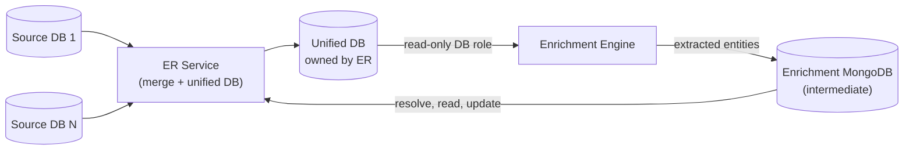
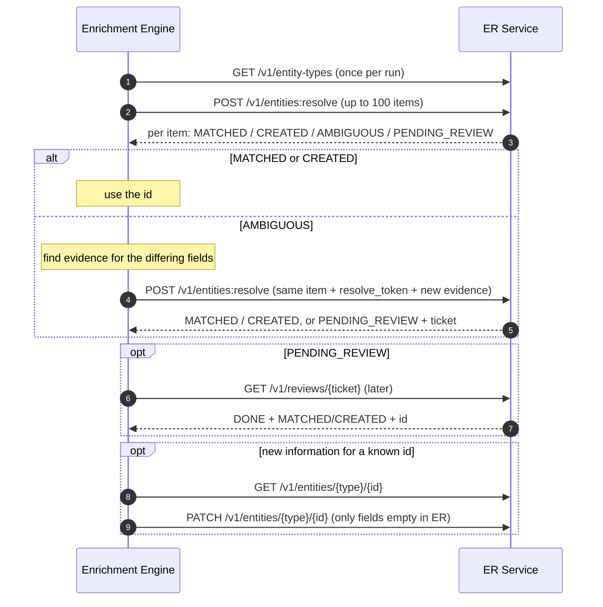

# Entity Resolution (ER) Service — Integration Contract v1.2

| | |
| :--- | :--- |
| **From** | Entity Resolution (ER) Service team |
| **To** | Enrichment Engine team |
| **Status** | Proposed v1.2 — our answer to your v1 (2026-11-18). Agreed on our side, **not implemented yet**. Please confirm or push back, and answer §9. |
| **Machine-readable spec** | Your `er_service_openapi.json` follows v1. It needs regenerating for v1.2 (§10 lists every change). |

---

## 1. Context



- ER merges the source databases into one unified database. **ER owns it.**
- You read records from it (read-only role, §5) and extract new information from text columns.
- You describe what you found; **ER decides** whether it is an existing entity or a new one, and returns its id.
- **ER is the only system that creates entities and assigns ids.** You never write to the unified DB.
- Delete is out of scope.
- **Our schema is fixed.** We never add a table or a column for anything you send.

---

## 2. Endpoints — summary

| # | Endpoint | Purpose |
| :--- | :--- | :--- |
| 1 | `GET  /v1/health` | Readiness check before a run |
| 2 | `GET  /v1/entity-types` | Our entity types, field names, tables, thresholds. Call once per run. |
| 3 | `POST /v1/entities:resolve` | **Batch.** For each entity you found: ER returns `MATCHED`, `CREATED`, `AMBIGUOUS` or `PENDING_REVIEW`, with an id when decided. |
| 4 | `GET  /v1/reviews/{ticket}` | Answer for an entity a human must decide |
| 5 | `GET  /v1/entities/{entity_type}/{id}` | Read one entity |
| 6 | `PATCH /v1/entities/{entity_type}/{id}` | Add new information to an entity |

All bodies are JSON. All ids are opaque strings. Every request carries header `X-API-Key: <key>` (we send the key separately); missing or wrong key → `401`.

---

## 3. The conversation

### 3.1 Two kinds of entity, two ways to name them

1. **A row you read from our DB** (e.g. an `Experience` row). Its `id` column **is** the ER id. Use it directly in `GET`, `PATCH` and `references`. **Never resolve it.**
2. **Something new you found inside the text** (e.g. the product named in an experience summary). Describe it and `resolve` it.

### 3.2 Step by step

```text
0. GET /v1/entity-types                       once per run: types, our field names, tables, thresholds
1. read Experience row id=er_exp_8821         (read-only DB role)
   extract: product "SAP HANA 2.0", maker "SAP SE"
2. resolve the company                        -> er_comp_104      (parents first)
3. resolve the product, references.manufacturer = er_comp_104
                                              -> er_prod_501
4. PATCH known entities with new information  (by id)
```



**Parents first.** Resolve the company before the product that references it. References are always real ER ids, never your internal ids.

---

## 4. Endpoint details

### 4.1 `GET /v1/health`

```json
200 OK
{ "status": "ok", "version": "1.4.2" }
```
Non-200, or slower than about 2 s, means "not ready".

### 4.2 `GET /v1/entity-types`

```json
200 OK
{
  "entity_types": [
    {
      "entity_type": "company",
      "table": "public.company",
      "aliases": [],
      "fields": { "name": "string", "website": "string", "country": "string" },
      "identity_fields": ["name", "website"],
      "required_fields": ["name"],
      "reference_fields": {},
      "thresholds": { "auto_match": 0.95, "review": 0.70 }
    }
  ]
}
```
*Shape only. Real types, fields and numbers come from our schema and our last merge run.*

| Field | Meaning |
| :--- | :--- |
| `entity_type` | The name you must use. |
| `table` | Where this type lives in the unified DB. **Field name = column name** in that table, so you need no mapping to read it. |
| `fields` | Field → type: `string`, `integer`, `number`, `boolean`, `date` (`YYYY-MM-DD`), `datetime` (ISO-8601), `string[]`. Convert before sending. |
| `identity_fields` | Fields ER matches on. Fill as many as you can before resolving. |
| `required_fields` | Needed before ER can create an entity. |
| `reference_fields` | Field → entity type it points to; the value is an ER id. |
| `thresholds` | `auto_match`: at or above, ER answers `MATCHED`. Below `review`: ER creates a new entity. In between: `AMBIGUOUS`. Scores are comparable **within one type only**. |

A type is listed only if it has a table in the unified DB **and** at least one completed merge run. Any other type → `UNSUPPORTED_ENTITY_TYPE`.

### 4.3 `POST /v1/entities:resolve` (batch, up to 100 items)

**Request**
```json
{
  "items": [
    {
      "item_id": "cand_9f3a",
      "idempotency_key": "sess_20261118_01:cand_9f3a",
      "entity_type": "product",
      "attributes": { "name": "SAP HANA" },
      "references": { "manufacturer": "er_comp_104" },
      "inferred_fields": [],
      "extra": { "version": "2.0", "deployment": "on-prem" },
      "source_text": "Led migration of financial reporting onto SAP HANA 2.0.",
      "provenance": {
        "run_id": "sess_20261118_01",
        "source_table": "Experience",
        "source_record_id": "er_exp_8821",
        "source_column": "summary"
      },
      "resolve_token": null
    }
  ]
}
```

| Field | Required | Meaning |
| :--- | :--- | :--- |
| `item_id` | yes | Your id, echoed back. |
| `idempotency_key` | yes | ≤ 255 chars. Same key again → the first answer again. Same key with a different entity → item `INVALID` (`IDEMPOTENCY_PAYLOAD_MISMATCH`). Kept ≥ 30 days. |
| `entity_type` | yes | From `/v1/entity-types`. |
| `attributes` | yes | **Our field names only.** Used to match and to store. An unknown name → item `INVALID`. |
| `references` | no | ER ids only. |
| `inferred_fields` | no | Which `attributes` you guessed rather than read. Stored with the lowest trust: only fills a field nothing else fills. |
| `extra` | no | **Everything else you found**, in your own names. Kept with the entity's history and shown to a human reviewer. Never matched on, never becomes a column. Nothing you found is lost. |
| `source_text` | no | The text snippet. Shown to a human reviewer. |
| `provenance` | yes | Where it came from. Kept for audit. |
| `resolve_token` | no | `null` on the first ask. On the second ask after `AMBIGUOUS`: the token we gave you, with your new evidence in `attributes` / `references` / `extra`. |

**Response**
```json
200 OK
{
  "results": [
    { "item_id": "cand_9f3a", "decision": "MATCHED", "id": "er_prod_501",
      "score": 0.97, "matched_fields": ["name", "manufacturer"] }
  ]
}
```

| `decision` | When | Body | What you do |
| :--- | :--- | :--- | :--- |
| `MATCHED` | best score ≥ `auto_match` | `id`, `score`, `matched_fields` | Use `id`. `PATCH` it if you have new information. |
| `CREATED` | no candidate ≥ `review` | `id` (new) | Use `id`. |
| `AMBIGUOUS` | first ask, best score between `review` and `auto_match` | `candidates` (`id`, `score`, `attributes`, `differing_fields`), `resolve_token` | Look for evidence on `differing_fields`; ask again with the token. |
| `PENDING_REVIEW` | still ambiguous on the second ask | `ticket` | Keep the entity in your store; ask `GET /v1/reviews/{ticket}` later. |
| `UNSUPPORTED_ENTITY_TYPE` | type not listed | `error` | Keep it locally. |
| `INVALID` | malformed item | `error`, `fields` | Log it, mark it failed. No retry. |

Rules:
1. One result per item, any order, linked by `item_id`.
2. One bad item never fails the batch.
3. Two of your workers resolving the same new entity at the same time get **the same id** — ER serializes creates per type and checks for a match before creating.
4. If the entity was found, nothing is created or changed. Use `PATCH` to add information.

### 4.4 `GET /v1/reviews/{ticket}`

```json
200 OK
{ "status": "PENDING" }
{ "status": "DONE", "decision": "MATCHED", "id": "er_prod_501" }
{ "status": "DONE", "decision": "CREATED", "id": "er_prod_9002" }
```
A human sees the candidates, your `attributes`, `extra` and `source_text`. That is why `extra` and `source_text` matter.

### 4.5 `GET /v1/entities/{entity_type}/{id}`

```json
200 OK
{
  "id": "er_prod_501",
  "entity_type": "product",
  "attributes": { "name": "SAP HANA", "category": "Database", "description": null },
  "references": { "manufacturer": "er_comp_104" },
  "version": 7,
  "redirected_from": null
}
```
- **Merged ids keep working.** If `er_prod_77` was merged into `er_prod_501`, `GET .../er_prod_77` returns `er_prod_501` with `"redirected_from": "er_prod_77"`.
- **Split entities:** if a merge run splits one entity in two, the id stays with one part; the other part gets a new id (no redirect).
- `404` only for ids that never existed.
- `version` increases on every change, including changes made by our merge runs.

### 4.6 `PATCH /v1/entities/{entity_type}/{id}`

**Headers:** `Idempotency-Key` (required), `If-Match: <version>` (optional)

```json
{
  "set": { "description": "In-memory, column-oriented database" },
  "references": { "manufacturer": "er_comp_104" },
  "add_aliases": ["HANA"],
  "inferred_fields": [],
  "extra": { "release_year_mentioned": "2010" },
  "provenance": { "run_id": "sess_20261118_01", "source_table": "Experience",
                  "source_record_id": "er_exp_8821", "source_column": "summary" }
}
```

| Case | Status |
| :--- | :--- |
| Updated | `200` with the full entity (§4.5 shape) |
| Retry with the same key | `200`, same response, `"idempotent_replay": true` |
| `If-Match` version is old | `412`. Re-read and recompute. |
| Id was merged | `200`, applied to the surviving entity, `redirected_from` set |
| Unknown field, bad type, bad reference | `422 VALIDATION_FAILED` |
| `add_aliases` on a type with no aliases field | `422 VALIDATION_FAILED` |

**ER has the final say, also later.** Your values enter ER as one more source (`enrichment_engine`) with the **lowest** priority. The response shows what was actually stored. A later merge run may replace your value with a value from a source database. Re-read; never assume a write stuck.

---

## 5. Reading the unified DB

- A **read-only database role** for you (connection details sent separately).
- It can `SELECT` the tables named in `/v1/entity-types` (`table`), plus:
  - `merge_engine.er_entity_version (entity_type, id, version, updated_at)` — **change feed**: `WHERE updated_at > <your last watermark>` lists every entity changed by ER or by a merge run.
  - `merge_engine.er_redirect (entity_type, old_id, new_id)` — merged ids.
- The `id` column in the tables **is** the ER id the API uses.
- All writes go through the API.

---

## 6. Errors and retries

| Situation | HTTP | Your behaviour |
| :--- | :--- | :--- |
| Missing / wrong API key | `401` | Stop; fix configuration. |
| Bad request / validation | `400`, `422` | No retry. |
| Not found | `404` | No retry. |
| **Merge run loading** — writes paused | `503` + `Retry-After` | Wait, then retry. `resolve` items that would **create**, and `PATCH`, are paused; `GET`, `health`, `reviews` stay up. |
| Rate limited | `429` + `Retry-After` | Wait, retry, lower your rate. |
| Temporary failure | `500`, `502`, `503`, `504`, timeout | Retry 3 times with backoff, then pause publishing and keep your data. |

Error body (all errors):
```json
{ "error": "VALIDATION_FAILED", "message": "human readable text", "fields": { "name": "required", "vendor": "unknown" } }
```

During an ER outage, never create entities anywhere else; keep them and publish when ER is back.

---

## 7. Performance targets (initial)

| Call | Target |
| :--- | :--- |
| `resolve`, 100 items, no creates | p95 ≤ 500 ms |
| `GET` one entity | p95 ≤ 100 ms |
| `PATCH` one entity | p95 ≤ 300 ms |
| `GET /v1/health` | ≤ 50 ms |

Expected load: tens of requests per second at peak.

---

## 8. Guarantees

**You guarantee**
1. Our type and field names in `attributes`; everything else in `extra`.
2. Rows you read are named by their `id`, never resolved.
3. Parents resolved before children; references are real ER ids.
4. A stable `idempotency_key` / `Idempotency-Key` on every resolve item and every PATCH.
5. `PATCH` only sets fields that are empty in ER; guessed values marked in `inferred_fields`.
6. Provenance on every write. No delete.

**We guarantee**
1. ER alone decides match vs new, and alone assigns ids.
2. Two concurrent resolves of the same new entity get one id.
3. Ids never stop working: merged ids redirect; only never-issued ids `404`.
4. `extra` and `inferred_fields` are kept; `extra` never becomes a column; a guessed value never overwrites evidence.
5. Every change, ours or a merge run's, bumps `version` and appears in the change feed.

---

## 9. Open questions for you

1. **Relationships.** Your v1 `context.related` (e.g. person *used_by* company) suggests you want links between entities. v1.2 cannot create links. Do you need that? Which links?
2. **OpenAPI.** Please regenerate `er_service_openapi.json` for v1.2 and send it; we validate our responses against it.
3. Do you agree to `resolve` replacing `search` + `create` (§10)?

---

## 10. Changes from your v1

| v1 | v1.2 | Why |
| :--- | :--- | :--- |
| `POST /v1/entities:search` + your tie-break + `POST /v1/entities/{type}` | **`POST /v1/entities:resolve`** — ER decides | Matching rules, thresholds and human review live in one system, not two |
| Your re-search before create; your writer serialization | ER serializes creates per type, finds before it creates | Duplicates are impossible, also across other writers |
| Your field names (`manufacturer`, `organization` …) | Our names from `/v1/entity-types`; the rest goes in **`extra`** | Our schema is fixed; nothing you found is lost |
| — | `table` and `thresholds` in `/v1/entity-types` | You read the DB directly; scores are comparable only within a type |
| — | `GET /v1/reviews/{ticket}` | Still ambiguous after your evidence → a human decides |
| — | Read-only DB role, change feed, redirect table (§5) | How you find what changed and what merged |
| — | Writes pause (`503`) while a merge run loads | A merge run rewrites the same rows |
| — | Splits documented (§4.5) | v1 covered merges only |
| `context` in search | `source_text` + `extra` in resolve; `context.related` open (§9.1) | Evidence for the reviewer |
| Auth open | `X-API-Key` header | One internal client |

Your v1 §8 questions, answered: find-or-create — **yes**, built into `resolve`. Types and fields — **generated** from our schema (§4.2). Score calibration — **within a type only**, thresholds published. Batch create — **not needed**, `resolve` is batch. Auth — **API key**. `inferred_fields` — **stored, lowest trust**.

---

## 11. Change log

| Version | Date | Change |
| :--- | :--- | :--- |
| v1 (proposed) | 2026-11-18 | First version, from the Enrichment Engine team |
| v1.2 (proposed) | 2026-11-21 | ER team answer: `resolve` replaces `search` + `create`; hybrid `extra`; review tickets; read-only DB access and change feed; API key. Not implemented yet. |
