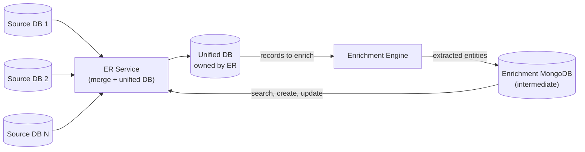
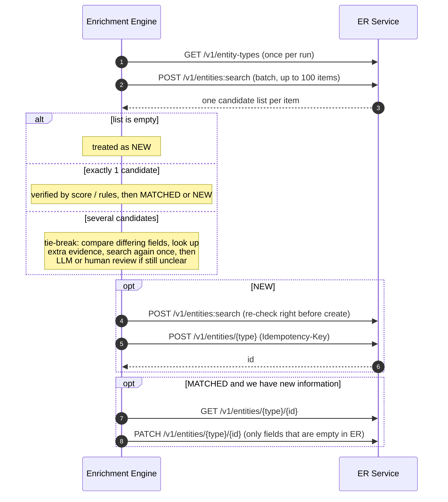

# Entity Resolution (ER) Service — Integration Contract v1

| | |
| :--- | :--- |
| **From** | Enrichment Engine team |
| **To** | Entity Resolution (ER) Service team |
| **Status** | Proposed v1. We are building against this now, using a simulator that follows it. If you need changes, tell us and we will change our side. |
| **Machine-readable spec** | `er_service_openapi.json` (not in this repo), generated from our simulator |
| **Reference simulator** | `enrichment_engine/er_simulator/` (run: `uv run uvicorn enrichment_engine.er_simulator.app:app --port 8090`) |

---

## 1. Context



- ER merges the source databases into one unified database. **ER owns that database.**
- The Enrichment Engine reads records from it and extracts **new information** from text columns. For example, from an experience summary it extracts a product (name, description, maybe manufacturer).
- Extracted entities are first stored in our own MongoDB, which is an intermediate store.
- We then ask ER: **"does this entity already exist?"**
  - If it does, we may send new information for it (**update**).
  - If it doesn't, we ask ER to **create** it.
- **ER is the only system that creates entities and assigns their ids.** We never write into the unified database directly.
- **Delete is out of scope.** We only need search, read, create, and update.

---

## 2. What we need — summary

| # | Endpoint | Purpose | Priority |
| :--- | :--- | :--- | :--- |
| 1 | `GET  /v1/health` | Readiness check before a run | P0 |
| 2 | `GET  /v1/entity-types` | Which entity types exist, their fields, identity fields, required fields, and reference fields | P0 |
| 3 | `POST /v1/entities:search` | **Batch** search: for each extracted entity, return a ranked list of possible matches | P0 |
| 4 | `GET  /v1/entities/{entity_type}/{id}` | Read one entity (we use it to compute what is new before an update) | P0 |
| 5 | `POST /v1/entities/{entity_type}` | Create an entity. ER assigns the id. **Idempotent.** | P0 |
| 6 | `PATCH /v1/entities/{entity_type}/{id}` | Update an entity with new information. **Idempotent.** | P0 |

All bodies are JSON. All ids are opaque strings to us.

---

## 3. How we will call you



**Order of creation.** If we extract a new product and its new manufacturer, we create the **company first**. Then we create the product with `references.manufacturer = <company id returned by ER>`. ER always receives references as real ER ids, never as our internal ids.

---

## 4. Endpoint details

### 4.1 `GET /v1/health`

```json
200 OK
{ "status": "ok", "version": "1.4.2" }
```

Any non-200, or a response slower than about 2 s, means "not ready". We will not start publishing.

### 4.2 `GET /v1/entity-types`

Tells us what ER supports, so we don't hard-code ER's rules.

```json
200 OK
{
  "entity_types": [
    {
      "entity_type": "company",
      "aliases": ["organization", "org"],
      "fields": {
        "name": "string", "website": "string", "country": "string",
        "industry": "string", "founded_year": "integer", "aliases": "string[]"
      },
      "identity_fields": ["name", "website", "country"],
      "required_fields": ["name"],
      "reference_fields": {}
    },
    {
      "entity_type": "product",
      "aliases": [],
      "fields": { "name": "string", "description": "string", "category": "string" },
      "identity_fields": ["name", "manufacturer"],
      "required_fields": ["name"],
      "reference_fields": { "manufacturer": "company" }
    }
  ]
}
```

| Field | Meaning |
| :--- | :--- |
| `fields` | Field name → type. Types: `string`, `integer`, `number`, `boolean`, `date` (ISO-8601 `YYYY-MM-DD`), `datetime` (ISO-8601), `string[]`. We convert our values to these types before sending. |
| `identity_fields` | Fields ER uses for matching. We try to fill these before searching. |
| `required_fields` | Minimum fields needed before ER accepts a create. |
| `reference_fields` | Field → entity type it points to. The value is an ER id of that type. |

### 4.3 `POST /v1/entities:search` (batch)

**Request**

```json
{
  "items": [
    {
      "item_id": "cand_9f3a",
      "entity_type": "product",
      "attributes": { "name": "SAP HANA", "description": "In-memory database" },
      "references": { "manufacturer": "er_comp_104" },
      "context": {
        "related": [ { "entity_type": "company", "id": "er_comp_220", "role": "used_by" } ],
        "source_text": "Led migration of financial reporting onto SAP HANA."
      },
      "limit": 5
    }
  ]
}
```

| Field | Required | Meaning |
| :--- | :--- | :--- |
| `item_id` | yes | Our id for the item, echoed back in the result. |
| `entity_type` | yes | One of `/v1/entity-types` (or one of its aliases). |
| `attributes` | yes | What we extracted. May be sparse (often only `name`). |
| `references` | no | Known references as ER ids. |
| `context` | no | Hints to help ranking: related entities and the original text snippet. ER may ignore these. |
| `limit` | no | Max candidates to return. Default 5, max 20. |

**Response**

```json
200 OK
{
  "results": [
    {
      "item_id": "cand_9f3a",
      "status": "OK",
      "candidates": [
        {
          "id": "er_prod_501",
          "entity_type": "product",
          "score": 0.94,
          "matched_fields": ["name", "manufacturer"],
          "attributes": { "name": "SAP HANA", "category": "Database", "manufacturer": "er_comp_104" }
        }
      ]
    }
  ]
}
```

Rules we rely on:

1. **One result per request item**, in any order, linked by `item_id`.
2. **`candidates` is sorted by `score`, highest first.** `score` is between 0 and 1, and is comparable between candidates of the same entity type.
3. **Empty list = no realistic candidate.** ER decides its own minimum score for listing a candidate.
4. **Per-item errors don't fail the batch.** One bad item gets an item-level `status`, and the other items still return normally:

| Item `status` | Meaning | What we do |
| :--- | :--- | :--- |
| `OK` | Normal result (the list may be empty) | Decide match / new |
| `UNSUPPORTED_ENTITY_TYPE` | ER doesn't know this type | Keep it locally. Never create it. |
| `INVALID` (+ `error` message) | Item is malformed | Log it and mark the item failed. No retry. |

5. **Search has no side effects.** It must never create or change anything. We may call it several times for the same entity.
6. **Batch size:** we send up to **100 items** per request.

### 4.4 `GET /v1/entities/{entity_type}/{id}`

```json
200 OK
{
  "id": "er_prod_501",
  "entity_type": "product",
  "attributes": { "name": "SAP HANA", "category": "Database", "description": null },
  "references": { "manufacturer": "er_comp_104" },
  "version": 7,
  "redirected_from": null
}
```

- **Merged entities:** if ER merged `er_prod_77` into `er_prod_501`, then `GET .../er_prod_77` must return the surviving entity with `"redirected_from": "er_prod_77"`, not `404`. Ids we stored earlier must keep working.
- `404` only for ids that never existed.
- `version` increases on every change. It is used for optimistic locking in update (§4.6).

### 4.5 `POST /v1/entities/{entity_type}` — create

**Headers:** `Idempotency-Key: <string, ≤ 255 chars>` (required)

```json
{
  "attributes": { "name": "SAP HANA", "description": "In-memory database" },
  "references": { "manufacturer": "er_comp_104" },
  "inferred_fields": ["category"],
  "provenance": [
    {
      "source": "enrichment_engine",
      "run_id": "sess_20261118_01",
      "source_table": "Experience",
      "source_record_id": "er_exp_8821",
      "source_column": "summary",
      "evidence": "Led migration of financial reporting onto SAP HANA."
    }
  ]
}
```

**Responses**

| Case | Status | Body |
| :--- | :--- | :--- |
| Created | `201` | `{ "id": "er_prod_9001", "outcome": "CREATED", "idempotent_replay": false }` |
| Same `Idempotency-Key` received again (retry) | `200` | Exactly the first response, with `"idempotent_replay": true`. **Not `409`.** |
| Same key, but a different entity in the body | `422` | `{ "error": "IDEMPOTENCY_PAYLOAD_MISMATCH" }` |
| *(recommended)* An entity that clearly matches already exists | `200` | `{ "id": "er_prod_501", "outcome": "EXISTING", "idempotent_replay": false }` |
| Missing required field / bad reference | `422` | `{ "error": "VALIDATION_FAILED", "fields": { "name": "required" } }` |
| Unsupported type | `422` | `{ "error": "UNSUPPORTED_ENTITY_TYPE" }` |

> [!IMPORTANT]
> **Why we ask for the `EXISTING` outcome.** Two of our workers may extract the same new entity at the same time, both see "no match", and both call create. A plain create would then make **two ids for one real-world entity**. If create first checks for a clear match inside ER (a "find-or-create"), duplicates are impossible.
>
> **Until you support this**, we protect against duplicates on our side: one serialized writer per entity, a search again right before each create, and our own `Idempotency-Key` ledger. That only protects against *our* duplicates, though, not against other writers into ER.

- `inferred_fields`: fields we **guessed** rather than read in the text (for example, "manufacturer is probably X"). Please store them with lower trust, or ignore them if your policy requires.
- `provenance`: where the information came from. Please keep it for audit. It may also help your matching later.
- Idempotency keys must be remembered for **at least 30 days**.

### 4.6 `PATCH /v1/entities/{entity_type}/{id}` — update

**Headers:** `Idempotency-Key` (required), `If-Match: <version>` (optional)

```json
{
  "set": { "description": "In-memory, column-oriented database" },
  "references": { "manufacturer": "er_comp_104" },
  "add_aliases": ["HANA"],
  "inferred_fields": [],
  "provenance": [ { "source": "enrichment_engine", "run_id": "sess_20261118_01", "evidence": "..." } ]
}
```

| Case | Status |
| :--- | :--- |
| Updated | `200` with the full entity (same shape as §4.4) |
| Retry with the same key | `200`, same response, `"idempotent_replay": true` |
| `If-Match` version is old | `412 Precondition Failed`. We re-read the entity and re-compute the update. |
| Id was merged | `200`, applied to the surviving entity, with `redirected_from` set |
| Validation failure | `422` (same shape as create) |

**What we promise to send.** By default we only `set` fields that are **empty** in ER. We never overwrite an existing value with a guessed (`inferred`) one. ER keeps the final say and may still reject or ignore any field.

---

## 5. Errors and retries

| Situation | HTTP | Our behaviour |
| :--- | :--- | :--- |
| Bad request / validation | `400`, `422` | No retry. Item marked failed, with your error message. |
| Not found | `404` | No retry. |
| Rate limited | `429` + `Retry-After` | Wait, then retry. We also lower our request rate. |
| Temporary failure | `500`, `502`, `503`, `504`, timeout | Retry 3 times with backoff. After that we pause publishing and keep all data until ER is back. |

Error body (all errors):

```json
{ "error": "VALIDATION_FAILED", "message": "human readable text", "fields": { "name": "required" } }
```

> [!NOTE]
> During an ER outage **we never create entities anywhere else**. Everything waits in our intermediate store and is published when ER is back.

## 6. Performance targets (initial)

| Call | Target |
| :--- | :--- |
| `POST /v1/entities:search`, 100 items | p95 ≤ 500 ms |
| `GET` one entity | p95 ≤ 100 ms |
| Create / update one entity | p95 ≤ 300 ms |
| `GET /v1/health` | ≤ 50 ms |

Our load: extraction is LLM-bound, so expect **tens of requests per second at peak**, not thousands.

---

## 7. What we guarantee on our side

1. References in create/update are always real ER ids (we create parents first).
2. Every create/update carries a stable `Idempotency-Key`, so retries are safe.
3. We search again right before every create.
4. We only fill empty fields by default, and we mark guessed fields as `inferred_fields`.
5. We send provenance (run, source record, text evidence) with every write.
6. We never call delete.

## 8. Open questions for the ER team

1. Can create do **find-or-create** (`outcome: EXISTING`), as in §4.5? This is the most important point for avoiding duplicates.
2. What are the real entity types and fields for v1 (company, person, product, …)?
3. Are search `score`s calibrated, i.e. does 0.9 mean roughly the same across entity types? If not, can you share recommended thresholds?
4. Do you want a **batch create** endpoint? We can switch to it if one-by-one is too slow.
5. Authentication: API key header, OAuth2 client credentials, or mTLS?
6. What should happen with `inferred_fields`: store with a flag, or reject?

## 9. Change log

| Version | Date | Change |
| :--- | :--- | :--- |
| v1 (proposed) | 2026-11-18 | First version for review |
