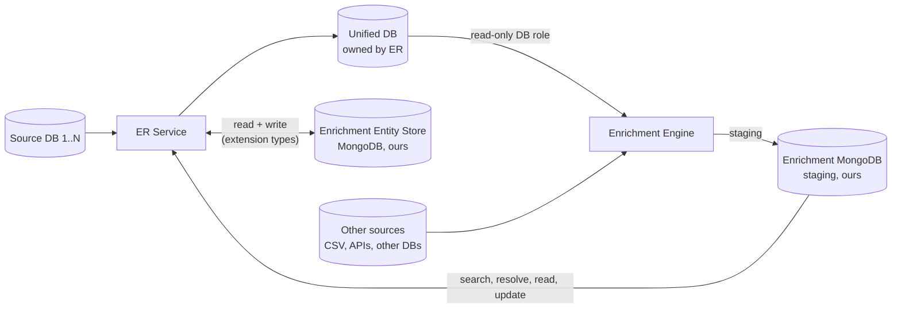

# Entity Resolution (ER) Service — Integration Contract v1.3

| | |
| :--- | :--- |
| **From** | Enrichment Engine team |
| **To** | Entity Resolution (ER) Service team |
| **Status** | **Draft v1.3**: our answer to your v1.2 (2026-11-21). Internal review first, then it goes to you. Please answer §11. |
| **Based on** | v1.2 (yours). Anything this document does not change stays as in v1.2. §12 lists every change. |
| **Machine-readable spec** | `er_service_openapi.json` will be regenerated for v1.3 once you agree (your §9.2). |

---

## 1. Context



What stays from v1.2:
- ER owns the unified DB and is **the only system that creates entities and assigns ids**.
- Our values have the lowest priority. Delete is out of scope.
- **Your schema stays fixed.** We never ask you to add a table or column to the unified DB.

What is new in v1.3:
1. **Two entity stores, one ER.**
   - Types that have a table in the unified DB live there.
   - Types you have no table for (**extension types**, e.g. `certification`) live in **our** MongoDB: a separate database, the *Enrichment Entity Store*.
   - ER resolves, creates and assigns ids for both stores in the same way (§3).
2. **We decide unclear cases.**
   - When ER is sure (`MATCHED`, `CREATED`), ER decides.
   - When it is not (`AMBIGUOUS`), ER returns the candidates and **we** send back our choice, which ER accepts (§5.4).
3. **A side-effect-free search** endpoint stays (§5.3).
4. **Field history.** ER keeps a trace of every field change (§5.7).
5. **Relationships** between entities are **not** stored by ER. We keep them in our MongoDB (answer to your §9.1).

---

## 2. Endpoints — summary

| # | Endpoint | Purpose | v1.3 |
| :--- | :--- | :--- | :--- |
| 1 | `GET  /v1/health` | Readiness check | as v1.2 |
| 2 | `GET  /v1/entity-types` | Types, fields, tables, thresholds, **store** | changed |
| 3 | `PUT  /v1/entity-types/{entity_type}` | **Register an extension type** (lives in our store) | **new** |
| 4 | `POST /v1/entities:search` | **Batch, no side effects.** Candidates + what `resolve` would decide | **new** |
| 5 | `POST /v1/entities:resolve` | Batch. `MATCHED` / `CREATED` / `AMBIGUOUS`; also accepts **our choice** | changed |
| 6 | `GET  /v1/reviews/{ticket}` | ER human review | kept, **not used by us** |
| 7 | `GET  /v1/entities/{entity_type}/{id}` | Read one entity | as v1.2 |
| 8 | `PATCH /v1/entities/{entity_type}/{id}` | Add / correct information | changed |
| 9 | `GET  /v1/entities/{entity_type}/{id}/history` | **Field change history** | **new** |

Auth: `X-API-Key` header, as v1.2. All ids are opaque strings issued by ER.

---

## 3. Two stores

### 3.1 Which store a type lives in

`/v1/entity-types` returns each type with `"store"`:

| `store` | Where the records are | Who defined the type |
| :--- | :--- | :--- |
| `unified` | Your unified DB table (`table`) | You, from your schema |
| `enrichment` | Our Enrichment Entity Store, collection `collection` | Us, registered via `PUT /v1/entity-types/{type}` (§5.2) |

From our side, **the API is the same for both stores.** We call `search`, `resolve`, `GET` and `PATCH` the same way. ER knows where to look.

### 3.2 The Enrichment Entity Store

- A **separate** MongoDB database. It is not our staging database, and ER never sees our staging data.
- Proposed name: `enrichment_entities`, with one collection per extension type.
- **ER gets read and write access** to it. ER creates and updates the records, exactly as it does in the unified DB. We only read it.
- **ER assigns the ids** for these records, in the same format as all other ER ids (e.g. `er_cert_15`).
- Every change ER makes there bumps `version` and appears in the change feed and in history (§6, §5.7), the same as for unified types.

### 3.3 When you later add a table for an extension type

If the unified DB later gets a table for a type that lives in our store (e.g. you add `certification`):
1. ER moves all records from our collection into the new table, **keeping the same ids**.
2. The type's `store` changes to `unified`.
3. The collection is no longer written to.

No id changes, so nothing pointing at those ids breaks.

---

## 4. The conversation

### 4.1 Three kinds of entity

| Kind | Example | What we do |
| :--- | :--- | :--- |
| **A row read from the unified DB** | `Experience` row `er_exp_8821` | Already has an ER id. Never resolved. `PATCH` it with new facts. |
| **A row read from another source** (CSV, API, other DB) | A Boeing row from a CSV file | Has no ER id. **Resolved first**, like anything we found. New facts are then `PATCH`ed to the returned id. |
| **Something found in the text** | Product "737 MAX" in a description | Resolved. |

### 4.2 Step by step

```text
0. GET /v1/entity-types                        once per run
1. read source row (unified DB, or other source → resolve it first)
2. extract entities from its text; map names to your field names; the rest → extra
3. resolve parents first (company), then children with references (product)
     MATCHED / CREATED  → use id
     AMBIGUOUS          → we decide: either send more evidence (new resolve),
                          or send our choice (§5.4)
4. PATCH new facts onto known ids
```

### 4.3 Parents first, and loops

- A child that references a parent (product → `manufacturer`) is resolved only **after** the parent has an ER id.
- If two entities reference each other, we resolve one **without** the reference, then the other, then `PATCH` the missing reference onto the first. So `references` must be optional on `resolve` and settable via `PATCH` (both true in v1.2).

---

## 5. Endpoint details

### 5.1 `GET /v1/entity-types`

As v1.2, plus `store`, and `collection` for extension types:

```json
{
  "entity_types": [
    {
      "entity_type": "company",
      "store": "unified",
      "table": "public.company",
      "fields": { "name": "string", "website": "string", "country": "string" },
      "identity_fields": ["name", "website"],
      "required_fields": ["name"],
      "reference_fields": {},
      "thresholds": { "auto_match": 0.95, "review": 0.70 }
    },
    {
      "entity_type": "certification",
      "store": "enrichment",
      "collection": "enrichment_entities.certification",
      "fields": { "name": "string", "issuer": "string" },
      "identity_fields": ["name", "issuer"],
      "required_fields": ["name"],
      "reference_fields": { "issuer_company": "company" },
      "thresholds": { "auto_match": 0.95, "review": 0.70 }
    }
  ]
}
```

### 5.2 `PUT /v1/entity-types/{entity_type}` — register an extension type (new)

Used when our extraction finds a type you have no table for. Before we call this, a human on our side approves the type and its matching rules.

**Request**
```json
{
  "fields": { "name": "string", "issuer": "string", "valid_until": "date" },
  "identity_fields": ["name", "issuer"],
  "required_fields": ["name"],
  "reference_fields": { "issuer_company": "company" }
}
```

| Case | Status |
| :--- | :--- |
| Registered | `201` with the §5.1 entry (`store: "enrichment"`, thresholds chosen by ER) |
| Same definition again | `200`, no change |
| Name already used by a `unified` type | `409` |
| Bad field type, or an identity / required field not in `fields` | `422` |

Changing an existing extension type (adding a field) is the same call. Fields are only ever **added**, never removed or retyped.

### 5.3 `POST /v1/entities:search` — no side effects (new)

The same request items as `resolve` (§5.4), minus `idempotency_key`, `provenance` and `choice`. **Nothing is created, changed or logged as a decision.**

We use it to:
- preview results before a run
- support evidence gathering
- show results to a human in manual mode, and in our review panel

**Response, per item**
```json
{
  "item_id": "cand_9f3a",
  "would_decide": "AMBIGUOUS",
  "candidates": [
    { "id": "er_comp_220", "score": 0.84, "attributes": { "name": "Apex Systems LLC", "country": "US" } },
    { "id": "er_comp_221", "score": 0.81, "attributes": { "name": "Apex Systems Ltd", "country": "UK" } }
  ],
  "differing_fields": ["country"]
}
```

| Field | Meaning |
| :--- | :--- |
| `would_decide` | `MATCHED`, `CREATED`, `AMBIGUOUS`, `UNSUPPORTED_ENTITY_TYPE` or `INVALID`: what `resolve` would answer **right now**. |
| `candidates` | Best candidates first, up to 10, with score and attributes. |
| `differing_fields` | Fields whose values tell the candidates apart. If we find these values, a new `resolve` can decide. |

### 5.4 `POST /v1/entities:resolve`

Request items as v1.2, with three changes:

1. **`resolve_token` is removed.** Nothing links a later request to an earlier one. A decision may come days later (a human), so nothing may expire.
2. **New optional field `choice`:** our decision after an `AMBIGUOUS` answer.
3. **Every new attempt uses a new `idempotency_key`**, e.g. `run1:cand_9f3a`, then `run1:cand_9f3a:2`, then `run1:cand_9f3a:3`. The v1.2 rule "same key + different payload → `INVALID`" stays and protects retries.

**Ask with more evidence:** a normal resolve item with more `attributes` / `references` / `extra` (typically values for `differing_fields`) and a new key. ER decides again from scratch.

**Send our choice:**
```json
{
  "item_id": "cand_9f3a",
  "idempotency_key": "run1:cand_9f3a:2",
  "entity_type": "company",
  "attributes": { "name": "Apex Systems" },
  "extra": {},
  "provenance": { "...": "as v1.2" },
  "choice": { "id": "er_comp_220" }
}
```
or `"choice": { "new": true }`.

| Choice | What ER does | Answer |
| :--- | :--- | :--- |
| `{ "id": X }` | **Accepts it.** If X was merged, follows the redirect. | `MATCHED`, `id` = X (or its survivor), `decided_by: "client"`, `redirected_from` if a redirect was followed |
| `{ "id": X }`, X never existed | Rejects. | `INVALID` (`UNKNOWN_ID`) |
| `{ "new": true }` | Creates, **unless** a candidate now scores ≥ `auto_match` (created since our search). Then it does not create. | `CREATED`, or `MATCHED` with that id and `"reason": "MATCH_APPEARED"` |

**Decisions (changes to the v1.2 table)**

| `decision` | When |
| :--- | :--- |
| `MATCHED` | **Exactly one** candidate ≥ `auto_match`, or our `choice` |
| `CREATED` | No candidate ≥ `review`, or our `choice` `new` |
| `AMBIGUOUS` | Best score between `review` and `auto_match`, **or two or more candidates ≥ `auto_match`**. Body: `candidates` + `differing_fields`. **On every ask**, not only the first. |
| `PENDING_REVIEW` | **Never returned to the Enrichment Engine.** We have our own review flow. Tickets stay in the contract for other clients. |
| `UNSUPPORTED_ENTITY_TYPE` | Type in neither store. (We register extension types first, so this should be rare.) |
| `INVALID` | As v1.2, plus `UNKNOWN_ID` for a bad `choice`. |

Unchanged from v1.2:
- If the entity was found, nothing on it is changed. We add our new information with `PATCH` afterwards.
- One bad item never fails the batch.
- Concurrent creates of the same entity get one id.

**503 during a merge run:** the **whole request** is rejected with `503` + `Retry-After`, and we resend all of it later. This is the v1.2 behaviour, stated here explicitly.

### 5.5 `GET /v1/entities/{entity_type}/{id}`

As v1.2. Works the same for `enrichment` types.

### 5.6 `PATCH /v1/entities/{entity_type}/{id}`

As v1.2, with these clarifications:

| Our found value | What we send | What ER does |
| :--- | :--- | :--- |
| Field exists, ER value **empty** | `set` | Stores it |
| Field exists, **same** value | nothing | — |
| Field exists, **different** value | `set` | ER's priority rules decide (ours is lowest). Recorded in history either way (§5.7). |
| Field has **several** values, column holds one | best value in `set`, the rest in `extra` | Stores both |
| **No such field** in your schema | `extra` | Kept with the entity, never a column |

- This replaces v1.2 guarantee "PATCH only sets fields that are empty in ER": we **may** send a value that differs from ER's, and ER decides.
- `references` may be set by `PATCH` (used for loops, §4.3).
- `If-Match` stays optional. We send it, and on `412` we re-read and retry.

### 5.7 `GET /v1/entities/{entity_type}/{id}/history` (new)

ER keeps a trace of **every** field change on every entity, from any source, including values that were rejected or later replaced.

```json
{
  "id": "er_comp_104",
  "changes": [
    { "version": 7, "at": "2026-11-20T10:02:00Z", "field": "employee_count",
      "old": null, "new": 170000, "source": "enrichment_engine",
      "provenance": { "run_id": "run1", "source_table": "Experience", "source_record_id": "er_exp_8821" } },
    { "version": 9, "at": "2026-11-23T03:10:00Z", "field": "employee_count",
      "old": 170000, "new": 160000, "source": "registry_db", "reason": "HIGHER_PRIORITY_SOURCE" },
    { "version": 9, "at": "2026-11-23T03:10:00Z", "field": "website",
      "old": null, "new": null, "attempted": "boeing.com/new", "source": "enrichment_engine",
      "reason": "LOWER_PRIORITY_REJECTED" }
  ]
}
```

Query parameter `since_version` (optional). Merged ids redirect, as for `GET`.

---

## 6. Reading the unified DB, change feed

As v1.2 §5: a read-only role, the `merge_engine.er_entity_version` change feed, and the `merge_engine.er_redirect` table.

- **We consume the change feed from day one.** We update our stored ids after merges (redirect) and splits.
- **Extension types are included** in the change feed and the redirect table, so one feed covers both stores.
- For a **split**, please confirm how we can tell which records belong to the new id. Our proposal: a row in `merge_engine.er_split (entity_type, id, new_id, at)`.

---

## 7. Relationships (answer to your §9.1)

We **do not** need ER to store links between entities.
- We keep relationships (e.g. person *works_at* company) in our own MongoDB, using ER ids on both ends.
- We keep them correct through the change feed.
- Relationship types come from a list our users define; ER does not need to know them.

---

## 8. Errors and retries

As v1.2 §6, with these changes:
- A `503` on `resolve` rejects the whole request (§5.4). We wait for `Retry-After` and resend it all.
- We expect no rate limiting and no size limit on `extra` / `source_text` for our client. We still honour `429` + `Retry-After` if it ever comes.

---

## 9. Guarantees

**We guarantee**
1. Your type and field names in `attributes`, everything else in `extra`. Extension types are registered (§5.2) before we resolve them.
2. Rows read from the unified DB are named by their `id`, never resolved. Rows from other sources are resolved first.
3. Parents before children. References are real ER ids.
4. A new `idempotency_key` per attempt and a stable key per retry. `Idempotency-Key` on every `PATCH`.
5. Guessed values marked in `inferred_fields`. Provenance on every write. No delete.
6. We never write to the unified DB or to the Enrichment Entity Store. All writes go through the API.
7. We check extractions before sending (no generic names such as "the company", required fields present).

**You guarantee**
1. ER alone assigns ids, in both stores.
2. ER decides `MATCHED` / `CREATED` when it is sure. When it is not, it returns `AMBIGUOUS` with candidates and `differing_fields`, and **accepts our `choice`**, with the one exception in §5.4.
3. `search` has no side effects.
4. Concurrent resolves of the same new entity get one id.
5. Ids never stop working: merges redirect (also for a chosen id); splits appear in the feed.
6. Every change, in both stores, bumps `version`, appears in the change feed and is kept in history (§5.7).
7. `PENDING_REVIEW` is never returned to the Enrichment Engine.
8. Moving an extension type into the unified DB keeps its ids (§3.3).

---

## 10. Performance

As v1.2 §7. Add: `search`, 100 items, p95 ≤ 500 ms.

---

## 11. Open questions for you

1. **Your real types.** Please send the current output of `GET /v1/entity-types`. Which types do you have today (company, person, product, …)?
2. **Extension types in our MongoDB (§3).** Can ER work on a second store that is a MongoDB database we own? What do you need from us: connection string, network access, a dedicated user?
3. **Registering extension types (§5.2).** Is the shape OK? Do you set the thresholds, or should we propose them?
4. **History (§5.7).** Do you already keep field-level history? Is the shape OK, including rejected attempts?
5. **Splits (§6).** How can we tell which records go to the new id?
6. **`choice` (§5.4).** Any problem with accepting our choice, and with the `MATCH_APPEARED` exception for `new`?
7. **Two or more ≥ `auto_match` → `AMBIGUOUS`.** OK?
8. **Moving extension types into the unified DB (§3.3)**, with ids kept. OK?

---

## 12. Changes from v1.2

| v1.2 | v1.3 | Why |
| :--- | :--- | :--- |
| Types without a table → `UNSUPPORTED_ENTITY_TYPE` | **Extension types** in our MongoDB, resolved by ER, ER ids; `PUT /v1/entity-types/{type}` | Nothing we find is lost, and ER still owns all ids |
| `/v1/entity-types` | adds `store`, `collection` | Two stores |
| No search | **`POST /v1/entities:search`**, side-effect free, with `would_decide` | Preview, manual mode, review panel |
| `AMBIGUOUS` → second ask with token → ER decides → human ticket | `AMBIGUOUS` → **we decide**: more evidence (new resolve) or `choice`; **no token**; no tickets for us | We have our own review flow; humans may decide days later |
| Same key for the second ask (would be `INVALID`) | New `idempotency_key` per attempt | Fixes the conflict |
| Best ≥ `auto_match` → `MATCHED` | **Exactly one** ≥ `auto_match` → `MATCHED`; two or more → `AMBIGUOUS` | Covers duplicates inside ER |
| `PATCH` only empty fields | `PATCH` may send differing values; ER priority decides; multi-values → `extra` | We report what we found; ER decides |
| — | `GET .../history` | Trace of every change, including replaced values |
| Change feed | Also covers extension types; split table proposed | We sync ids from day one |
| §9.1 relationships open | Not needed from ER; kept by us | — |
| `503` scope unclear for batches | Whole request rejected | Stated explicitly |

Your §9.3, `resolve` replacing `search` + `create`: **agreed for writes.** We keep a search that never writes.

---

## 13. Change log

| Version | Date | Change |
| :--- | :--- | :--- |
| v1 | 2026-11-18 | First version, Enrichment Engine team |
| v1.2 | 2026-11-21 | ER team answer |
| v1.3 (draft) | 2026-11-23 | Enrichment Engine answer: extension store, client choice on `AMBIGUOUS`, search, history, no token, per-attempt keys |
