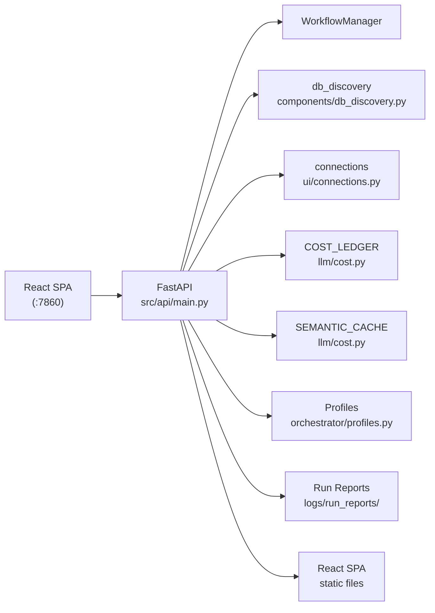

# API Layer Overview

## Purpose

The API layer (`src/api/main.py`) is a thin JSON wrapper around the framework-agnostic backend. It provides:

1. **Workflow lifecycle endpoints** — start, pause, resume, status, abort
2. **Connection testing & schema discovery** — validate origin/destination DB connections
3. **Profile management** — build, save, load, list, delete saved run profiles
4. **Configuration management** — platform overrides, session env overrides, provenance tracking
5. **Cost & tracing** — access the LLM cost ledger and semantic cache stats
6. **Run reports** — read reconciliation reports written after load completion
7. **React SPA serving** — static files from `src/ui/frontend/dist/`

No merge or business logic lives in the API layer — every endpoint delegates to `WorkflowManager`, `db_discovery`, `connections`, or the LLM cost/tracing modules.

## Architecture

## Application Lifecycle

The FastAPI app uses an async lifespan context manager (`@asynccontextmanager`) for startup and shutdown:

**Startup:**
1. Loads `.env` file relative to project root
2. Creates the single long-lived `WorkflowManager` singleton (lazy-built)
3. Creates `COST_LEDGER` and `SEMANTIC_CACHE` (LLM cost controls)
4. Initializes Langfuse tracing callback handler

**Shutdown:**
1. Flushes Langfuse traces
2. Cleans up completed workflows in `WorkflowManager`

The `WorkflowManager` is built lazily — importing this module is cheap because the manager only instantiates when the first request hits. The module-level `_manager: WorkflowManager | None = None` is populated by `get_manager()` which calls `_build_manager()` on first access.

## Key Symbols

| Symbol | File | Role |
|--------|------|------|
| `get_app()` | `src/api/main.py:509` | Creates and returns the FastAPI app with lifespan |
| `get_manager()` | `src/api/main.py:100` | Lazy singleton accessor for `WorkflowManager` |
| `_RUN_REPORTS_DIR` | `src/api/main.py:78` | `Path("logs") / "run_reports"` — where reconciliation reports land |
| `_FRONTEND_DIST` | `src/api/main.py:97` | Absolute path to `src/ui/frontend/dist/` |
| `_GOLDEN_SUBJECTS` | `src/api/main.py:81` | `("boeing", "airbus", "lockheed")` — golden subjects for eval |
| `_SESSION_ENV_OVERRIDES` | `src/api/main.py:256` | Session-only env var overrides, reset on process restart |

## Thread Safety

The `WorkflowManager` runs graphs on a background daemon thread per workflow while the API serves status reads on the main thread. The `_LoopSafeSqliteSaver` in `src/orchestrator/workflow_manager.py` bridges async checkpoint methods to lock-serialized sync SQLite operations via `asyncio.to_thread()`, making checkpoint reads and writes safe across threads.

## Cross-References

| Concern | Page |
|---------|------|
| All endpoints | [API Endpoints](/openwiki/api/endpoints.md) |
| Workflow lifecycle | [Workflow Manager](/openwiki/orchestrator/workflow_manager.md) |
| Profile management | [Saved Profiles](/openwiki/orchestrator/profiles.md) |
| Cost ledger | [LLM Cost](/openwiki/llm/cost.md) |
| Connection persistence | [Recent Connections](/openwiki/ui/recent_connections.md) |
