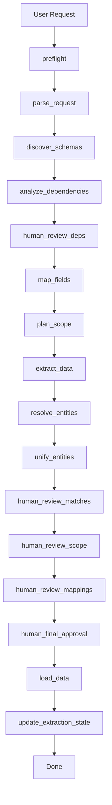

# Architecture Overview

## What It Does

Merge-engine takes data from one or more heterogeneous origin databases (PostgreSQL, MongoDB, ClickHouse) and unifies it into a single destination (PostgreSQL or ClickHouse). The pipeline is driven by a natural-language request from the user ("merge customers from both DBs"), parsed by an LLM, and executed through a LangGraph state graph with five human-in-the-loop (HITL) review gates that can abort the run before any data is written.

## Core Pipeline Stages



Each stage is an async node function operating on a typed `MergeState` dict. The pipeline can be **scoped** (merge only data about a specific subject, e.g. "Nova") or **full** (all extracted tables).

## Architectural Layers

<!-- openwiki: mermaid parse failed and this diagram was converted to a text fence so it does not break rendering. Fix the diagram source and restore the mermaid fence. Parser error: Heuristic: an unescaped angle bracket inside a label breaks rendering; rephrase the label. -->
```text
flowchart LR
    subgraph Frontend
        A["React SPA\n(Vite/TS)"]
    end
    subgraph API Layer
        B["FastAPI\nsrc/api/main.py"]
        B --> C["WorkflowManager"]
    end
    subgraph Orchestration
        D["LangGraph StateGraph\nsrc/orchestrator/graph.py"]
        D --> E["Pipeline Nodes"]
    end
    subgraph Data Layer
        F["DuckDB Spool\nlogs/spool/<run>.duckdb"]
        G["SQLite Checkpoints\ndata/checkpoints.db"]
    end
    subgraph Connectors
        H["PostgreSQL\nMongoDB\nClickHouse"]
        I["PostgreSQL Dest.\nClickHouse Dest.\nDatabricks"]
    end
    A --> B
    B --> D
    E --> F
    E --> G
    E --> H
    E --> I
```

### 1. Frontend — React SPA

A Vite-built TypeScript React application served as static files by the FastAPI backend on port 7860 (default). State management is client-side; all data flows through the FastAPI JSON API. See [UI Overview](/openwiki/ui/overview.md) for details.

### 2. API Layer — FastAPI

The `src/api/main.py` module provides a thin JSON wrapper around `WorkflowManager`. No merge or business logic lives here — every endpoint delegates. It also serves the built React SPA and the MCP server can be started on the same process (port 8000) via `--mode both`. See [API Overview](/openwiki/api/overview.md) and [API Endpoints](/openwiki/api/endpoints.md).

### 3. Orchestration — LangGraph State Graph

The core pipeline is a `StateGraph` built in `src/orchestrator/graph.py`. Nodes are plain async functions; LangGraph's `SqliteSaver` checkpointer persists state after every node, which is what makes the HITL pause (`interrupt_before`) survive an app restart.

**Key design decision**: Row **data** does not live in the checkpointed state — it lives in a per-run DuckDB file (the "spool") under `logs/spool/<run_id>.duckdb`. A 43-million-row list inside a checkpoint is not something SQLite should serialize on every step.

See [Orchestrator Overview](/openwiki/orchestrator/overview.md) and [State Graph](/openwiki/orchestrator/graph.md).

### 4. LLM Integration Layer

A unified `LLMClient` in `src/llm/client.py` wraps LangChain (OpenAI, Azure OpenAI, Anthropic) with structured JSON output, semantic caching (bounded 5000-entry LRU), cost ledger (token accounting), and Langfuse tracing. Prompt templates live in `src/llm/prompts/` as `.system.txt` / `.human.txt` pairs for 6 pipeline stages.

See [LLM Overview](/openwiki/llm/overview.md).

### 5. Database Connectors

A registry of source connectors (`PostgresConnector`, `MongoDBConnector`, `ClickHouseConnector`, `DatabricksConnector`) under `src/mcp_server/connectors/` sharing a `BaseConnector` interface. Source connectors provide `discover_schema()` and `extract()`. Destination connectors (`PostgreSQLDestinationConnector`, `ClickHouseDestinationConnector`) provide upsert and schema extension capabilities.

Shared utilities include filter normalization, keyset (seek) pagination, and watermark column detection.

See [Connectors Overview](/openwiki/connectors/overview.md).

### 6. MCP Server

The Model Context Protocol server (`src/mcp_server/server.py`) exposes 7 tools for external AI agents and automation scripts: `discover_schema`, `extract_data`, `resolve_entities`, `unify_entity_group`, `map_fields`, `load_data`, and `extend_schema`. Tool implementations are shared async functions also called directly by LangGraph nodes.

See [MCP Overview](/openwiki/mcp/overview.md).

### 7. Configuration System

`config/config.yaml` provides base settings (destination type, LLM model, retry config). `config/platform_overrides.yaml` (gitignored) allows runtime overrides via the API. `${ENV_VAR}` placeholders in config are resolved from `.env` at load time. All values are validated against Pydantic models.

See [Configuration Overview](/openwiki/configuration/overview.md).

### 8. Saved Run Profiles

A profile pins the LLM's non-deterministic metadata decisions: which source tables hold each entity, matching rules, conflict resolution policy, and field mappings. Secrets (passwords) are stripped on save. Profiles are matched to live credentials by a connection key (host|port|database|user|type), so reordering origins cannot silently point a profile at the wrong server.

See [Saved Profiles](/openwiki/orchestrator/profiles.md).

## Status

All planned phases (0 through P) are implemented, unit-tested, and verified live against real databases:

- **Correctness (Phase K):** reject stops the run at all 4 gates; match-gate decisions are applied; deterministic cluster IDs make re-runs idempotent.
- **Matching precision (Phase L):** Fellegi–Sunter probabilistic scoring with term-frequency adjustment; layered blocking; clustering with conflict-repair and cohesion cut. Measured: pairwise precision 1.0000, recall 1.0000 on the eval harness.
- **Resilience (Phase M):** Typed error taxonomy drives per-node retry policy and human escalation; preflight checks; transactional loads.
- **Scale (Phase N):** Keyset pagination and DuckDB spool replace OFFSET pagination and in-checkpoint row lists. Proven against a 43,276,150-row ClickHouse table: 44.6 minutes, 16,184 rows/s, 380.8 MB peak memory.
- **Customization (Phase O):** Saved run profiles, per-entity matching rules, configurable conflict resolution, LLM semantic cache, per-run token ledger.
- **Targeted merges (Phase P):** Scoped merges extract only the subject and its linked entities via direct name match, foreign-key link, or two-hop link through junction tables.

## Cross-References

| Concern | Page |
|---------|------|
| API endpoints | [API Endpoints](/openwiki/api/endpoints.md) |
| State graph wiring | [State Graph](/openwiki/orchestrator/graph.md) |
| Workflow lifecycle | [Workflow Manager](/openwiki/orchestrator/workflow_manager.md) |
| Row storage (spool) | [DuckDB Spool](/openwiki/orchestrator/spool.md) |
| LLM client | [LLM Client](/openwiki/llm/client.md) |
| Cost tracking | [LLM Cost](/openwiki/llm/cost.md) |
| Database connectors | [Connectors Overview](/openwiki/connectors/overview.md) |
| MCP tools | [MCP Overview](/openwiki/mcp/overview.md) |
| Error taxonomy | [Error Handling](/openwiki/orchestrator/utils/error_handling.md) |
| HITL gates | [Human-in-the-Loop](/openwiki/orchestrator/nodes/human_in_the_loop.md) |
| Saved profiles | [Saved Profiles](/openwiki/orchestrator/profiles.md) |
<!-- openwiki: broken internal link [/openwiki/data/state_schema.md] file "/openwiki/data/state_schema.md" does not exist. Fix the href or restore the target, then delete this comment. -->
| State schema | [Merge State](/openwiki/data/state_schema.md) |
