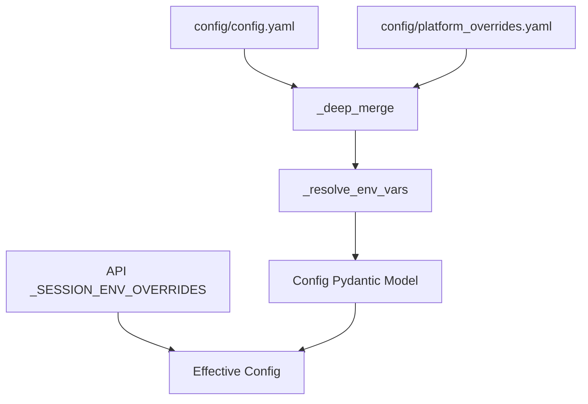

# Configuration System Overview

## Purpose

The configuration system provides validated, layered configuration for
merge-engine. It combines a base YAML file, platform-specific overlays,
environment variable substitution, and session-only overrides.

## File

`src/utils/config_loader.py` — Pydantic models and loading
`src/api/main.py` — `_SESSION_ENV_OVERRIDES` and `_provenance()`

## Configuration Layers



### Layer 1: Base Config (`config/config.yaml`)

Contains destination settings, LLM configuration, retry defaults, and
extraction defaults.

### Layer 2: Platform Overrides (`config/platform_overrides.yaml`)

Gitignored overlay for site-specific customizations. Deep-merged into the
base config at load time.

### Layer 3: Environment Variables

`${ENV_VAR}` placeholders in the config are resolved against the process
environment. The `.env` file is loaded automatically relative to the project
root.

### Layer 4: Session Env Overrides

Per-session environment variable overrides set via the API (`POST /api/config/env`),
reset on process restart. Stored in `_SESSION_ENV_OVERRIDES`.

## Provenance Tracking

The `_provenance()` closure in `src/api/main.py` traces each config value
back to its source:

```python
def _provenance(section: str, key: str) -> str:
    if key in (overlay.get(section) or {}):
        return "override"
    raw_val = (base_raw.get(section) or {}).get(key)
    if isinstance(raw_val, str) and raw_val.startswith("${") and raw_val.endswith("}"):
        return "env"
    return "file"
```

Returns `"override"`, `"env"`, or `"file"` for each config value.

## Secret Handling

Passwords and API keys are stripped before saving platform overrides:

```python
_SECRET_CONFIG_KEYS = ("password", "passwd", "secret", "api_key", "token")


def _strip_config_secrets(value):
    if isinstance(value, dict):
        return {
            k: "" if k.lower() in _SECRET_CONFIG_KEYS and v else _strip_config_secrets(v)
            for k, v in value.items()
        }
    # ... similar for lists and scalars
```

## Test Coverage

- `tests/unit/test_config_loader.py` — config loading, validation, override merging (13KB)
