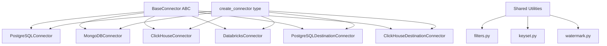

# Database Connectors Overview

## Purpose

The connector layer provides a uniform abstraction over heterogeneous source
databases (PostgreSQL, MongoDB, ClickHouse) and destination databases
(PostgreSQL, ClickHouse, Databricks). Every connector implements the
`BaseConnector` interface for schema discovery and data extraction, and
destination connectors additionally implement load methods.

## File

`src/mcp_server/connectors/__init__.py` — factory registry

## Architecture



## BaseConnector Interface

```python
class BaseConnector(ABC):
    def __init__(self, config: dict[str, Any]) -> None: ...
    async def discover_schema(self) -> dict[str, Any]: ...
    async def extract(
        self,
        table: str,
        filter: dict[str, Any] | None = None,
        offset: int = 0,
        limit: int = 1000,
    ) -> dict[str, Any]: ...
    async def close(self) -> None: ...
```

Key contract:

- `discover_schema()` returns `{"tables": [{"name": str, "columns": [{"name": str, "type": str}], "sample": [...], "foreign_keys": [...]}, ...]}`
- `extract()` returns `{"rows": [...], "total": int, "has_more": bool}`
- All methods are async
- Connection lifecycle: `__init__` → `discover_schema()` → `extract()` → `close()`

## Factory Registry

`create_connector(type: str, config: dict) -> BaseConnector` creates the right connector:

```python
REGISTRY = {
    "postgres": PostgresConnector,
    "postgresql": PostgresConnector,
    "clickhouse": ClickHouseConnector,
    "mongodb": MongoDBConnector,
    "databricks": DatabricksConnector,
    "postgresql_dest": PostgreSQLDestinationConnector,
    "clickhouse_dest": ClickHouseDestinationConnector,
}
```

## Connector Registry

### Source Connectors

| Connector | Type | Driver | Key Feature |
|-----------|------|--------|-------------|
| `PostgresConnector` | `postgres` | SQLAlchemy + asyncpg | Keyset pagination, watermark pushdown |
| `ClickHouseConnector` | `clickhouse` | clickhouse-connect | Scratch-table for large IN filters |
| `MongoDBConnector` | `mongodb` | PyMongo AsyncMongoClient | Collection discovery via document sampling |
| `DatabricksConnector` | `databricks` | databricks-sql-connector | Dual role: source + destination |

### Destination Connectors

| Connector | Type | Driver | Purpose |
|-----------|------|--------|---------|
| `PostgreSQLDestinationConnector` | `postgresql_dest` | psycopg2 | PostgreSQL/ClickHouse destination writes |
| `ClickHouseDestinationConnector` | `clickhouse_dest` | clickhouse-connect | ClickHouse destination writes |

## Shared Utilities

All source connectors use shared utilities from:

| Module | Purpose |
|--------|---------|
| `filters.py` | Filter normalization (eq, ilike, in, in_scratch) |
| `keyset.py` | Keyset (seek) pagination cursors |
| `watermark.py` | Watermark column detection for incremental extraction |

## Test Coverage

- `tests/unit/test_connectors.py` — general connector tests
- `tests/unit/test_connectors_base.py` — BaseConnector interface
- `tests/unit/test_postgres_connector.py` — PostgreSQL connector (31KB, most comprehensive)
- `tests/unit/test_mongodb_connector.py` — MongoDB connector (27KB)
- `tests/unit/test_clickhouse_scratch_table.py` — ClickHouse scratch table
- `tests/unit/test_databricks_connector.py` — Databricks connector (22KB)
- `tests/unit/test_postgresql_destination.py` — PostgreSQL destination (37KB)
