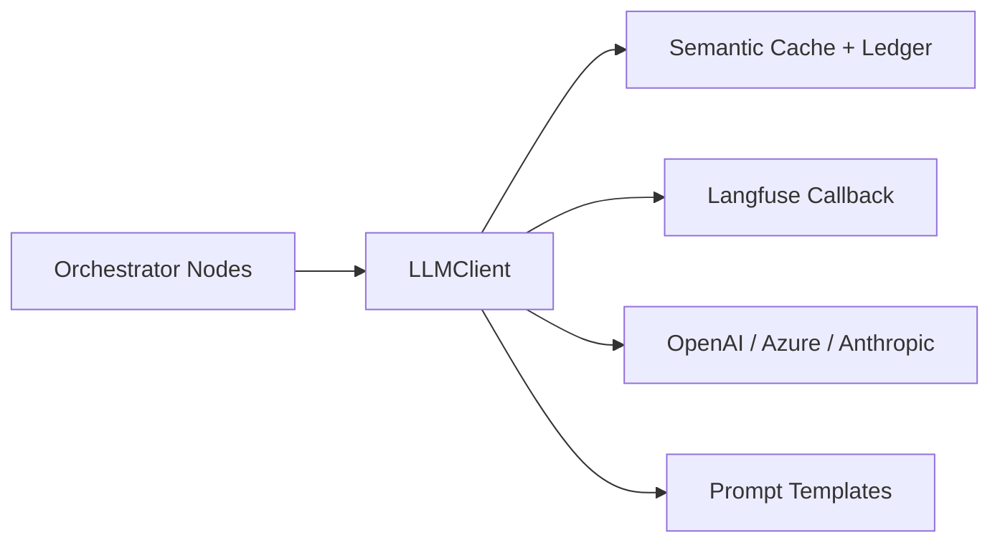

# LLM Integration Overview

## Purpose

The LLM layer provides a unified interface for all large language model
interactions in merge-engine. It wraps LangChain to support multiple providers
(OpenAI, Azure, Anthropic), manages semantic caching to reduce costs, tracks
token usage for auditing, and integrates with Langfuse for observability.

## File

| Component | File |
|-----------|------|
| LLM Client | `src/llm/client.py` |
| Cost Controls | `src/llm/cost.py` |
| Tracing | `src/llm/tracing.py` |
| Prompt Templates | `src/llm/prompts/` (13 files) |
| Module Init | `src/llm/__init__.py` |

## Architecture

## Components

### LLMClient

Unified async client wrapping LangChain chat models:

- **Provider support**: OpenAI (`ChatOpenAI`), Azure OpenAI, Anthropic (`ChatAnthropic`)
- **Structured output**: JSON schema response format when available
- **Quota fallback**: `model_chain` advances on quota/billing errors
- **Semantic caching**: Integrates with `SemanticCache` for repeated prompts

### Cost Controls

Two separate subsystems kept apart in `src/llm/cost.py`:

1. **Semantic Cache** — bounded LRU (5000 entries), thread-safe, keyed on normalized prompt hash
2. **Cost Ledger** — token accounting with per-model pricing

### Prompt Templates

Six stages, each with a (system, human) prompt pair loaded from
`src/llm/prompts/*.txt`:

| Stage | Files | Used By |
|-------|-------|---------|
| `request_parsing` | `request_parsing.system.txt` / `.human.txt` | `parse_request` node |
| `dependency_analysis` | `dependency_analysis.system.txt` / `.human.txt` | `analyze_dependencies` node |
| `entity_table_selection` | `entity_table_selection.system.txt` / `.human.txt` | `analyze_dependencies` node |
| `scope_planning` | `scope_planning.system.txt` / `.human.txt` | `plan_scope` node |
| `entity_resolution` | `entity_resolution.system.txt` / `.human.txt` | `resolve_entities` node |
| `field_mapping` | `field_mapping.system.txt` / `.human.txt` | `map_fields` node |

### Tracing

Langfuse integration provides:

- Shared callback handler on every LLM call
- Trace ID binding for HITL resume linkage
- Nested spans under owning graph-node spans
- Graceful degradation when Langfuse is unreachable (no-op)

## Test Coverage

- `tests/unit/test_llm_client.py` — LLM client behavior
- `tests/unit/test_llm_cost.py` — cache + ledger
- `tests/unit/test_tracing.py` / `tests/unit/test_utils_tracing.py` — tracing
