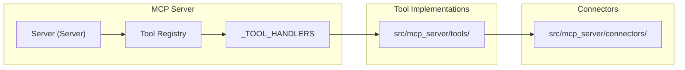

# MCP Server Overview

## Purpose

The Model Context Protocol server (`src/mcp_server/server.py`) exposes merge-engine's capabilities as standardized MCP tools for external AI agents and automation scripts. The server runs on port 8000 (default) via `uvicorn` when started with `--mode mcp` or `--mode both`.

## Architecture



The server uses the `mcp.server.Server` class and registers handlers for the MCP `tools/list` and `tools/call` RPC methods. Tool implementations are plain async functions in `src/mcp_server/tools/` that are also called directly by LangGraph orchestrator nodes — this shared implementation pattern ensures consistency between MCP usage and pipeline usage.

## Tool Registry

Seven tools are registered in `_TOOL_HANDLERS`:

| # | Tool Name | Handler | Purpose |
|---|-----------|---------|---------|
| 1 | `discover_schema` | `discover_schema_handler` | Connect to origin DB, return tables/columns/types/samples/FKs |
| 2 | `extract_data` | `extract_data_handler` | Extract rows with batch pagination and watermark support |
| 3 | `resolve_entities` | `resolve_entities_impl` | Cluster matching records using blocking + LLM scoring |
| 4 | `unify_entity_group` | `unify_entity_group_handler` | Merge matched clusters into unified records |
| 5 | `map_fields` | `map_fields_handler` | Map unified fields to destination columns |
| 6 | `load_data` | `load_data_handler` | Upsert unified records to destination with FK translation |
| 7 | `extend_schema` | `_extend_schema_handler` | Add new columns to Databricks destination tables |

**Dynamic registration:** The `register_tool(name, handler)` function (line 359) allows additional tools to be registered at runtime into `_TOOL_HANDLERS`.

## Server Initialization

The server is initialized via `initialize_server(config)`:

```python
# In server.py
app = Server("merge-engine")
_config: dict[str, Any] | None = None


def initialize_server(config: Any) -> None:
    global _config
    _config = config


def _get_config() -> Any:
    if _config is None:
        raise RuntimeError("MCP server not initialized")
    return _config
```

The config is set at startup by `src/main.py` when the MCP mode is selected. It provides access to the validated `Config` object (destination, LLM settings, retry config) needed by tool handlers.

## Compatibility Patching

The server includes compatibility patches for older MCP library versions (lines 20-56):

1. **`Server.list_tools`** — If the `list_tools` decorator doesn't exist, installs a fallback request handler for `tools/list`.
2. **`Server.call_tool`** — If the `call_tool` decorator doesn't exist, installs a fallback for `tools/call`.
3. **`Tool.inputSchema`** — For Pydantic v2 models where `hasattr(Tool, "inputSchema")` is False on the class, installs a property that reads from `input_schema` attribute.

## Configuration Access

Tools access configuration via `_get_config()` which returns the validated `Config` object. This includes:

- `config.destination` — `DestinationConfig` with type, host, port, database
- `config.llm` — `LLMConfig` with provider, model, api_key, temperature
- `config.retry` — `RetryConfig` with max_attempts, backoff settings

Tools typically call `create_connector(config.destination.type, config.destination.model_dump())` to get a connector instance for database operations.

## Cross-References

| Concern | Page |
|---------|------|
| Tool: discover_schema | [discover_schema Tool](/openwiki/mcp/tools/discover_schema.md) |
| Tool: extract_data | [extract_data Tool](/openwiki/mcp/tools/extract_data.md) |
| Tool: resolve_entities | [resolve_entities Tool](/openwiki/mcp/tools/resolve_entities.md) |
| Tool: unify_entity_group | [unify_entity_group Tool](/openwiki/mcp/tools/unify_entity_group.md) |
| Tool: map_fields | [map_fields Tool](/openwiki/mcp/tools/map_fields.md) |
| Tool: load_data | [load_data Tool](/openwiki/mcp/tools/load_data.md) |
| Tool: extend_schema | [extend_schema Tool](/openwiki/mcp/tools/extend_schema.md) |
| Connector factory | [Connectors Overview](/openwiki/connectors/overview.md) |
| Error taxonomy | [Error Handling](/openwiki/orchestrator/utils/error_handling.md) |
