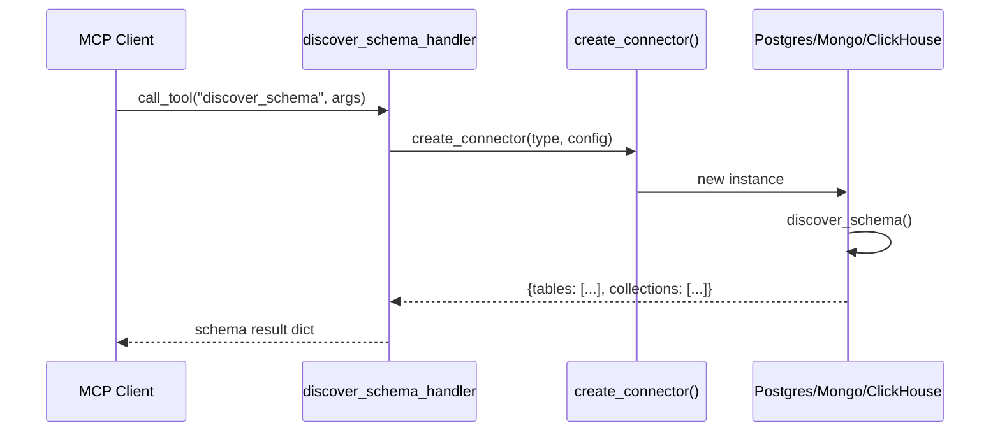

# discover_schema Tool

## Purpose

Connects to an origin database and returns a comprehensive schema description including table names, column definitions (name, type, nullable), sample values, and foreign key relationships. This is the first tool called in any merge pipeline to understand the source data landscape.

## Handler

**File:** `src/mcp_server/server.py:95-111` (tool definition), `src/mcp_server/tools/discover_schema.py:discover_schema_handler` (handler)

**Tool definition:**
```python
Tool(
    name="discover_schema",
    description="Connect to an origin database and return all tables/collections with column names, types, one sample value, and foreign keys.",
    input_schema={"type": "object", "properties": {
        "connection": {...},      // DB connection config
        "type": "postgres|clickhouse|mongodb",
        "sample_row_count": 5,    // Optional: samples per table
    }},
)
```

## Flow



## Implementation Details

The handler in `src/mcp_server/tools/discover_schema.py`:

1. Creates a connector via `create_connector(type, connection_config)`
2. Calls `connector.discover_schema()` — which is implemented per-connector type:
   - **PostgreSQL:** queries `information_schema.tables` and `information_schema.columns`, plus `pg_constraint` for FKs
   - **MongoDB:** samples collections to infer schema, returns collection names with representative document structure
   - **ClickHouse:** queries `system.tables` and `system.columns`
3. For each table/collection, fetches sample rows (configurable via `sample_row_count`, default 5)
4. Returns a structured dict: `{origin_id: {"tables": [{"name", "columns": [...], "foreign_keys": [...], "samples": [...]}]}}`

## Error Handling

Wraps any exception in `PermanentError` — schema discovery failures are unrecoverable (bad credentials, wrong host, etc.).

## Source Symbol

- `discover_schema_handler` at `src/mcp_server/tools/discover_schema.py`
- Tool registered at `src/mcp_server/server.py:95`

## Cross-References

| Concern | Page |
|---------|------|
| PostgreSQL schema discovery | [PostgreSQL Connector](/openwiki/connectors/postgres.md) |
| MongoDB collection discovery | [MongoDB Connector](/openwiki/connectors/mongodb.md) |
| ClickHouse schema discovery | [ClickHouse Connector](/openwiki/connectors/clickhouse.md) |
| Orchestrator node equivalent | [Discover Schemas Node](/openwiki/orchestrator/nodes/discover_schemas.md) |
