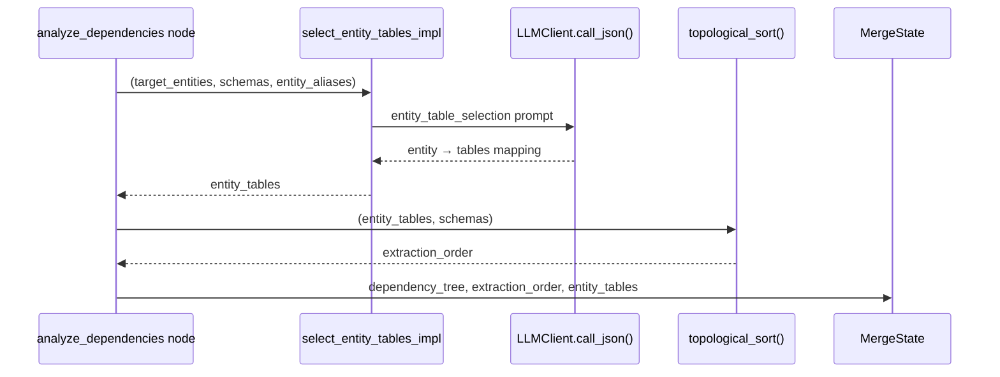

# Analyze Dependencies Node

## Purpose

Analyzes the discovered schemas to build an entity dependency tree. This determines:
1. **Which source tables hold each entity** — via LLM-based table selection
2. **Dependency order** — which entities must be extracted before others (for FK references)
3. **Column-level dependencies** — which columns in one entity reference columns in another

## File

`src/orchestrator/nodes/analyze_dependencies.py` (~12KB)

## Flow



## Implementation

1. Calls `select_entity_tables_impl` (shared with MCP server) to determine which tables hold each entity
2. Uses `topological_sort()` from `dependency_sort.py` to build execution order
3. LLM-based dependency analysis via the `dependency_analysis` prompt template for column-level FK relationships
4. Produces `dependency_analysis_warning` if the analysis detects potential issues (circular deps, missing tables)

## State

Produces:

```python
{
    "dependency_tree": {entity: [dependent_entities]},
    "extraction_order": ["entity_a", "entity_b"],
    "entity_tables": {"company": ["companies", "corporations"]},
    "column_dependencies": [...],
    "table_selection_notes": "string",
}
```

## Retry Policy

Carries `NETWORK_RETRY` — both table selection and dependency analysis are LLM calls.

## Test Coverage

- `tests/unit/test_analyze_dependencies_node.py` — dependency tree construction (19KB)

## Cross-References

| Concern | Page |
|---------|------|
| Entity table selection | [Entity Table Selection](/openwiki/orchestrator/utils/select_entity_tables.md) |
| Topological sort | [Dependency Sort](/openwiki/orchestrator/utils/dependency_sort.md) |
| Prompt templates | [LLM Prompts](/openwiki/llm/prompts.md) |
