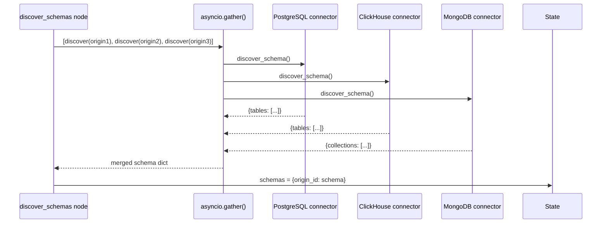

# Discover Schemas Node

## Purpose

Concurrently discovers the schema of all origin databases. Uses `asyncio.gather` to parallelize discovery across all origins, significantly reducing total discovery time for multi-origin merges.

## File

`src/orchestrator/nodes/discover_schemas.py` (~4.7KB)

## Flow



## Implementation

1. Iterates over all origin configs
2. Creates a connector for each via `create_connector(type, connection)`
3. Calls `connector.discover_schema()` concurrently
4. Merges results into `MergeState.schemas`:

```python
{
    "origin_1": {
        "type": "postgres",
        "tables": [
            {"name": "customers", "columns": [...], "foreign_keys": [...]},
            {"name": "orders", "columns": [...], "foreign_keys": [...]},
        ],
    },
    "origin_2": {
        "type": "clickhouse",
        "tables": [...],
    },
}
```

5. Closes all connectors after discovery

## Retry Policy

Carries `NETWORK_RETRY` — each origin's schema discovery can transiently fail.

## Test Coverage

- `tests/unit/test_discover_schemas_node.py` — concurrent discovery correctness

## Cross-References

| Concern | Page |
|---------|------|
| Graph wiring | [State Graph](/openwiki/orchestrator/graph.md) |
| MCP tool | [discover_schema Tool](/openwiki/mcp/tools/discover_schema.md) |
| Connectors | [Connectors Overview](/openwiki/connectors/overview.md) |
