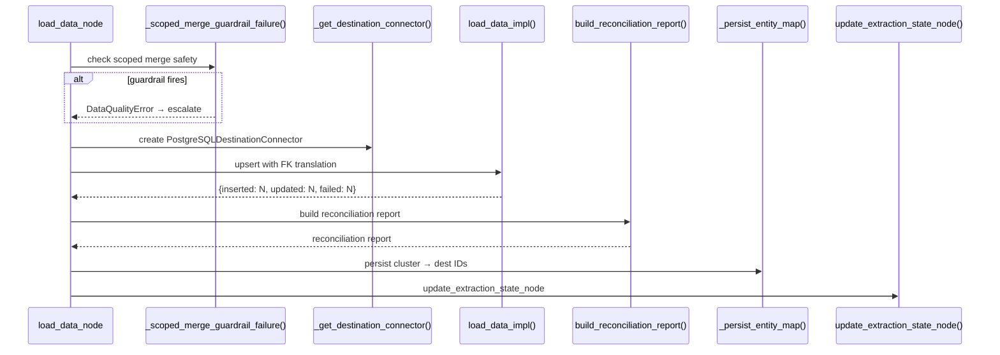

# Load Data Node

## Purpose

Upserts unified records into the destination database (PostgreSQL or ClickHouse). Applies field mappings, transforms records, handles foreign key translation, produces reconciliation reports, and persists watermarks for incremental extraction.

## File

`src/orchestrator/nodes/load_data.py` (~38KB — one of the largest node files)

## Flow



## Scoped Merge Guardrail

`_scoped_merge_guardrail_failure()` (lines 42-83) prevents duplicate loading when the matcher collapses all clusters to singletons — the exact Airbus 20→20 / Lockheed 9→9 matcher-collapse failure pattern.

**Firing conditions:**
1. `merge_scope.active` is True (scoped merge)
2. ≥5 clusters formed for the subject entity
3. Multi-record clusters exist (2+ records per cluster)
4. **Zero** auto-merges among them

Returns a `DataQualityError` with `disposition: "escalate"` — the run pauses for human review rather than shipping duplicates.

Threshold: `_SCOPED_MERGE_GUARDRAIL_MIN_CLUSTERS = 5`.

## Reconciliation Report

`build_reconciliation_report()` (lines 86-251) produces per-entity reconciliation numbers:

```python
{
    "run_id": "...",
    "generated_at": "...",
    "entities": {
        "company": {
            "extracted_per_origin": {"origin_1": 100, "origin_2": 50},
            "extracted_total": 150,
            "candidate_pairs": 28170,
            "uncompared_pairs": 0,
            "clusters_formed": 130,
            "auto_merged_clusters": 92,
            "human_reviewed_clusters": 38,
            "unified_records": 100,
            "conflicts": {"email": 5, "phone": 3},
            "conflict_fields": {...},
            "conflict_winning_rules": {"email": "priority", "phone": "completeness"},
            "rows_inserted": 42,
            "rows_updated": 58,
            "rows_dropped": 0,
            "type_coercion_failures": 2,
            "subject_unification_ratio": 0.85,
        }
    },
    "new_columns": [...],
    "errors": [...],
    "data_quality": {
        "grade": "B",  # A (clean), B (minor issues), C (type coercion/dropped fields), F (rolled back)
        "red_flags": ["type_coercion_failures: 2"],
    },
    "timings": {...},
}
```

### Data Quality Grading

| Grade | Condition |
|-------|-----------|
| **A** | Clean — no red flags |
| **B** | Minor issues (e.g., small number of uncompared pairs) |
| **C** | Type coercion failures or fields dropped from mapping |
| **F** | Load rolled back or zero auto-merges in scoped merge |

## Watermark Update

After successful load, calls `update_extraction_state_node` (see separate page) to persist observed watermarks to the destination's `merge_engine_extraction_state` tracking table. This enables incremental extraction on future runs.

## Error Handling

Seeds with existing `errors` (not overwrites) to avoid double-counting via `operator.add`. Each table's watermark write is individual — failure on one table logs and continues to the next.

## Test Coverage

- `tests/unit/test_load_data_node.py` — destination upsert logic, reconciliation reports (29KB)
- `tests/integration/test_load_data.py` — end-to-end loading with actual databases

## Cross-References

| Concern | Page |
|---------|------|
| Destination connectors | [Destination Connectors](/openwiki/connectors/destinations.md) |
| Update extraction state | [Update Extraction State](/openwiki/orchestrator/nodes/update_extraction_state.md) |
| Reconciliation | [Reconciliation Reports](/openwiki/orchestrator/reconciliation_reports.md) |
| Value coercion | [Value Coercion](/openwiki/utils/value_coercion.md) |
| MCP tool | [load_data Tool](/openwiki/mcp/tools/load_data.md) |
