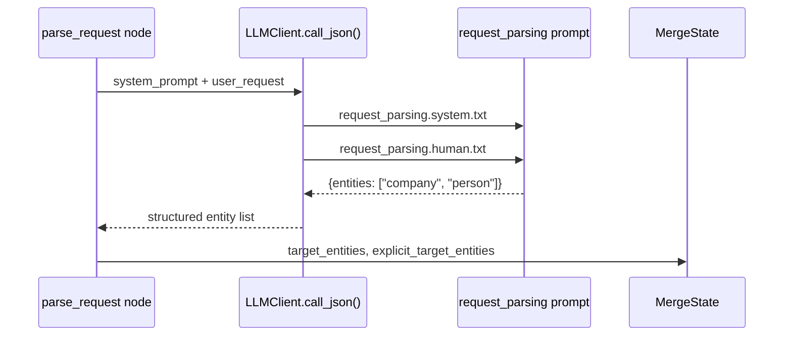

# Parse Request Node

## Purpose

Takes the user's natural language request (e.g., "merge customers from both DBs" or "merge all information about Nova") and extracts a structured list of target entity types via LLM call.

## File

`src/orchestrator/nodes/parse_request.py` (~6.5KB)

## Flow



## Prompt Template

Uses the `request_parsing` prompt from `src/llm/prompts/request_parsing.system.txt` and `request_parsing.human.txt`. The system prompt defines allowed entity types and output format. The human prompt contains few-shot examples and the live user request.

## State

Produces:

```python
{
    "target_entities": ["company", "person"],
    "explicit_target_entities": [...],  # User-confirmed entities
    "dropped_inferred_entities": [...],  # Inferred but rejected entities
    "merge_scope": {...},  # For scoped merges (Phase 6)
}
```

## Retry Policy

Carries `NETWORK_RETRY` — LLM calls can transiently fail.

## Retry Hints

If the user retries this gate, their feedback is appended to the prompt via `apply_retry_hint()`.

## Test Coverage

- `tests/unit/test_parse_request_node.py` — entity extraction correctness

## Cross-References

| Concern | Page |
|---------|------|
| Graph wiring | [State Graph](/openwiki/orchestrator/graph.md) |
| Prompt templates | [LLM Prompts](/openwiki/llm/prompts.md) |
| Retry hints | [Retry Hints](/openwiki/orchestrator/utils/retry_hints.md) |
