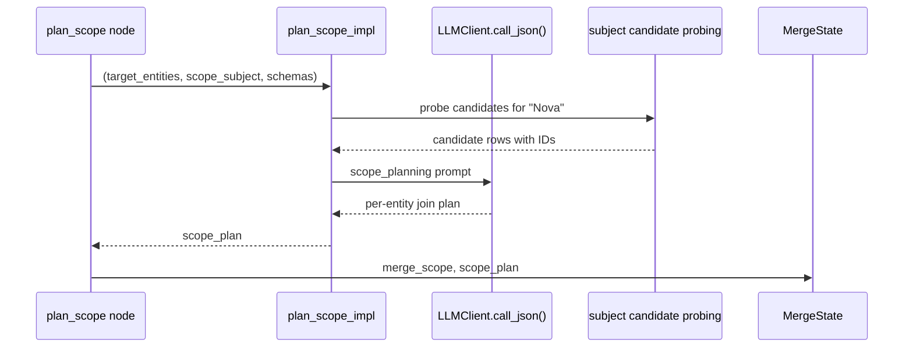

# Plan Scope Node

## Purpose

Plans scoped merges by identifying the subject entity's candidates and building per-entity extraction filters. This node is the core of Phase 6's targeted merge feature — "merge all information about Nova" extracts **only** that company and its related records.

## File

`src/orchestrator/nodes/plan_scope.py` (~2.6KB)

## Flow



## Implementation

### Subject Candidate Probing

Identifies which source records match the subject (e.g., "Nova"). The UI shows these candidates so a human can distinguish "Nova Labs" from "Novatech."

### Per-Entity Join Plan

Builds a plan for how each dependent entity links to the subject:
- **Direct name match** — e.g., `person WHERE company_name = 'Nova'`
- **Foreign-key link** — e.g., `person WHERE company_id IN (SELECT id FROM companies WHERE name = 'Nova')`
- **Two-hop link** — e.g., `person WHERE id IN (SELECT person_id FROM employment WHERE company_id IN (...))`

### Scope Filter Generation

Produces a filter dict like:

```python
{
    "company_id": {"op": "in", "value": [1, 2, 3]},
}
```

This filter is applied during `extract_data` to limit extraction to only the subject's scope.

## State

Produces:

```python
{
    "merge_scope": {
        "active": True,
        "scope_type": "company",
        "subject": "Nova",
        "candidate_ids": [1, 2, 3],
    },
    "scope_plan": {
        "company": {"filter": {...}},
        "person": {"filter": {"company_id": {"op": "in", "value": [...]}}},
        "product": {"filter": {"company_id": {"op": "in", "value": [...]}}},
    },
}
```

## Retry Policy

Carries `NETWORK_RETRY` — the LLM call for the join plan can transiently fail.

## Test Coverage

- `tests/unit/test_plan_scope.py` — scope plan construction
- `tests/unit/test_scope_plan_eval.py` — scope plan evaluation

## Cross-References

| Concern | Page |
|---------|------|
| Graph wiring | [State Graph](/openwiki/orchestrator/graph.md) |
| Scope plan tool | [Plan Scope Tool](/openwiki/mcp/tools/plan_scope.md) |
| Prompt templates | [LLM Prompts](/openwiki/llm/prompts.md) |
