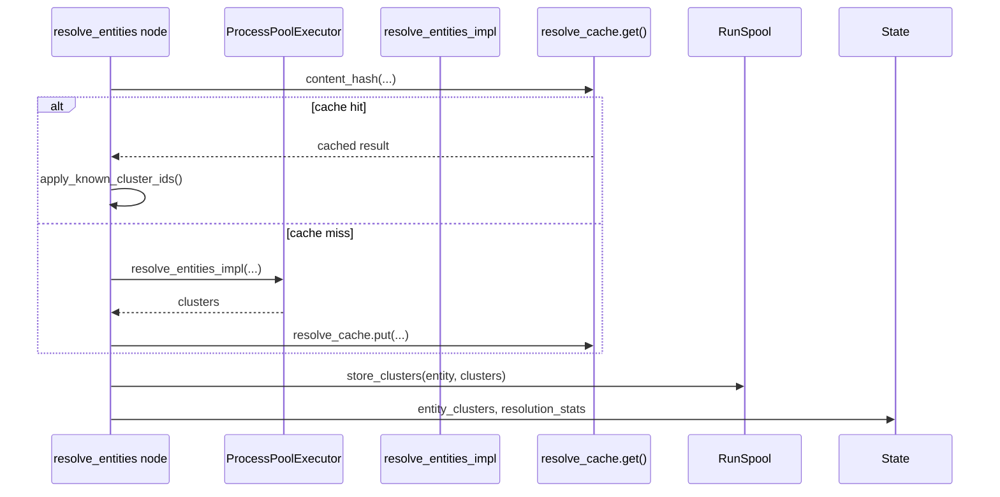

# Resolve Entities Node

## Purpose

Clusters matching records across origins for each entity type. Uses a four-phase pipeline: deterministic blocking, heuristic scoring (Jaccard/difflib), LLM scoring for borderline cases, and Union-Find clustering. Runs in parallel via `ProcessPoolExecutor` (bounded to 4 workers).

## File

`src/orchestrator/nodes/resolve_entities.py` (~21KB)

## Flow



## Implementation

### Per-Entity Processing

Each entity type is processed independently in a separate process. The entity type's records are read from the DuckDB spool, and the resolved clusters are stored back to the spool.

### Entity Map Loading

Loads `entity_map` from the spool for incremental runs — entity IDs already assigned to source records by previous runs. Without this, an incremental run would re-derive IDs from a smaller membership and insert new destination rows instead of updating existing ones.

### Destination Dedup (Scoped Merge)

For scoped merges, reads subject rows the destination already holds and adds them to the candidate set. An incoming record that IS one already present clusters with it and adopts its ID — updating the row instead of inserting a second copy.

### Per-Entity Matching Rules

Rules are keyed per entity type with a `_default` fallback (O.2 convention). The node reads matching rules before processing each entity:

```python
def _matching_rules_for(matching_rules, entity_type):
    return matching_rules.get(entity_type) or matching_rules.get("_default")
```

## State

Produces:

```python
{
    "entity_clusters": {
        "entity_type": [
            {"cluster_id": "...", "record_ids": [...], "required_human_review": True / False},
            ...,
        ]
    },
    "resolution_stats": {
        "entity_type": {
            "candidate_pairs": N,
            "uncompared_pairs": N,
            "clusters_formed": N,
            "auto_merged": N,
            "human_reviewed": N,
        }
    },
}
```

## Retry Policy

Carries `NETWORK_RETRY` — though the node itself is pure compute, it reads from the spool which uses DuckDB.

## Process Pool

Bounded to `_MAX_POOL_WORKERS = 4` because each worker holds a full copy of one entity's records (pickled across the process boundary), and other processes (API server, database connectors) are already competing for cores.

## Test Coverage

- `tests/unit/test_resolve_entities_node.py` — clustering correctness
- `tests/unit/test_phase_l_matching.py` — matching precision/recall
- `tests/unit/test_matching_rules_and_policy.py` — per-entity matching rules
- `tests/unit/test_matching_performance.py` — performance benchmarks
- `tests/integration/test_resolve_entities.py` — end-to-end resolution

## Cross-References

| Concern | Page |
|---------|------|
| Resolve entities tool | [resolve_entities Tool](/openwiki/mcp/tools/resolve_entities.md) |
| Resolve cache | [Resolve Cache](/openwiki/orchestrator/utils/resolve_cache.md) |
| Entity aliases | [Entity Aliases](/openwiki/orchestrator/utils/entity_aliases.md) |
| Retry hints | [Retry Hints](/openwiki/orchestrator/utils/retry_hints.md) |
