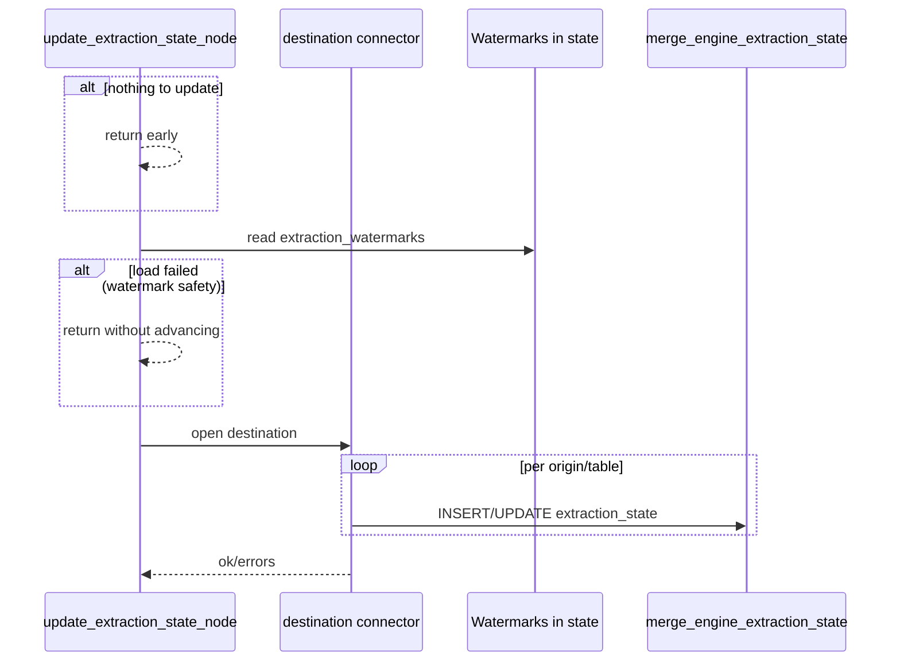

# Update Extraction State Node

## Purpose

Persists watermarks observed during extraction to the destination's `merge_engine_extraction_state` tracking table. This enables incremental extraction on future runs by remembering the highest watermark value seen for each origin/table combination.

## File

`src/orchestrator/nodes/load_data.py:772-853` (co-located with `load_data_node`)

## Flow



## Key Logic

### Skip if Nothing

Returns immediately if `extraction_watermarks` is empty — no watermarks were observed during extraction.

### Watermark Safety

**Never advances watermarks if load failed.** If the load phase fails partway through, the next run must re-extract those rows from the beginning. Returns early with no errors.

### Connector Lifecycle

Opens a single destination connector and reuses it across all watermark updates. Close is handled by the caller.

### Per-Table Persistence

Calls `connector.update_extraction_state()` for each entry with:
- `origin_id`, `table_name`
- `watermark_column`, `watermark_kind` (numeric, timestamp)
- `last_value`, `run_id`, `rows_extracted`

Each table's write is individual — failure on one table logs and continues to the next.

## State

Consumes:

```python
{
    "extraction_watermarks": {
        "origin_1:customers": {
            "column": "id",
            "kind": "numeric",
            "last_value": 12345,
        },
        "origin_2:companies": {...},
    },
    "destination": {...},
    "run_id": "...",
}
```

Produces: `{"errors": [...]}` — only this call's own errors (fix for `operator.add` double-counting from Phase 0 Sec 0.8).

## Test Coverage

- `tests/unit/test_load_data_node.py` — watermark persistence correctness
